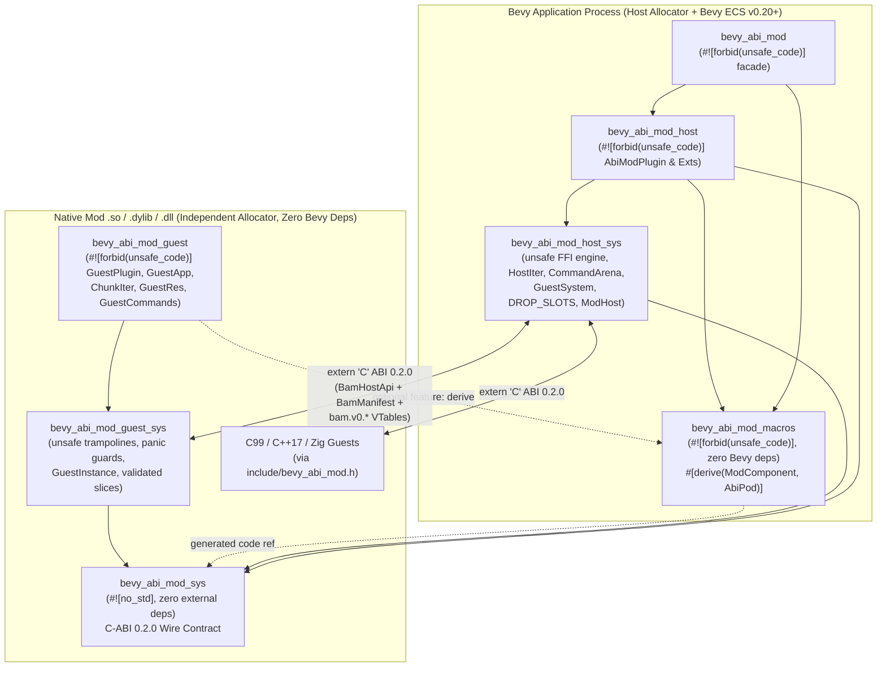
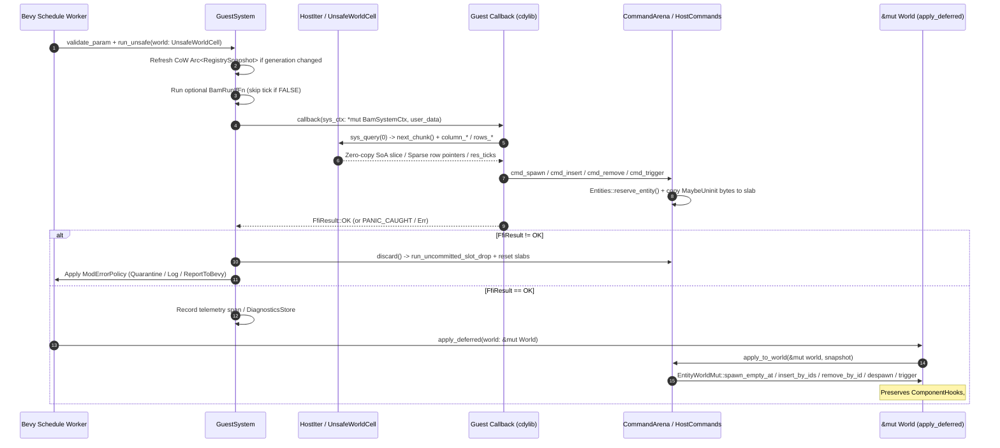
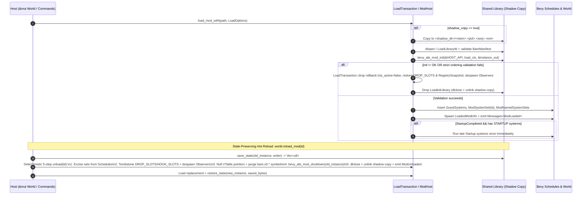

# Architecture Guide: `bevy_abi_mod` (`ABI 0.2.0`)

This document describes the architecture, safety invariants, workspace topology, and subsystem internals of **`bevy_abi_mod`**—a zero-serialization, asymmetric C-ABI native modding framework for Bevy ECS (`v0.20+`).

For byte-level struct layouts, field offsets, error enumerations, and wire rules, see the companion [`spec.md`](../spec.md).

---

## 1. Design Philosophy & Non-Negotiable Invariants

Native dynamic modding inside a data-oriented parallel ECS poses four fundamental hazards: unstable Rust compiler ABIs across `.cdylib` boundaries, dual-heap allocator corruption, data races across Bevy's multi-threaded scheduler, and dangling pointers after `dlclose` / `FreeLibrary`. `bevy_abi_mod` resolves these through five strict architectural invariants:

1. **Zero Shared Rust ABI Assumptions (`ABI 0.2.0`):** Host and guest crates never share Rust types, trait objects (`dyn Trait`), slices (`&[T]` / `&str`), `Vec`, `Box`, or panic unwinds across `.cdylib` boundaries. Guests may be compiled with different `rustc` versions, mismatched Debug/Release profiles, or written in ISO C99, C++17/20, or Zig against [`include/bevy_abi_mod.h`](../include/bevy_abi_mod.h).
2. **Asymmetric Host-Driven Zero-Copy Execution:** Rather than serializing world snapshots to JSON or Bincode, the host drives dynamic Bevy `System`s over contiguous Structure-of-Arrays (SoA) `Table` byte slices and batched `SparseSet` indirect row pointer arrays, while enforcing Bevy `FilteredAccessSet` borrow rules.
3. **Strict Memory & Allocator Isolation:** Host allocations live and die on the host allocator; guest allocations (closures, plugin structs, `GuestInstance` state) live and die on the guest allocator inside `bevy_abi_mod_shutdown`.
4. **Zero-Steady-State-Allocation Hot Paths:** Components, resources, and messages resolve at load time into 1-based `BamComponent` handles; systems reuse bump-allocated `CommandArena` slabs, flat command tapes, and scratch row buffers after warmup.
5. **Audit-Friendly `-sys` Boundary Isolation:** All `unsafe` FFI code is confined inside `bevy_abi_mod_sys`, `bevy_abi_mod_host_sys`, and `bevy_abi_mod_guest_sys` (under `#![deny(unsafe_op_in_unsafe_fn, improper_ctypes_definitions, clippy::undocumented_unsafe_blocks, clippy::missing_safety_doc)]`). Every user-facing crate (`bevy_abi_mod`, `bevy_abi_mod_host`, `bevy_abi_mod_guest`, `bevy_abi_mod_macros`, `xtask`) enforces `#![forbid(unsafe_code)]`.

> **Native Trust Model:** Shared libraries run in-process with the host OS privileges and `nounwind` C callbacks. `bevy_abi_mod` protects against compiler ABI skew, ECS aliasing UB, allocator crossover, and accidental faults (`PANIC_CAUGHT` quarantine) for **trusted native mods**—it is not a cryptographic sandbox for untrusted user code (use Wasm for untrusted plugins). Enabling the optional `signature-verification` feature enforces load-time cryptographic authentication (`ModTrustPolicy` over OpenSSH `SSHSIG` detached `.sig` sidecars + Ed25519 CA certificates or pinned public keys) strictly **before** `dlopen` / `LoadLibraryW` so only verified publisher binaries are ever mapped.

---

## 2. Workspace Topology & Crate Boundaries



### Crate & Module Map

| Crate | Policy | `bevy*` Deps | Key Modules & Responsibilities |
|---|---|---|---|
| `bevy_abi_mod_sys` | `#![no_std]`, zero deps | None | [`host_api.rs`](../crates/bevy_abi_mod_sys/src/host_api.rs) (`BamHostApi`, `BamManifest`, `BamInstance`), [`component.rs`](../crates/bevy_abi_mod_sys/src/component.rs) (`ComponentDesc`, `VTableHeader`), [`access.rs`](../crates/bevy_abi_mod_sys/src/access.rs) (`AccessMode`, `ScheduleId`, `BamTermDesc`), [`system.rs`](../crates/bevy_abi_mod_sys/src/system.rs) (`BamSystemDesc`, `BamQueryDesc`, `BamObserverDesc`), [`iter.rs`](../crates/bevy_abi_mod_sys/src/iter.rs) (`BamColumnInfo`, `BamChangeTicks`), [`commands.rs`](../crates/bevy_abi_mod_sys/src/commands.rs) (`BamCommands`), [`primitives/`](../crates/bevy_abi_mod_sys/src/primitives/mod.rs) (`FfiResult`, `FfiBool`, `FfiEntity`, `FfiChildOf`, `StrView`, `FfiSlice`, `ComponentUuid`), [`extensible.rs`](../crates/bevy_abi_mod_sys/src/extensible.rs), [`traits.rs`](../crates/bevy_abi_mod_sys/src/traits.rs) (`ModComponent`, `AbiPod`, `RawInsertable`). |
| `bevy_abi_mod_macros` | `#![forbid(unsafe_code)]` | None | [`abi_pod.rs`](../crates/bevy_abi_mod_macros/src/abi_pod.rs), [`attrs.rs`](../crates/bevy_abi_mod_macros/src/attrs.rs), [`classify.rs`](../crates/bevy_abi_mod_macros/src/classify.rs), [`codegen/vtable.rs`](../crates/bevy_abi_mod_macros/src/codegen/vtable.rs), [`codegen/c_decl.rs`](../crates/bevy_abi_mod_macros/src/codegen/c_decl.rs) (`C_DECL`, `ZIG_DECL`), plus primitive/bool/string/vec/nested slot emitters. |
| `bevy_abi_mod_host_sys` | Isolated host `unsafe` | `bevy_ecs`, `bevy_app`, `bevy_tasks` | [`ffi/host_api.rs`](../crates/bevy_abi_mod_host_sys/src/ffi/host_api.rs) (`HOST_API`), [`ffi/iter.rs`](../crates/bevy_abi_mod_host_sys/src/ffi/iter.rs) (`HostIter`, `host_par_for_each_chunk`, resource & message FFI), [`ffi/commands.rs`](../crates/bevy_abi_mod_host_sys/src/ffi/commands.rs) (`CommandArena`, `HostCommands`), [`ffi/register.rs`](../crates/bevy_abi_mod_host_sys/src/ffi/register.rs) (`LoadContext`, `GuestObserverBinding`), [`registry/`](../crates/bevy_abi_mod_host_sys/src/registry/mod.rs) (`ModRegistry`, `RegistrySnapshot`, `ComponentOptions`), [`system/`](../crates/bevy_abi_mod_host_sys/src/system/mod.rs) (`GuestSystem`, `ModQuarantine`, `ModErrorPolicy`), [`drop_trampoline.rs`](../crates/bevy_abi_mod_host_sys/src/drop_trampoline.rs) (`DROP_SLOTS`, `WorldDropGuard`), [`loader/`](../crates/bevy_abi_mod_host_sys/src/loader/mod.rs) (`ModHost`, `LoadOptions`, `LoadTransaction`, optional `signing.rs` `ModTrustPolicy` + `VerifiedModSignature`), [`schedule.rs`](../crates/bevy_abi_mod_host_sys/src/schedule.rs) (`ModSystemSet`, `ModNamedSystemSet`, `ModScheduleMap`, `ModVisibleSets`). |
| `bevy_abi_mod_host` | `#![forbid(unsafe_code)]` | `bevy_ecs`, `bevy_app`, optional `bevy_diagnostic` | [`plugin.rs`](../crates/bevy_abi_mod_host/src/plugin.rs) (`AbiModPlugin` / `with_trust_policy`), [`app_ext.rs`](../crates/bevy_abi_mod_host/src/app_ext.rs) (`ModAppExt`), [`world_ext.rs`](../crates/bevy_abi_mod_host/src/world_ext.rs) (`ModWorldExt`), [`commands_ext.rs`](../crates/bevy_abi_mod_host/src/commands_ext.rs) (`ModCommandsExt`), [`schedule_sets.rs`](../crates/bevy_abi_mod_host/src/schedule_sets.rs), [`events.rs`](../crates/bevy_abi_mod_host/src/events.rs), [`diagnostics.rs`](../crates/bevy_abi_mod_host/src/diagnostics.rs). |
| `bevy_abi_mod` | `#![forbid(unsafe_code)]` | Via `bevy_abi_mod_host` | [`lib.rs`](../crates/bevy_abi_mod/src/lib.rs) re-exporting `bevy_abi_mod_host`, `ModComponent`, `AbiPod`, `bevy_abi_mod_sys`, and `prelude`. |
| `bevy_abi_mod_guest_sys` | Isolated guest `unsafe` | None | [`host.rs`](../crates/bevy_abi_mod_guest_sys/src/host.rs) (`Host`, `ValidatedLoadCtx`), [`instance.rs`](../crates/bevy_abi_mod_guest_sys/src/instance.rs) (`GuestInstance`, `save_state`/`restore_state` trampolines), [`panic.rs`](../crates/bevy_abi_mod_guest_sys/src/panic.rs) (`catch_guest_*`), [`trampoline.rs`](../crates/bevy_abi_mod_guest_sys/src/trampoline.rs) (`ReentrantCell`, closures), [`iter.rs`](../crates/bevy_abi_mod_guest_sys/src/iter.rs), [`commands.rs`](../crates/bevy_abi_mod_guest_sys/src/commands.rs), [`component.rs`](../crates/bevy_abi_mod_guest_sys/src/component.rs). |
| `bevy_abi_mod_guest` | `#![forbid(unsafe_code)]` | None | [`lifecycle.rs`](../crates/bevy_abi_mod_guest/src/lifecycle.rs) (`GuestPlugin`), [`app/`](../crates/bevy_abi_mod_guest/src/app/mod.rs) (`GuestApp`, `SystemBuilder`, `QueryBuilder`, `SystemContext`, `GuestRes`, `GuestResMut`), [`iter/`](../crates/bevy_abi_mod_guest/src/iter/mod.rs) (`Chunk`, `ChunkIter`, `TypedChunkIter`, `With`/`Without`/`Added`/`Changed`), [`commands.rs`](../crates/bevy_abi_mod_guest/src/commands.rs) (`GuestCommands`), [`component.rs`](../crates/bevy_abi_mod_guest/src/component.rs) (`GuestComponent`, `GuestComponentHooks`), [`macros.rs`](../crates/bevy_abi_mod_guest/src/macros.rs) (`export_mod!`), [`raw.rs`](../crates/bevy_abi_mod_guest/src/raw.rs). |

---

## 3. Extensible Wire Contract & Polyglot Header (`bevy_abi_mod_sys`)

### 3.1 `struct_size` Prefix Extensibility
Every extensible wire struct (`BamManifest`, `BamHostApi`, `BamSystemDesc`, `BamObserverDesc`, `BamQueryDesc`, `BamTermDesc`, `ComponentDesc`, `BamColumnInfo`, `VTableHeader`) obeys four strict C-ABI rules:

- **`struct_size: u32` at byte offset `0`:** Frozen minimum valid sizes (`MIN_V0_2_SIZE`) are asserted at compile time via `core::mem::offset_of!`.
  - `BamHostApi` has `MIN_V0_2_SIZE = 224` bytes on 64-bit (`8`B header + `27` mandatory core slots) and `size_of = 312` bytes (`38` total slots including 11 optional extended slots: `par_for_each_chunk`, `sys_entity_get`, `sys_entity_get_mut`, `msg_read_batch`, `msg_send`, `msg_write_batch`, `res_ticks`, `sys_res_ptr`, `sys_res_mut_ptr`, `register_observer`, `cmd_trigger`).
- **`ExtensibleStruct` Readers:** `read_extensible_struct` / `read_descriptor` on Rust hosts (and `bam_host_api_copy_bounded` in C99) validate `struct_size >= MIN_V0_2_SIZE`, zero-extend trailing fields omitted by older callers, and truncate unknown trailing bytes from newer callers.
- **Explicit Padding & Niche Callbacks:** Zero implicit compiler padding is permitted anywhere in wire structs (`reserved0: u32 = 0` must be zero; unknown `flags` bits return `FfiResult::UNSUPPORTED`). Function pointers use `Option<unsafe extern "C" fn(...)>`.
- **Handle Poisoning & Validation (`handle_header.rs`):** Opaque FFI contexts (`BamHostCtx`, `BamLoadCtx`, `BamSystemCtx`, `BamIter`, `BamCommands`) carry a `HandleHeader { magic, generation }` at byte offset `0`. Dropping a scoped handle overwrites `magic = POISONED_MAGIC`, turning post-scope use in debug/strict builds into deterministic `FfiResult` errors instead of silent UAF.

### 3.2 `include/bevy_abi_mod.h`
`cargo xtask header` generates [`include/bevy_abi_mod.h`](../include/bevy_abi_mod.h) directly from Rust metadata, verified by `cargo xtask header --check --test-c99` using strict `-std=c99 -Wall -Wextra -Wpedantic -Werror` plus compile-time `BAM_STATIC_ASSERT` checks (`sizeof`, `alignof`, `offsetof`) and standalone mirror implementations of `bam_uuid_from_parts` (`SipHash-2-4-128`) and `bam_host_api_copy_bounded`.

---

## 4. Type System, `ModComponent` VTables & Overlap Safety (`bevy_abi_mod_macros`)

### 4.1 Plain Old Data (`AbiPod` / `RawInsertable`) vs. Opaque Host Types
- **`#[derive(AbiPod)]`:** Enforces `#[repr(C)]` or `#[repr(transparent)]` (non-packed), `Copy + Send + Sync + 'static`, `!core::mem::needs_drop::<Self>()`, and runs `assert_abi_pod::<FieldTy>()` on every field. Disallows `bool`, `char`, `u128`, `i128`, `usize`, `isize`, Rust `enum`s, references, and heap types so guest `&[T]` / `&mut [T]` slices and `SpawnEntry` byte copies never form invalid bit patterns or platform-dependent layouts.
- **`#[derive(ModComponent)]`:** Works on **both** POD structs and non-POD `#[repr(Rust)]` host components containing `String`, `Vec<T>`, `bool`, or host-private (`#[mod_field(skip)]`) fields:
  - Generates a `#[repr(C)]` `<Struct>VTable` prefixed by `VTableHeader` (`struct_size`, `abi_version`, `uuid`, `size`, `align`) with `extern "C"` field slots registered under `"bam.v0.<canonical_name>.vtable"` and `"bam.v0.<canonical_name>.<slot>"`.
  - Setters return `FfiResult` (`NULL_POINTER`, `INVALID_ARGUMENT`, `INVALID_UTF8`, `OK`). String and vector setters copy incoming `StrView` / `FfiSlice<T>` buffers into temporary host buffers before mutating `String`/`Vec` in place, preventing aliasing/reallocation UB when a guest passes a pointer derived from the same field (`src` aliasing `dst`).
  - Syntactic field classification is verified at compile time with concrete `std::string::String` / `std::vec::Vec<T>` assertions (spoofed user structs fail compilation), overridable via `#[mod_field(string | vec(T) | bool | primitive | nested | skip)]`.
  - Emits compile-time `C_DECL` and `ZIG_DECL` constants for POD structs (exported to `.h` headers via `cargo xtask gen-component-headers`).

### 4.2 Streaming `const` SipHash-2-4-128 UUIDs & `BamComponent` Handles
- Canonical names (`"<namespace>::<Name>"`) combined with `size`, `align`, and per-field `(name, tag, offset_of!)` hashes feed a `const fn` SipHash-2-4-128 producing `ComponentUuid` (`[u8; 16]`). Unqualified dynamic names registered by guests are automatically qualified with `"<manifest.name>::"`.
- During `bevy_abi_mod_init`, guests call `resolve_component` once per type to receive a 1-based `BamComponent(u32)` handle (`BamComponent(1)` is pre-seeded for `bevy_ecs::hierarchy::ChildOf`).
- `ModRegistry` stores entries in a generation-tracked copy-on-write (`CoW`) `Arc<RegistrySnapshot>` indexed with `foldhash`. Hot paths resolve `BamComponent` directly as `snapshot.entries[(handle - 1) as usize]` with zero locking, hashing, or string comparisons; `GuestSystem` refreshes its cached `Arc<RegistrySnapshot>` only when `ModRegistry::generation()` advances.

---

## 5. Frame Execution, `FilteredAccessSet` & Bevy 0.20 Scheduler Integration

### 5.1 Scheduling, Conflicts & Deterministic Ordering (`GuestSystem`)
`GuestSystem` implements Bevy's `System<In = (), Out = ()>` (`Send + Sync`):
1. **`initialize(&mut World) -> SystemAccess` (`access_builder.rs`):** `build_query_groups_in_world` translates each of up to `MAX_QUERIES_PER_SYSTEM` (`8`) `BamQueryDesc` definitions (`<= MAX_TERMS_PER_QUERY = 16` terms) via Bevy `QueryBuilder` / `FilteredAccess` into a combined `FilteredAccessSet` plus `QueryPlan`s, `QueryState`s, and singleton resource / `Messages<M>` `ComponentId` access entries:
   - Immutability enforcement: `WRITE`, `OPTIONAL_WRITE`, `RESOURCE_WRITE`, and `MESSAGE_WRITE` on components marked `IMMUTABLE` fail synchronously with `FfiResult::PERMISSION_DENIED`.
   - Duplicate/conflicting writes within the same system trigger Bevy access validation failures (`SystemInitError`), allowing compatible systems from different mods (and host systems) to run in parallel across Bevy's multi-threaded scheduler.
2. **Schedule & Ordering Resolution (`schedule.rs` & `schedule_sets.rs`):**
   - Built-in `ScheduleId`s (`STARTUP`, `PRE_UPDATE`, `UPDATE`, `POST_UPDATE`, `FIXED_UPDATE`, `LAST`) and custom `ScheduleId::custom(id >= 1024)` map through `ModScheduleMap` (`register_mod_schedule`).
   - Every system joins `ModSystemSet(mod_id)` and `ModNamedSystemSet { mod_name, system_name }`.
   - `.in_set()`, `.before()`, and `.after()` constraints resolve intra-mod (`"step_a"`), cross-mod (`"other_mod::step_a"` — created on demand so order does not depend on load order), and host-exported `SystemSet` handles registered via `app.register_mod_visible_set("physics", PhysicsSet)` (`"host::physics"`), preventing Bevy 0.20 schedule-randomization bugs.
   - `BAM_SYSTEM_FLAG_MAIN_THREAD` adds `SystemStateFlags::NON_SEND` alongside `SystemStateFlags::DEFERRED` in `GuestSystem::flags()` to pin thread-affine systems onto Bevy's main thread without making them exclusive `World` systems.
   - If a mod registers `ScheduleId::STARTUP` systems after Bevy `Startup` has already completed (`StartupCompleted`), the host executes those startup systems once immediately on load commit.

### 5.2 Per-Frame Execution & `EntityWorldMut` Deferred Commands



Key execution mechanisms:
- **Zero-Copy SoA & Tick Filtering (`ffi/iter.rs`):** `HostIter` walks `QueryState::matched_tables()` (or `matched_archetypes()` when querying `SparseSet` columns).
  - For `Changed<T>` / `Added<T>` terms, `HostIter` caches table `ComponentTicks` slices once per table and skips entire archetypes whose table summary ticks predate `last_run`.
  - Normal mutable column borrows (`iter_column_mutable` / `iter_column_rows_mutable`) set each chunk's `marked_changed_mask` bit at most once per chunk. Guests performing conditional writes can call `iter_column_mutable_untracked` paired with explicit `iter_mark_changed_range(term_index, start_row, row_count)`.
- **Parallel Chunk Execution (`host_par_for_each_chunk`):** Fans matched table/archetype chunks across `bevy_tasks::ComputeTaskPool::get().scope(...)` with per-task stack `HostIter` windows and `ACCESS_CONFLICT` guards forbidding recursive nested parallel dispatch on the same iterator.
- **Random Entity Lookup (`sys_entity_get` / `sys_entity_get_mut`):** O(1) per-entity access strictly gated to components and filters already declared inside the system's `FilteredAccessSet`.
- **Resource Change Ticks (`res_ptr` / `res_mut_ptr` / `res_ticks`):** Expose `BamChangeTicks { added, changed, last_run, this_run }` (`GuestRes<R>` / `GuestResMut<R>`) mapped via Bevy's `Tick::is_newer_than(last_run, this_run)` arithmetic, letting guests drive cache invalidation cleanly with `res.is_added()` / `res.is_changed()`.
- **`EntityWorldMut` Command Fidelity (`CommandArena`):** Deferred spawns, inserts, and removals never write raw archetype table columns directly. Instead:
  - Entities are reserved upfront via `Entities::reserve_entity()` so `cmds.spawn` returns a real, usable `FfiEntity` (`ChildOf` parenting in the same tick!).
  - Payloads are copied into reusable 64-byte-aligned `MaybeUninit<u8>` slabs (`ArenaSlab`) via `ptr::copy_nonoverlapping` (never forming `&[u8]` over uninitialized padding bytes).
  - During `apply_deferred`, `spawn_empty_at` + `EntityWorldMut::insert_by_ids` / `insert_by_id` / `remove_by_id` / `despawn` run natively through Bevy's `EntityWorldMut` paths, guaranteeing that Bevy `ComponentHooks` (`on_add`, `on_insert`, `on_replace`, `on_remove`), `#[require(...)]` Required Components, `ChildOf` / `Children` hierarchy links (`FfiChildOf`), and parent-cycle/self-parent guards execute accurately.

---

## 6. Buffered `Messages<M>`, Immediate Triggers & Dynamic Observers

`bevy_abi_mod` supports both frame-buffered event streams and immediate push-based observer triggers:
- **Buffered `Messages<M>`:** Host apps register `M: Message + ModComponent + AbiPod` via `app.register_mod_message::<M>()`. Guest systems declare `AccessMode::MESSAGE_READ` / `MESSAGE_WRITE` and read/write contiguous Pod batches via `msg_read_batch`, `msg_send`, and `msg_write_batch`, backed by independent per-system `MessageCursor<M>` instances.
- **Immediate `world.trigger()` & `EntityEvent` Observers:** Host apps register global `Event`s (`register_mod_event::<E>()`) or entity-targeted `EntityEvent`s (`register_mod_entity_event::<E>()`), and guests may trigger custom runtime layout events as well.
  - Guests emit events via `GuestCommands::trigger` / `trigger_target` (`cmd_trigger` -> `world.trigger()` / `world.trigger_targets(...)` during `apply_deferred`).
  - Guests subscribe during `bevy_abi_mod_init` via `register_observer` (`BamObserverDesc`), targeting either all events (`target = FfiEntity::NULL`) or a specific entity (`target != FfiEntity::NULL`). The host stores `Observer` entity IDs (`GuestObserverBinding`) inside `LoadedMod` and despawns them cleanly during unload or init rollback.

---

## 7. Runtime Dynamic Components & Safe Destructor Reclamation (`DROP_SLOTS`)

Mods can define private `#[repr(C)]` ECS components (and dynamic trigger events) at runtime without recompiling the host via `register_component` (`ComponentDescriptor::new_with_layout`), attaching optional `on_add` / `on_remove` hooks (`HOOK_SLOTS`) and optional foreign destructors (`drop_fn` -> `DROP_SLOTS`).

Because a foreign `drop_fn` lives in a `.cdylib`'s `.text` segment while entities carrying that component live inside a Bevy `World`, **two independent hazard conditions** exist on teardown:
1. A mod unloads while entities with its dynamic component remain alive in the `World`.
2. A `World` outlives or drops while Bevy tears down `Table` columns in arbitrary order relative to `World::resource::<WorldDropGuard>()`!

```mermaid
stateDiagram-v2
    [*] --> SLOT_FREE: Initial (free_list = 0..1024)
    SLOT_FREE --> SLOT_IN_USE: register_dynamic_component_owned allocates slot\nSLOT_LIFECYCLE[slot] = SLOT_IN_USE_BIT | 0\nWorldDropGuard records owned slot
    SLOT_IN_USE --> SLOT_IN_USE: on_insert_hook -> fetch_add(1, AcqRel)\ndrop_trampoline -> run drop_fn if active & fetch_sub(1, AcqRel)\nmod unload -> tombstone is_active=false + prune snapshot
    SLOT_IN_USE --> SLOT_CLOSING: WorldDropGuard::drop ->\nfetch_xor(SLOT_IN_USE_BIT | SLOT_CLOSING_BIT, AcqRel)
    SLOT_CLOSING --> SLOT_CLOSING: Drop of remaining entities:\nrun_uncommitted / drop_trampoline skips unmapped drop_fn (is_active=false)\n& fetch_sub(1, AcqRel)
    SLOT_CLOSING --> SLOT_FREE: Condition met: (prev == SLOT_CLOSING_BIT | 1)\nor WorldDropGuard saw live_values == 0 ->\nreclaim_closed_slot: CAS(SLOT_CLOSING_BIT -> 0), clear snapshot, push free_list
```

`MAX_DROP_TRAMPOLINES = 1024` pre-monomorphized `drop_trampoline::<SLOT>` functions avoid closure captures (matching Bevy's `fn(OwningPtr<'_>)` requirement). Packing `(state_bits | live_values)` into one `AtomicUsize` (`SLOT_LIFECYCLE[slot]`) places `WorldDropGuard::drop` (`fetch_xor`) and `drop_trampoline` (`fetch_sub`) into a single modification order, guaranteeing wait-free reads on hot paths via `ArcSwapOption<DropSlotSnapshot>` and zero use-after-`dlclose` across all interleavings. Note: Bevy `ComponentId`s for unloaded dynamic components remain registered inside `ModRegistry` (`vtable_ptr` cleared) so reloading the mod seamlessly rebinds its destructor trampoline and systems to existing entities!

---

## 8. Transactional Load, Deterministic Unload, Hot Reload & Fault Policy



### Key Safety Details
- **Core Shadow Copying (`LoadOptions::shadow_copy`):** Copying `<stem>.<ext>` to a unique `<stem>.<pid>.<seq>.<ext>` file before `dlopen` bypasses POSIX inode caching (so recompiling produces fresh code instead of reusing the old image), Windows `.dll`/`.pdb` write locks during rebuilds, and macOS Apple Silicon code-signature page invalidation `SIGKILL`s. `LoadedLibrary` drops `libloading::Library` strictly before `ShadowFileGuard` unlinks the temporary file.
- **Optional Cryptographic Signature, CA, & KRL Verification (`signature-verification`):**
  - Hosts enable `signature-verification` on `bevy_abi_mod` / `bevy_abi_mod_host` and attach a World-level `ModTrustPolicy` resource (via `AbiModPlugin::with_trust_policy(...)` or `set_mod_trust_policy(...)`) holding deduplicated OpenSSH Ed25519 Root CA public keys (`ssh-ed25519`) and/or pinned leaf keys, direct revocations (`revoke_serial`, `revoke_serial_range`, `revoke_key_id`, `revoke_fingerprint`), full OpenSSH `PROTOCOL.krl` (`SSHKRL`) binary revocation lists (`KrlBuilder`, `add_krl_bytes`/`add_krl_file`, `add_revocation_spec_str`), detached `SSHSIG` signed KRLs (`add_signed_krl_bytes`/`add_signed_krl_file` under `DEFAULT_KRL_SIGNATURE_NAMESPACE`) with monotonic `with_min_krl_version` anti-rollback, validity window policy, and optional principal / `BamManifest::name` binding.
  - Each shared library carries a detached OpenSSH `SSHSIG` PEM sidecar (`<lib>.sig`, or `LoadOptions::with_signature_path`), compatible with standard `ssh-keygen -Y sign`, `ssh-keygen -k`/`-Q`, and pure-Rust `cargo xtask sign <keygen|cert|file|krl|verify>`.
  - **Strict Curve Validation, TOCTOU, & `DllMain` Prevention:** Verification executes purely in `#![forbid(unsafe_code)]` Rust (`crates/bevy_abi_mod_host_sys/src/loader/signing.rs`) **before** `dlopen` / `LoadLibraryW` (so malicious static constructors never run), rejecting empty binaries, empty certificate nonces, small-order Curve25519 torsion keys, non-canonical compressed coordinates ($y \ge 2^{255}-19$), and malleable Ed25519 scalars (`ed25519_dalek::VerifyingKey::verify_strict`). Size-bounded library bytes are verified once in memory and written to an exclusively created (`create_new(true)`, `0o700` on Unix / `FILE_SHARE_READ` on Windows) file inside a verified leaf shadow directory (`0o700`, rejecting symlinks and world-writable directories) regardless of `LoadOptions::shadow_copy`, preventing file-swap races between verification and OS mapping.
  - **Hot-Reload Pre-Verification, ECS Audit Receipt, & Runtime Eviction:** `reload_mod_with` / `reload_mod_from` run `preverify_mod_on_disk` and pre-check `verify_manifest_principal` against the running module name before unloading the live module so unsigned, tampered, revoked, or principal-mismatched replacements fail cleanly without disrupting active gameplay. After updating `ModTrustPolicy` at runtime (e.g., loading a newer signed KRL), hosts can call `evict_revoked_mods()` (`ModWorldExt` / `ModAppExt`) to surgically unload compromised or newly revoked live mods while leaving unaffected mods running. On successful load, a `VerifiedModSignature` component (recording signer fingerprint, CA fingerprint, key ID, principals, serial, namespace, and binary SHA-256) is attached to the spawned `LoadedModInfo` entity.
- **Exclusive `World` Mutation Boundary:** `unload_mod` and `reload_mod` require `&mut World` (`ModWorldExt` / `ModAppExt`) or deferred execution (`ModCommandsExt`), making concurrent `dlclose` during parallel schedule execution impossible at compile time.
- **Fault Containment & Quarantine Recovery (`ModErrorPolicy`):**
  - Default `panic = "unwind"` Rust guests wrap every `extern "C"` callback in `catch_guest_result` / `catch_guest_bool` / `catch_guest_unit` backed by a lock-free `ReentrantCell` (`UnsafeCell` + `AtomicBool`), dropping panic payloads strictly on the guest heap and returning `FfiResult::PANIC_CAUGHT`.
  - On any non-`OK` return (`PANIC_CAUGHT`, `ACCESS_CONFLICT`, etc.), `GuestSystem` discards uncommitted `HostCommands`, emits `Messages<ModSystemFaulted>`, and applies `ModErrorPolicy`:
    - `ModErrorPolicy::Quarantine` *(default)*: Disables the faulting system (`AtomicBool = false`), leaving all other systems running; hosts can later restore it via `ModQuarantine::reenable(mod_id, "system_name")`.
    - `ModErrorPolicy::Log`: Quarantines and logs at `tracing::error!`.
    - `ModErrorPolicy::ReportToBevy`: Quarantines, logs at `tracing::error!`, and forwards `ModSystemError` into Bevy's native error handler pipeline.
