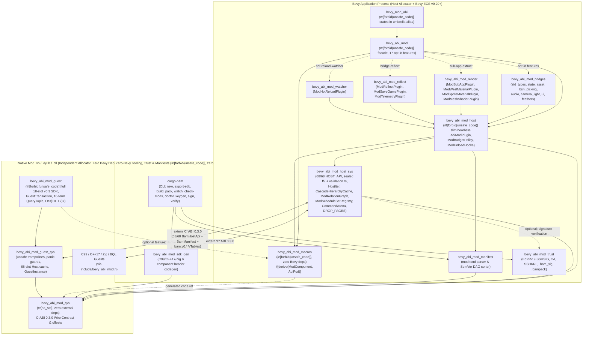
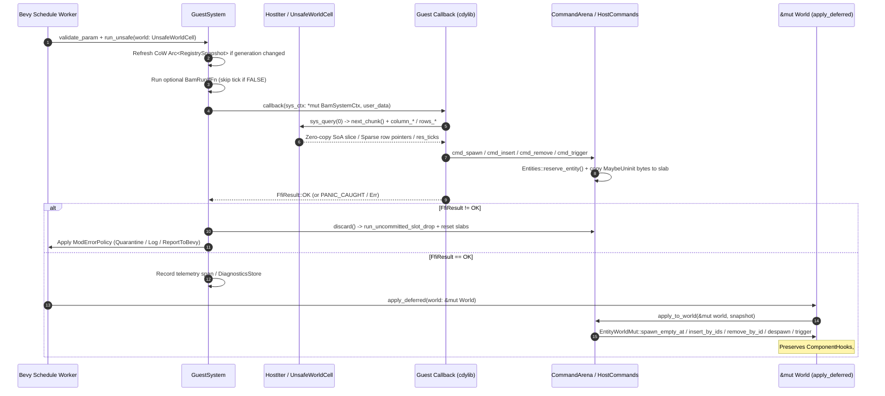
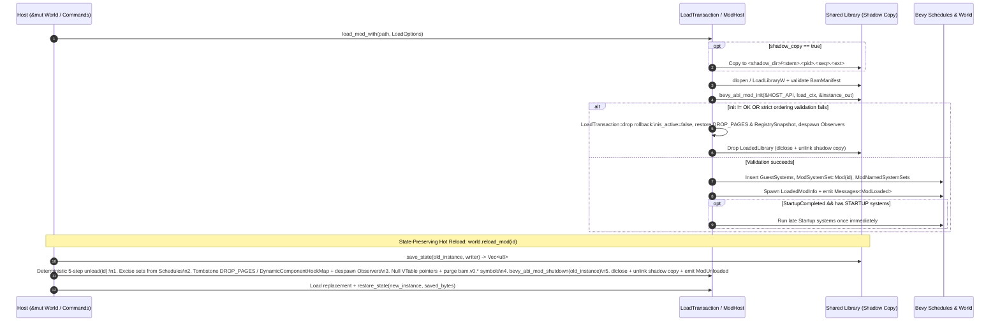

# Architecture Guide: `bevy_abi_mod` (`ABI 0.3.0`)

This document describes the architecture, safety invariants, workspace topology, and subsystem internals of **`bevy_abi_mod`**—a zero-serialization, asymmetric C-ABI native modding framework for Bevy ECS (`v0.20+`).

For byte-level struct layouts, field offsets, error enumerations, and wire rules, see the companion [`spec.md`](../spec.md).

---

## 1. Design Philosophy & Non-Negotiable Invariants

Native dynamic modding inside a data-oriented parallel ECS poses four fundamental hazards: unstable Rust compiler ABIs across `.cdylib` boundaries, dual-heap allocator corruption, data races across Bevy's multi-threaded scheduler, and dangling pointers after `dlclose` / `FreeLibrary`. `bevy_abi_mod` resolves these through five strict architectural invariants:

1. **Zero Shared Rust ABI Assumptions (`ABI 0.3.0`):** Host and guest crates never share Rust types, trait objects (`dyn Trait`), slices (`&[T]` / `&str`), `Vec`, `Box`, or panic unwinds across `.cdylib` boundaries. Guests may be compiled with different `rustc` versions, mismatched Debug/Release profiles, or written in ISO C99, C++17/20, or Zig against [`include/bevy_abi_mod.h`](../include/bevy_abi_mod.h).
2. **Asymmetric Host-Driven Zero-Copy Execution:** Rather than serializing world snapshots to JSON or Bincode, the host drives dynamic Bevy `System`s over contiguous Structure-of-Arrays (SoA) `Table` byte slices and batched `SparseSet` indirect row pointer arrays, while enforcing Bevy `FilteredAccessSet` borrow rules.
3. **Strict Memory & Allocator Isolation:** Host allocations live and die on the host allocator; guest allocations (closures, plugin structs, `GuestInstance` state) live and die on the guest allocator inside `bevy_abi_mod_shutdown`.
4. **Zero-Steady-State-Allocation Hot Paths:** Components, resources, and messages resolve at load time into 1-based `BamComponent` handles; systems reuse bump-allocated `CommandArena` slabs, flat command tapes, and scratch row buffers after warmup.
5. **Encapsulated `-sys` Unsafe Boundary & Slim Headless Host:** All `unsafe` FFI code is confined inside `bevy_abi_mod_sys`, `bevy_abi_mod_host_sys` (with sealed `pub(crate)` `ffi/` submodules and `ffi/validation.rs`), and `bevy_abi_mod_guest_sys` (under `#![deny(unsafe_op_in_unsafe_fn, improper_ctypes_definitions, clippy::undocumented_unsafe_blocks, clippy::missing_safety_doc)]`). All 13 safe user-facing, companion, trust, manifest, SDK-generator, and CLI crates (`bevy_mod_abi`, `bevy_abi_mod`, `bevy_abi_mod_host`, `bevy_abi_mod_bridges`, `bevy_abi_mod_render`, `bevy_abi_mod_reflect`, `bevy_abi_mod_watcher`, `bevy_abi_mod_guest`, `bevy_abi_mod_macros`, `bevy_abi_mod_trust`, `bevy_abi_mod_manifest`, `bevy_abi_mod_sdk_gen`, `cargo-bam`, plus `xtask`) enforce `#![forbid(unsafe_code)]`, and `bevy_abi_mod_host` remains strictly headless with zero `bevy_render`, `bevy_reflect`, `bevy_scene`, `bevy_asset`, or `notify` dependencies.

> **Native Trust Model:** Shared libraries run in-process with the host OS privileges and `nounwind` C callbacks. `bevy_abi_mod` protects against compiler ABI skew, ECS aliasing UB, allocator crossover, and accidental faults (`PANIC_CAUGHT` quarantine) for **trusted native mods**—it is not a cryptographic sandbox for untrusted user code (use Wasm for untrusted plugins). Enabling the optional `signature-verification` feature enforces load-time cryptographic authentication (`ModTrustPolicy` over OpenSSH `SSHSIG` detached `.sig` sidecars, embedded `.bam_sig` sections, or signed `.bampack` archives + Ed25519 CA certificates or pinned public keys) strictly **before** `dlopen` / `LoadLibraryW` so only verified publisher binaries are ever mapped.

---

## 2. Sixteen-Crate Workspace Topology & Crate Boundaries



### Crate & Module Map (16 Workspace Crates + `xtask`)

| Crate | Policy | `bevy*` Deps | Key Modules & Responsibilities |
|---|---|---|---|
| `bevy_abi_mod_sys` | `#![no_std]`, zero deps | None | [`host_api.rs`](../crates/bevy_abi_mod_sys/src/host_api.rs) (68-slot `BamHostApi`, `offsets::{<FIELD>, OFF64_*, OFF32_*}`, `BamManifest`, `BamInstance`), [`component.rs`](../crates/bevy_abi_mod_sys/src/component.rs) (`ComponentDesc`, `BamFieldDesc`, `BamRequiredComponent`, `BamRelationDesc`, `BamLayoutInfo`, `BamScheduleSetDesc`, `VTableHeader`), [`access.rs`](../crates/bevy_abi_mod_sys/src/access.rs) (`AccessMode`, `ScheduleId`, `BamTermDesc`), [`system.rs`](../crates/bevy_abi_mod_sys/src/system.rs) (`BamSystemDesc`, `BamQueryDesc`, `BamObserverDesc`), [`iter.rs`](../crates/bevy_abi_mod_sys/src/iter.rs) (`BamColumnInfo`, `BamChangeTicks`), [`commands.rs`](../crates/bevy_abi_mod_sys/src/commands.rs) (`BamCommands`), [`primitives/`](../crates/bevy_abi_mod_sys/src/primitives/mod.rs) (`FfiResult` incl. `CYCLE_DETECTED`, `FfiBool`, `FfiEntity`, `FfiChildOf`, `StrView`, `FfiSlice`, `ComponentUuid`), [`extensible.rs`](../crates/bevy_abi_mod_sys/src/extensible.rs), [`traits.rs`](../crates/bevy_abi_mod_sys/src/traits.rs) (`ModComponent`, `AbiPod`, `RawInsertable`). |
| `bevy_abi_mod_macros` | `#![forbid(unsafe_code)]` | None | [`abi_pod.rs`](../crates/bevy_abi_mod_macros/src/abi_pod.rs) (`size_of == sum(fields)` check), [`attrs.rs`](../crates/bevy_abi_mod_macros/src/attrs.rs), [`classify.rs`](../crates/bevy_abi_mod_macros/src/classify.rs), [`codegen/vtable.rs`](../crates/bevy_abi_mod_macros/src/codegen/vtable.rs), [`codegen/c_decl.rs`](../crates/bevy_abi_mod_macros/src/codegen/c_decl.rs) (`C_DECL`, `ZIG_DECL`, `SCHEMA_FINGERPRINT`, `BAM_FIELDS`, `REQUIRED_COMPONENTS`). |
| `bevy_abi_mod_trust` | `#![forbid(unsafe_code)]` | None | Pure-Rust Ed25519 OpenSSH `SSHSIG`, CA certificate, `PROTOCOL.krl` (`SSHKRL`), `.bam_sig` ELF/Mach-O/PE verification, and deterministic `.bampack` archive engine. |
| `bevy_abi_mod_manifest` | `#![forbid(unsafe_code)]` | None | Zero-Bevy `mod.toml` parser, `ModDependencyGraph` SemVer DAG topological resolver, and dependency mismatch/quarantine types. |
| `bevy_abi_mod_sdk_gen` | `#![forbid(unsafe_code)]` | None | Deterministic generator for `include/bevy_abi_mod.h`, `bevy_abi_mod.hpp`, `bevy_abi_mod.zig`, component headers (`ModComponent::C_DECL`), and `export_sdk` (`BAM_EXPORT`, `BAM_RESTRICT`, `BAM_HOST_API_OFFSET_*`). |
| `bevy_abi_mod_host_sys` | Isolated host `unsafe` | `bevy_ecs`, `bevy_app`, `bevy_tasks`, opt. `bevy_reflect` | Sealed [`ffi/mod.rs`](../crates/bevy_abi_mod_host_sys/src/ffi/mod.rs) (`HOST_API` 68/68 live, [`ffi/v03_ext.rs`](../crates/bevy_abi_mod_host_sys/src/ffi/v03_ext.rs), [`ffi/validation.rs`](../crates/bevy_abi_mod_host_sys/src/ffi/validation.rs) witness/`BamFieldDesc` `ReflectFromPtr`/extraction helpers, [`ffi/relations.rs`](../crates/bevy_abi_mod_host_sys/src/ffi/relations.rs) `ModRelationGraph`, [`ffi/hierarchy_ext.rs`](../crates/bevy_abi_mod_host_sys/src/ffi/hierarchy_ext.rs) `CascadeHierarchyCache`, [`ffi/iter.rs`](../crates/bevy_abi_mod_host_sys/src/ffi/iter.rs) & [`ffi/iter_ext.rs`](../crates/bevy_abi_mod_host_sys/src/ffi/iter_ext.rs), [`ffi/commands.rs`](../crates/bevy_abi_mod_host_sys/src/ffi/commands.rs) `CommandArena` quotas & checkpoints, [`ffi/register.rs`](../crates/bevy_abi_mod_host_sys/src/ffi/register.rs)), [`registry/`](../crates/bevy_abi_mod_host_sys/src/registry/mod.rs), [`system/`](../crates/bevy_abi_mod_host_sys/src/system/mod.rs) (`GuestSystem`, `ModQuarantine`, `FallbackErrorHandler`), [`drop_trampoline.rs`](../crates/bevy_abi_mod_host_sys/src/drop_trampoline.rs) (`DROP_PAGES`), [`loader/`](../crates/bevy_abi_mod_host_sys/src/loader/mod.rs) (`ModHost`, `schema_migration.rs`, `symbols.rs`, `signing.rs`), [`schedule.rs`](../crates/bevy_abi_mod_host_sys/src/schedule.rs) (`ModScheduleSetRegistry`, `ModScheduleSetRewirePass`). |
| `bevy_abi_mod_host` | `#![forbid(unsafe_code)]` | `bevy_ecs`, `bevy_app`, opt. `bevy_diagnostic` (**zero** render/reflect/scene/asset/notify) | Slim headless host: [`plugin.rs`](../crates/bevy_abi_mod_host/src/plugin.rs) (`AbiModPlugin`), [`budgets.rs`](../crates/bevy_abi_mod_host/src/budgets.rs) (`ModBudgetPolicy`, `ModBudgetTelemetry`, `ModBudgetBreach`), [`app_ext.rs`](../crates/bevy_abi_mod_host/src/app_ext.rs), [`world_ext.rs`](../crates/bevy_abi_mod_host/src/world_ext.rs) (`ModUnloadHooks`), [`commands_ext.rs`](../crates/bevy_abi_mod_host/src/commands_ext.rs), [`schedule_sets.rs`](../crates/bevy_abi_mod_host/src/schedule_sets.rs), [`events.rs`](../crates/bevy_abi_mod_host/src/events.rs), [`diagnostics.rs`](../crates/bevy_abi_mod_host/src/diagnostics.rs). |
| `bevy_abi_mod_bridges` | `#![forbid(unsafe_code)]` | Opt-in Bevy `0.20` features (`default = []`) | [`std_types.rs`](../crates/bevy_abi_mod_bridges/src/std_types.rs) (+ `Disabled`), [`state.rs`](../crates/bevy_abi_mod_bridges/src/state.rs) (dynamic `ModStateSlab`, `SubStates`, `ComputedStates`), [`asset.rs`](../crates/bevy_abi_mod_bridges/src/asset.rs) (`ModAssetPlugin`, `AssetOverlayPolicy`), [`bsn.rs`](../crates/bevy_abi_mod_bridges/src/bsn.rs), [`picking.rs`](../crates/bevy_abi_mod_bridges/src/picking.rs), [`input_ext.rs`](../crates/bevy_abi_mod_bridges/src/input_ext.rs), [`camera_light.rs`](../crates/bevy_abi_mod_bridges/src/camera_light.rs) (`PanOrbitCamera`, `SolariLighting`), [`audio.rs`](../crates/bevy_abi_mod_bridges/src/audio.rs), [`ui.rs`](../crates/bevy_abi_mod_bridges/src/ui.rs) (+ `feathers`). |
| `bevy_abi_mod_render` | `#![forbid(unsafe_code)]` | `bevy_extract`, `bevy_render`, `bevy_sprite_render`, `bevy_pbr` | [`sub_app_materials.rs`](../crates/bevy_abi_mod_render/src/sub_app_materials.rs) (`ModSubAppPlugin<L>`, `ModWeslMaterialPlugin`) and [`sprite_mesh_shaders.rs`](../crates/bevy_abi_mod_render/src/sprite_mesh_shaders.rs) (`ModSpriteMaterialPlugin`, unified `Mesh2d + SpriteMaterial`, opt-in `ModMeshShaderPlugin`). |
| `bevy_abi_mod_reflect` | `#![forbid(unsafe_code)]` | `bevy_reflect`, `bevy_remote`, `bevy-settings` | [`reflect.rs`](../crates/bevy_abi_mod_reflect/src/reflect.rs) (`ModReflectPlugin` witness + `BamFieldDesc` `ReflectFromPtr` & BRP), [`savegame.rs`](../crates/bevy_abi_mod_reflect/src/savegame.rs) (`ModSaveGamePlugin`), [`telemetry.rs`](../crates/bevy_abi_mod_reflect/src/telemetry.rs) (`ModTelemetryPlugin` `bam/*` BRP + 64B Unix/loopback digest stream). |
| `bevy_abi_mod_watcher` | `#![forbid(unsafe_code)]` | `bevy_app`, `bevy_ecs`, `notify-debouncer-full` | [`watcher.rs`](../crates/bevy_abi_mod_watcher/src/watcher.rs) (`ModHotReloadPlugin`, `ModHotReloadWatcher`, `ModHotReloadHistory`). |
| `bevy_abi_mod` | `#![forbid(unsafe_code)]` | Via `host` + 17 opt-in features | [`lib.rs`](../crates/bevy_abi_mod/src/lib.rs) facade re-exporting `bevy_abi_mod_host`, derives, `bevy_abi_mod_sys`, companion crates, and unified `prelude`. |
| `bevy_mod_abi` | `#![forbid(unsafe_code)]` | Via `bevy_abi_mod` | `crates.io` umbrella alias matching `github.com/yaga-simha/bevy_mod_abi`, forwarding `bevy_abi_mod::*`, `prelude`, and all 17 features 1:1. |
| `bevy_abi_mod_guest_sys` | Isolated guest `unsafe` | None | [`host.rs`](../crates/bevy_abi_mod_guest_sys/src/host.rs) (`Host` all 68 slots, `ValidatedLoadCtx`), [`instance.rs`](../crates/bevy_abi_mod_guest_sys/src/instance.rs) (`GuestInstance`), [`panic.rs`](../crates/bevy_abi_mod_guest_sys/src/panic.rs), [`trampoline.rs`](../crates/bevy_abi_mod_guest_sys/src/trampoline.rs), [`iter.rs`](../crates/bevy_abi_mod_guest_sys/src/iter.rs), [`commands.rs`](../crates/bevy_abi_mod_guest_sys/src/commands.rs), [`component.rs`](../crates/bevy_abi_mod_guest_sys/src/component.rs). |
| `bevy_abi_mod_guest` | `#![forbid(unsafe_code)]` | None | [`lifecycle.rs`](../crates/bevy_abi_mod_guest/src/lifecycle.rs), [`app/`](../crates/bevy_abi_mod_guest/src/app/mod.rs) (`GuestApp`, `SystemBuilder`, `ScheduleSetBuilder`, `RelationDescBuilder`, `ObserverBuilder`), [`bridges/`](../crates/bevy_abi_mod_guest/src/bridges/mod.rs), [`iter/`](../crates/bevy_abi_mod_guest/src/iter/mod.rs) (16-term `QueryTuple`, `Or<(T0..T7)>`, `up_cascade`, `par_for_each_chunk_readonly`), [`commands.rs`](../crates/bevy_abi_mod_guest/src/commands.rs) (`GuestCommands`, `GuestTransaction`), [`component.rs`](../crates/bevy_abi_mod_guest/src/component.rs), [`macros.rs`](../crates/bevy_abi_mod_guest/src/macros.rs) (`export_mod!`, `guest_log!`), [`raw.rs`](../crates/bevy_abi_mod_guest/src/raw.rs). |
| `cargo-bam` | `#![forbid(unsafe_code)]` | None | Standalone developer CLI (`new`, `export-sdk`/`header`, `build`, `pack`, `watch`, `check-mods`, `doctor`, `keygen`, `sign`, `verify`). |

---

## 3. Extensible Wire Contract & Polyglot Header (`bevy_abi_mod_sys`)

### 3.1 `struct_size` Prefix Extensibility
Every extensible wire struct (`BamManifest`, `BamHostApi`, `BamSystemDesc`, `BamObserverDesc`, `BamTriggerDesc`, `BamQueryDesc`, `BamTermDesc`, `ComponentDesc`, `BamFieldDesc`, `BamRequiredComponent`, `BamRelationDesc`, `BamLayoutInfo`, `BamScheduleSetDesc`, `BamColumnInfo`, `VTableHeader`) obeys four strict C-ABI rules:

- **`struct_size: u32` at byte offset `0`:** Frozen minimum valid sizes (`MIN_V0_2_SIZE` / `MIN_V0_3_SIZE`) are asserted at compile time via `core::mem::offset_of!`.
  - `BamHostApi` has `MIN_V0_2_SIZE = 224` bytes on 64-bit (`8`B header + `27` mandatory core slots; `116` bytes on 32-bit) and `MIN_V0_3_SIZE = size_of = 552` bytes (`280` bytes on 32-bit). All **68/68** slots (`27` core v0.2 slots, `23` v0.2 extended slots, and all `18` ABI `0.3.0` slots: `log_diagnostic`, `report_guest_fault`, `resolve_component_by_uuid`, `component_layout_info`, `register_relation`, `intern_symbol`, `bind_named_object`, `iter_count`, `iter_up_cascade`, `par_for_each_chunk_readonly`, `register_system_handle`, `configure_schedule_set`, `mount_system_in_schedule`, `cmd_checkpoint`, `cmd_rollback`, `cmd_insert_relation`, `cmd_remove_relation`, `migrate_component_column`) are **100% live and implemented**.
- **`ExtensibleStruct` Readers:** `read_extensible_struct` / `read_descriptor` on Rust hosts (and `bam_host_api_copy_bounded` in C99) validate `struct_size >= MIN_V0_2_SIZE`, zero-extend trailing fields omitted by older callers, and truncate unknown trailing bytes from newer callers.
- **Explicit Padding & Niche Callbacks:** Zero implicit compiler padding is permitted anywhere in wire structs (`reserved0: u32 = 0` must be zero; unknown `flags` bits return `FfiResult::UNSUPPORTED`). Function pointers use `Option<unsafe extern "C" fn(...)>`.
- **Handle Poisoning & Validation (`handle_header.rs` & `UnsafeCell` Snapshot):** Opaque FFI contexts (`BamHostCtx`, `BamLoadCtx`, `BamSystemCtx`, `BamIter`, `BamCommands`) carry a `HandleHeader { magic, generation }` at byte offset `0`. Dropping a scoped handle overwrites `magic = POISONED_MAGIC`, turning post-scope use in debug/strict builds into deterministic `FfiResult` errors instead of silent UAF; `HostContext::snapshot` is wrapped in `UnsafeCell` for strict Miri Tree Borrows soundness across FFI pointers.

### 3.2 `include/bevy_abi_mod.h`, `offsets` & `BAM_RESTRICT`
`crates/bevy_abi_mod_sys::offsets` exports target-native (`<FIELD>`), 64-bit (`OFF64_*`, `SIZE_64 = 552`), and 32-bit (`OFF32_*`, `SIZE_32 = 280`) byte offsets for all 70 `BamHostApi` fields (`SLOT_COUNT = 68`). `cargo xtask header` invokes `bevy_abi_mod_sdk_gen` to generate [`include/bevy_abi_mod.h`](../include/bevy_abi_mod.h), `bevy_abi_mod.hpp`, and `bevy_abi_mod.zig` directly from those offsets—emitting `BAM_EXPORT`, `BAM_RESTRICT` (`__restrict` on MSVC, `restrict` on C99/C11, `"noalias"` in Zig), and all 68 `BAM_HOST_API_OFFSET_*` macros—verified by `cargo xtask header --check --test-c99` under strict `-std=c99 -Wall -Wextra -Wpedantic -Werror` plus compile-time `BAM_STATIC_ASSERT` checks (`sizeof`, `alignof`, `offsetof`) and standalone mirrors of `bam_uuid_from_parts` (`SipHash-2-4-128`) and `bam_host_api_copy_bounded`.

### 3.3 `bevy_bql` Lowering Contract Internals
External DSL/query compilers (such as `bevy_bql` / `bql_jit`) lower directly onto ABI `0.3.0` primitives backed by host-side zero-allocation structures:
- **Offsets & Disjoint Column Vectorization:** `bevy_abi_mod_sys::offsets` (`OFF64_*`/`OFF32_*`) + `BAM_HOST_API_OFFSET_*` eliminate hardcoded slot indices in JIT/AOT backends, while `BAM_RESTRICT` hints non-aliasing SoA column pointers from `iter_column_readonly`/`iter_column_mutable`.
- **Identity, Zero-Copy Reload & Declarative Reflection:** `ComponentUuid::from_parts` (`SipHash-2-4-128`), `SCHEMA_FINGERPRINT` zero-copy retention (`RetainedZeroCopyColumn`, 0 bytes copied on reload), contiguous `migrate_component_column` (`OwnedMigrationBuffer`, 0 per-entity heap allocations, atomic error abort), and declarative `BamFieldDesc` reflection (`ffi/validation.rs` size-matched `BamFieldReflectSlot` pool -> `ReflectFromPtr`/`ReflectComponent`/`ReflectResource` + BRP without witness VTables).
- **Random Access, Ancestor Cascades & Zero-Arena Parallelism:** `sys_entity_get`/`sys_entity_get_mut` ($O(1)$ per-entity lookup), `iter_up_cascade` backed by the lazy per-`(World, RelationComponentId)` `CascadeHierarchyCache` (Bevy `Tick`/`summary_tick`/`RemovedComponents` invalidation + Brent cycle guard), and `par_for_each_chunk_readonly` (zero per-worker `HostCommands`/`CommandArena` allocations, rejecting writable terms with `PERMISSION_DENIED`).
- **Relations, Symbols, Named Objects, Transactions & Hot-Rewireable Schedules:** `ModRelationGraph` (`register_relation`/`cmd_insert_relation`/`cmd_remove_relation` with `EXCLUSIVE`/`SYMMETRIC`/`ACYCLIC`/`CASCADE_DELETE`/`CLEANUP_REMOVE` & `FfiResult::CYCLE_DETECTED`), `BamSymbolTable` (`intern_symbol`, lock-free paged reload-stable UTF-8 interning), `ModNamedObjects` (`bind_named_object`, strips `ModScoped` for reload persistence), `cmd_checkpoint`/`cmd_rollback` (LIFO command/arena rollback), and `ModScheduleSetRegistry` + `ModScheduleSetRewirePass` (`configure_schedule_set`/`mount_system_in_schedule` supporting `SEQUENCE`, `SEQUENCE_WEAK`/`.chain_weak()`, `PARALLEL`, `BEFORE_WEAK`, `AFTER_WEAK`, and schedule-only hot-rewiring without re-initializing `GuestSystem` kernels).
- **End-to-End Parity Harness:** [`examples/09_bql_wire_parity`](../examples/09_bql_wire_parity) (`tests/bql_wire_contract_test.rs`) proves bit-identical world-state hashes across 500 frames between an ISO C99 DSO and a Safe Rust `#![forbid(unsafe_code)]` DSO exercising every lowering primitive plus live frame-250 v1→v2 `migrate_component_column`.

---

## 4. Type System, `ModComponent` VTables & Overlap Safety (`bevy_abi_mod_macros`)

### 4.1 Plain Old Data (`AbiPod` / `RawInsertable`) vs. Opaque Host Types
- **`#[derive(AbiPod)]`:** Enforces `#[repr(C)]` or `#[repr(transparent)]` (non-packed), `Copy + Send + Sync + 'static`, `!core::mem::needs_drop::<Self>()`, compile-time zero-padding checks (`size_of::<Self>() == sum(size_of::<FieldTy>())`, matching `bytemuck::NoUninit`), and `assert_abi_pod::<FieldTy>()` on every field. Disallows `bool`, `char`, `u128`, `i128`, `usize`, `isize`, Rust `enum`s, references, heap types, and implicitly padded structs so guest `&[T]` / `&mut [T]` slices and `SpawnEntry` byte copies never form invalid bit patterns or uninitialized padding UB.
- **`#[derive(ModComponent)]`:** Works on **both** POD structs and non-POD `#[repr(Rust)]` host components containing `String`, `Vec<T>`, `bool`, or host-private (`#[mod_field(skip)]`) fields:
  - Emits 64-bit FNV-1a `SCHEMA_FINGERPRINT`, static `BAM_FIELDS: &[BamFieldDesc]`, and `#[mod_component(require(Comp = expr))]` custom-byte descriptors (`REQUIRED_COMPONENTS`).
  - Generates a `#[repr(C)]` `<Struct>VTable` prefixed by `VTableHeader` (`struct_size`, `abi_version`, `uuid`, `size`, `align`) with `extern "C"` field slots registered under `"bam.v0.<canonical_name>.vtable"` and `"bam.v0.<canonical_name>.<slot>"`.
  - Setters return `FfiResult` (`NULL_POINTER`, `INVALID_ARGUMENT`, `INVALID_UTF8`, `OK`). String and vector setters copy incoming `StrView` / `FfiSlice<T>` buffers into temporary host buffers before mutating `String`/`Vec` in place, preventing aliasing/reallocation UB when a guest passes a pointer derived from the same field (`src` aliasing `dst`).
  - Syntactic field classification is verified at compile time with concrete `std::string::String` / `std::vec::Vec<T>` assertions (spoofed user structs fail compilation), overridable via `#[mod_field(string | vec(T) | bool | primitive | nested | skip)]`.
  - Emits compile-time `C_DECL` and `ZIG_DECL` constants for POD structs (exported to `.h` headers via `cargo xtask gen-component-headers`).

### 4.2 Streaming `const` SipHash-2-4-128 UUIDs & `BamComponent` Handles
- Canonical names (`"<namespace>::<Name>"`) combined with `size`, `align`, and per-field `(name, tag, offset_of!)` hashes feed a `const fn` SipHash-2-4-128 producing `ComponentUuid` (`[u8; 16]`). Unqualified dynamic names registered by guests are automatically qualified with `"<manifest.name>::"`.
- During `bevy_abi_mod_init`, guests call `resolve_component` once per type to receive a 1-based `BamComponent(u32)` handle (`BamComponent(1)` is pre-seeded for `bevy_ecs::hierarchy::ChildOf`).
- `ModRegistry` stores entries in a generation-tracked copy-on-write (`CoW`) `Arc<RegistrySnapshot>` indexed with `foldhash`. Hot paths resolve `BamComponent` directly as `snapshot.entries[(handle - 1) as usize]` with zero locking, hashing, or string comparisons; `GuestSystem` refreshes its cached `Arc<RegistrySnapshot>` only when `ModRegistry::generation()` advances.

---

## 5. Frame Execution, `FilteredAccessSet` & Bevy 0.20 Scheduler Integration

### 5.1 Scheduling, Conflicts & Deterministic Ordering (`GuestSystem`)
`GuestSystem` implements Bevy's `System<In = (), Out = ()>` (`Send + Sync`):
1. **`initialize(&mut World) -> SystemAccess` (`access_builder.rs`):** `build_query_groups_in_world` translates each of up to `MAX_QUERIES_PER_SYSTEM` (`8`) `BamQueryDesc` definitions (`<= MAX_TERMS_PER_QUERY = 32` terms) via Bevy `QueryBuilder` / `FilteredAccess` into a combined `FilteredAccessSet` plus `QueryPlan`s, `QueryState`s, and singleton resource / `Messages<M>` `ComponentId` access entries:
   - Immutability enforcement: `WRITE`, `OPTIONAL_WRITE`, `RESOURCE_WRITE`, and `MESSAGE_WRITE` on components marked `IMMUTABLE` fail synchronously with `FfiResult::PERMISSION_DENIED`.
   - Duplicate/conflicting writes within the same system trigger Bevy access validation failures (`SystemInitError`), allowing compatible systems from different mods (and host systems) to run in parallel across Bevy's multi-threaded scheduler.
2. **Schedule & Ordering Resolution (`schedule.rs` & `schedule_sets.rs`):**
   - Built-in `ScheduleId`s (`STARTUP`, `PRE_UPDATE`, `UPDATE`, `POST_UPDATE`, `FIXED_UPDATE`, `LAST`) and custom `ScheduleId::custom(id >= 1024)` map through `ModScheduleMap` (`register_mod_schedule`).
   - Every system joins `ModSystemSet::Mod(mod_id)` and `ModNamedSystemSet { mod_name, system_name, generation }`.
   - `.in_set()`, `.before()`, and `.after()` constraints resolve intra-mod (`"step_a"`), cross-mod (`"other_mod::step_a"` — created on demand so order does not depend on load order), and host-exported `SystemSet` handles registered via `app.register_mod_visible_set("physics", PhysicsSet)` (`"host::physics"`), preventing Bevy 0.20 schedule-randomization bugs.
   - `BAM_SYSTEM_FLAG_MAIN_THREAD` adds `SystemStateFlags::NON_SEND` alongside `SystemStateFlags::DEFERRED` in `GuestSystem::flags()` to pin thread-affine systems onto Bevy's main thread without making them exclusive `World` systems.
   - If a mod registers `ScheduleId::STARTUP` systems after Bevy `Startup` has already completed (`StartupCompleted`), the host executes those startup systems once immediately on load commit.

### 5.2 Per-Frame Execution & `EntityWorldMut` Deferred Commands



Key execution mechanisms:
- **Zero-Copy SoA & Tick Filtering (`ffi/iter.rs`):** `HostIter` walks `QueryState::matched_tables()` (or `matched_archetypes()` when querying `SparseSet` columns).
  - For `Changed<T>` / `Added<T>` terms, `HostIter` caches table `ComponentTicks` slices once per table and skips entire archetypes whose table summary ticks predate `last_run`.
  - Normal mutable column borrows (`iter_column_mutable` / `iter_column_rows_mutable`) set each chunk's `marked_changed_mask` bit at most once per chunk. Guests performing conditional writes can call `iter_column_mutable_untracked` paired with explicit `iter_mark_changed_range(term_index, start_row, row_count)`.
- **Parallel Chunk Execution (`host_par_for_each_chunk` & `host_par_for_each_chunk_readonly`):** Fans matched table/archetype chunks across `bevy_tasks::ComputeTaskPool::get().scope(...)` with per-task stack `HostIter` windows and `ACCESS_CONFLICT` guards forbidding recursive nested parallel dispatch on the same iterator. `par_for_each_chunk_readonly` eliminates per-worker `HostCommands`/`CommandArena` allocations completely and rejects writable terms with `PERMISSION_DENIED`.
- **Random Entity Lookup & Ancestor Cascades (`sys_entity_get`, `sys_entity_get_mut`, `iter_up_cascade`):** $O(1)$ per-entity access strictly gated to components and filters declared inside the system's `FilteredAccessSet`, plus upward ancestor cascade lookups backed by the lazy per-`(World, RelationComponentId)` `CascadeHierarchyCache` with Brent cycle detection.
- **Resource Change Ticks (`res_ptr` / `res_mut_ptr` / `res_ticks`):** Expose `BamChangeTicks { added, changed, last_run, this_run }` (`GuestRes<R>` / `GuestResMut<R>`) mapped via Bevy's `Tick::is_newer_than(last_run, this_run)` arithmetic, letting guests drive cache invalidation cleanly with `res.is_added()` / `res.is_changed()`.
- **`EntityWorldMut` Command Fidelity, Transactions & Resource Quotas (`CommandArena` & `ModBudgetPolicy`):** Deferred spawns, inserts, relation mutations, and removals never write raw archetype table columns directly. Instead:
  - Entities are reserved upfront via `Entities::reserve_entity()` so `cmds.spawn` returns a real, usable `FfiEntity` (`ChildOf` parenting in the same tick!), checked against atomic per-mod frame spawn quotas (`ModBudgetPolicy`).
  - Payloads are copied into reusable 64-byte-aligned `MaybeUninit<u8>` slabs (`ArenaSlab`) via `ptr::copy_nonoverlapping` (never forming `&[u8]` over uninitialized padding bytes), bounded by `ModBudgetLimits` arena caps (`CAPACITY_EXCEEDED` with `ArenaWatermark` rewind) and supporting LIFO `cmd_checkpoint` / `cmd_rollback` transactions.
  - During `apply_deferred`, `spawn_empty_at` + `EntityWorldMut::insert_by_ids` / `insert_by_id` / `remove_by_id` / `despawn` run natively through Bevy's `EntityWorldMut` paths, guaranteeing that Bevy `ComponentHooks` (`on_add`, `on_insert`, `on_replace`, `on_remove`), `#[require(...)]` Required Components, `ChildOf` / `Children` hierarchy links (`FfiChildOf`), `ModRelationGraph` edges, and parent-cycle/self-parent guards execute accurately.
  - Sliding-window `p50_us`/`p99_us` execution watchdogs in `ModBudgetPolicy` emit `Messages<ModBudgetBreach>` / `ModSystemFaulted`, auto-quarantine runaway systems, and publish live snapshots through `ModBudgetTelemetry`, `diagnostics`, and `ModTelemetryPlugin`.

---

## 6. Buffered `Messages<M>`, Immediate Triggers & Dynamic Observers

`bevy_abi_mod` supports both frame-buffered event streams and immediate push-based observer triggers:
- **Buffered `Messages<M>`:** Host apps register `M: Message + ModComponent + AbiPod` via `app.register_mod_message::<M>()`. Guest systems declare `AccessMode::MESSAGE_READ` / `MESSAGE_WRITE` and read/write contiguous Pod batches via `msg_read_batch`, `msg_send`, and `msg_write_batch`, backed by independent per-system `MessageCursor<M>` instances.
- **Immediate `world.trigger()` & `EntityEvent` Observers:** Host apps register global `Event`s (`register_mod_event::<E>()`) or entity-targeted `EntityEvent`s (`register_mod_entity_event::<E>()`), and guests may trigger custom runtime layout events as well.
  - Guests emit events via `GuestCommands::trigger` / `trigger_target` (`cmd_trigger` -> `world.trigger()` / `world.trigger_targets(...)` during `apply_deferred`).
  - Guests subscribe during `bevy_abi_mod_init` via `register_observer` (`BamObserverDesc`), targeting either all events (`target = FfiEntity::NULL`) or a specific entity (`target != FfiEntity::NULL`). The host stores `Observer` entity IDs (`GuestObserverBinding`) inside `LoadedMod` and despawns them cleanly during unload or init rollback.

---

## 7. Runtime Dynamic Components & Safe Destructor Reclamation (`DROP_PAGES` & `DynamicComponentHookMap`)

Mods can define private `#[repr(C)]` ECS components (and dynamic trigger events) at runtime without recompiling the host via `register_component` (`ComponentDescriptor::new_with_layout`), attaching optional foreign destructors (`drop_fn` -> `DROP_PAGES`), custom `clone_fn` handlers, transitive `required_components`, and all five Bevy `0.20` lifecycle hooks (`on_add`, `on_insert`, `on_discard`, `on_remove`, `on_despawn`) dispatched through `DynamicComponentHookMap`.

Because a foreign `drop_fn` lives in a `.cdylib`'s `.text` segment while entities carrying that component live inside a Bevy `World`, **two independent hazard conditions** exist on teardown:
1. A mod unloads while entities with its dynamic component remain alive in the `World`.
2. A `World` outlives or drops while Bevy tears down `Table` columns in arbitrary order relative to `World::resource::<WorldDropGuard>()`!

```mermaid
stateDiagram-v2
    [*] --> SLOT_FREE: Initial lazy pages (64 pages x 64 slots = 4,096 max)
    SLOT_FREE --> SLOT_IN_USE: register_dynamic_component allocates slot (allocating page on demand)\nSLOT_LIFECYCLE[slot] = SLOT_IN_USE_BIT | 0\nWorldDropGuard records owned slot + generation
    SLOT_IN_USE --> SLOT_IN_USE: on_insert_trampoline -> fetch_add(1, AcqRel)\ndrop_trampoline -> run drop_fn if active & fetch_sub(1, AcqRel)\nmod unload -> tombstone is_active=false + clear DynamicComponentHookMap
    SLOT_IN_USE --> SLOT_CLOSING: WorldDropGuard::drop ->\nfetch_xor(SLOT_IN_USE_BIT | SLOT_CLOSING_BIT, AcqRel)
    SLOT_CLOSING --> SLOT_CLOSING: Drop of remaining entities:\nrun_uncommitted / drop_trampoline skips unmapped drop_fn (is_active=false)\n& fetch_sub(1, AcqRel)
    SLOT_CLOSING --> SLOT_FREE: Condition met: (prev == SLOT_CLOSING_BIT | 1)\nor WorldDropGuard saw live_values == 0 ->\nreclaim_closed_slot: CAS(SLOT_CLOSING_BIT -> 0), clear snapshot, bump generation, recycle slot
```

Up to `MAX_DROP_TRAMPOLINES = 4,096` (`MAX_DROP_PAGES = 64` × `DROP_PAGE_SIZE = 64`) pre-monomorphized `drop_trampoline::<SLOT>` functions avoid closure captures (matching Bevy's `fn(OwningPtr<'_>)` requirement), backed by `DROP_PAGES: [OnceLock<Box<DropPage>>; MAX_DROP_PAGES]`, `DROP_TRAMPOLINE_BLOCKS`, and `INSERT_HOOK_BLOCKS`. Packing `(state_bits | live_values)` into one `AtomicUsize` per slot places `WorldDropGuard::drop` (`fetch_xor`) and `drop_trampoline` (`fetch_sub`) into a single modification order, guaranteeing wait-free reads on hot paths via `ArcSwapOption<DropSlotSnapshot>` and zero use-after-`dlclose` across all interleavings. Note: Bevy `ComponentId`s for unloaded dynamic components remain registered inside `ModRegistry` (`vtable_ptr` cleared) so reloading the mod seamlessly rebinds its destructor trampoline, hooks, and systems to existing entities!

---

## 8. Transactional Load, Deterministic Unload, Hot Reload & Fault Policy



### Key Safety Details
- **Core Shadow Copying (`LoadOptions::shadow_copy`):** Copying `<stem>.<ext>` to a unique `<stem>.<pid>.<seq>.<ext>` file before `dlopen` bypasses POSIX inode caching (so recompiling produces fresh code instead of reusing the old image), Windows `.dll`/`.pdb` write locks during rebuilds, and macOS Apple Silicon code-signature page invalidation `SIGKILL`s. `LoadedLibrary` drops `libloading::Library` strictly before `ShadowFileGuard` unlinks the temporary file.
- **Optional Cryptographic Signature, CA, & KRL Verification (`signature-verification`):**
  - Hosts enable `signature-verification` on `bevy_abi_mod` / `bevy_abi_mod_host` and attach a World-level `ModTrustPolicy` resource (via `AbiModPlugin::with_trust_policy(...)` or `set_mod_trust_policy(...)`) holding deduplicated OpenSSH Ed25519 Root CA public keys (`ssh-ed25519`) and/or pinned leaf keys, direct revocations (`revoke_serial`, `revoke_serial_range`, `revoke_key_id`, `revoke_fingerprint`), full OpenSSH `PROTOCOL.krl` (`SSHKRL`) binary revocation lists (`KrlBuilder`, `add_krl_bytes`/`add_krl_file`, `add_revocation_spec_str`), detached `SSHSIG` signed KRLs (`add_signed_krl_bytes`/`add_signed_krl_file` under `DEFAULT_KRL_SIGNATURE_NAMESPACE`) with monotonic `with_min_krl_version` anti-rollback, validity window policy, and optional principal / `BamManifest::name` binding.
  - Each shared library carries a detached OpenSSH `SSHSIG` PEM sidecar (`<lib>.sig`, or `LoadOptions::with_signature_path`), embedded `.bam_sig` section, or signed `.bampack` archive, compatible with standard `ssh-keygen -Y sign`, `ssh-keygen -k`/`-Q`, `cargo bam <keygen|sign|verify>`, and `cargo xtask sign <keygen|cert|file|krl|verify>`.
  - **Strict Curve Validation, TOCTOU, & `DllMain` Prevention:** Verification executes purely in `#![forbid(unsafe_code)]` Rust (`crates/bevy_abi_mod_trust`) **before** `dlopen` / `LoadLibraryW` (so malicious static constructors never run), rejecting empty binaries, empty certificate nonces, small-order Curve25519 torsion keys, non-canonical compressed coordinates ($y \ge 2^{255}-19$), and malleable Ed25519 scalars (`ed25519_dalek::VerifyingKey::verify_strict`), and supporting detached `.sig` sidecars, embedded `.bam_sig` sections, and `.bampack` archives. Size-bounded library bytes are verified once in memory and written to an exclusively created (`create_new(true)`, `0o700` on Unix / `FILE_SHARE_READ` on Windows) file inside a verified leaf shadow directory (`0o700`, rejecting symlinks and world-writable directories) regardless of `LoadOptions::shadow_copy`, preventing file-swap races between verification and OS mapping (`ABI 0.3.0`).
  - **Hot-Reload Pre-Verification, ECS Verification Receipt, & Runtime Eviction:** `reload_mod_with` / `reload_mod_from` run `preverify_mod_on_disk` and pre-check `verify_manifest_principal` against the running module name before unloading the live module so unsigned, tampered, revoked, or principal-mismatched replacements fail cleanly without disrupting active gameplay. After updating `ModTrustPolicy` at runtime (e.g., loading a newer signed KRL), hosts can call `evict_revoked_mods()` (`ModWorldExt` / `ModAppExt`) to surgically unload compromised or newly revoked live mods while leaving unaffected mods running. On successful load, a `VerifiedModSignature` component (recording signer fingerprint, CA fingerprint, key ID, principals, serial, namespace, and binary SHA-256) is attached to the spawned `LoadedModInfo` entity.
- **Exclusive `World` Mutation Boundary:** `unload_mod` and `reload_mod` require `&mut World` (`ModWorldExt` / `ModAppExt`) or deferred execution (`ModCommandsExt`), making concurrent `dlclose` during parallel schedule execution impossible at compile time.
- **Fault Containment & Quarantine Recovery (`ModErrorPolicy`):**
  - Default `panic = "unwind"` Rust guests wrap every `extern "C"` callback in `catch_guest_result` / `catch_guest_bool` / `catch_guest_unit` backed by a lock-free `ReentrantCell` (`UnsafeCell` + `AtomicBool`), dropping panic payloads strictly on the guest heap and returning `FfiResult::PANIC_CAUGHT`.
  - On any non-`OK` return (`PANIC_CAUGHT`, `ACCESS_CONFLICT`, etc.), `GuestSystem` discards uncommitted `HostCommands`, emits `Messages<ModSystemFaulted>`, and applies `ModErrorPolicy`:
    - `ModErrorPolicy::Quarantine` *(default)*: Disables the faulting system (`AtomicBool = false`), leaving all other systems running; hosts can later restore it via `ModQuarantine::reenable(mod_id, "system_name")`.
    - `ModErrorPolicy::Log`: Quarantines and logs at `tracing::error!`.
    - `ModErrorPolicy::ReportToBevy`: Quarantines, logs at `tracing::error!`, and forwards `ModSystemError` into Bevy's native error handler pipeline.
    - `ModErrorPolicy::DelegateToBevyFallback`: Discards uncommitted commands, emits `Messages<ModSystemFaulted>`, and delegates a contextualized `BevyError` directly to Bevy's world `FallbackErrorHandler` without auto-quarantining the system.

---

## 9. Bevy `0.20` Production Capabilities, Companion Crates & Tooling

**Built-In Bevy `0.20` Capabilities:** `bevy_abi_mod` delivers complete Bevy `0.20+` ECS and engine subsystem coverage while keeping `bevy_abi_mod_host` slim/headless and enforcing `#![forbid(unsafe_code)]` across all 13 safe crates:

1. **Extended ECS Queries, Relations, Commands & Hierarchy (`host_sys` / `host`):**
   - `AccessMode::ALLOW` (`Allow<T>`), `AccessMode::HAS` (`Has<T>` `[FfiBool]` presence columns), `AccessMode::REMOVED_READ` (`RemovedComponents<T>` via `iter_read_removed`), disjunctive `BamTermDesc::or_group` (`Or<(T0..T7)>`), 16-term `QueryTuple`, and `BAM_COMPONENT_FLAG_SUMMARY_TICK` archetype table-skip acceleration.
   - Column-major SoA `cmd_spawn_batch`, `cmd_spawn_persistent` / `bind_named_object` vs `ModScoped` entity lifetime tracking, filter-driven `cmd_despawn_all`, `cmd_insert_if_new`, LIFO `cmd_checkpoint`/`cmd_rollback` (`GuestTransaction`), zero-copy `sys_entity_children`, lazy `CascadeHierarchyCache` (`iter_up_cascade`), zero-arena `par_for_each_chunk_readonly`, `BamSymbolTable` (`intern_symbol`), and typed `ModRelationGraph` edges (`EXCLUSIVE`/`SYMMETRIC`/`ACYCLIC`/`CASCADE_DELETE`/`CLEANUP_REMOVE`).
   - `ModBudgetPolicy` / `ModBudgetTelemetry` / `ModBudgetBreach` enforcing per-mod `CommandArena` byte caps, atomic per-frame spawn quotas, and sliding-window `p50_us`/`p99_us` frame-time watchdogs.
2. **Lifecycle/Mutable/Propagating Observers, Non-POD Messages & Reload Persistence:**
   - `BamObserverDesc` & `BamTriggerDesc` (`cmd_observe`, `cmd_trigger_ex`) supporting `ADD`, `INSERT`, `DISCARD`, `REMOVE`, `DESPAWN`, and `READY`, mutable `BamObserverMutFn` payloads, and stoppable upward `ChildOf` / custom relationship propagation.
   - VTable-backed non-POD `Messages<M>` (`register_mod_non_pod_message`) and persistent `PersistentMessageCursors` / `RemovedComponents` cursors across hot reloads.
3. **Paged `DROP_PAGES` (4,096 slots), Zero-Copy Reload, Column Migration & `ModUnloadHooks`:**
   - Lazily allocated `DROP_PAGES` (`64` pages × `64` slots = `4,096` max slots) with generation-tracked slot recycling, `DynamicComponentHookMap` dispatch for all 5 Bevy `0.20` lifecycle hooks, `EntityCloner` `clone_fn`, and transitive `required_components` + `required_init_descs`.
   - Zero-copy `SCHEMA_FINGERPRINT` column retention on reload (`0` bytes copied), contiguous `migrate_component_column` (`0` per-entity heap allocations), witness schema migration, `ModUnloadHooks` decoupled companion teardown, `mod.toml` SemVer DAG resolution (`load_mods_dir`), Windows `.pdb` RSDS sidecar staging, and ELF/Mach-O TLS/`DF_1_NODELETE` residency preflight.
4. **Dedicated Companion Crates (Re-Exported via `bevy_abi_mod` & `bevy_mod_abi`):**
   - **`bevy_abi_mod_bridges`** (`default = []`): `bridge-std-types` (`StdTypesBridgePlugin` + `Disabled` + `FfiMouseMotion`/`FfiMouseScroll`), `bridge-state` (unbounded dynamic `ModStateSlab`, `SubStates`, read-only `ComputedStates`), `bridge-asset` (`ModAssetPlugin` + opt-in `AssetOverlayPolicy` `mod://overlay/<rel_path>`), `bridge-bsn` (`ModBsnPlugin`), `bridge-picking` (all 7 flattened `Pointer*` observers with bubbling + `FfiEntityCursor` + `Gamepad`/rumble), `bridge-light` / `bridge-camera-controller` / `bridge-solari` (`Camera2d`/`Camera3d` + `Tonemapping`/`DebandDither`/`Exposure`/`Hdr`/`ScreenSpaceTransmission`, lights, `PanOrbitCamera`, `SolariLighting`), `bridge-audio` (`AudioPlayer<AudioSource>`, `PlaybackSettings`, `SpatialAudioSink`), and `bridge-ui` / `bridge-feathers` (retained UI `Val::Em`/`Rem`, `FixedNode`, `EditableText`/`TextInput`, `InlineBox`/`InlineImage`, headless `TabList`/`ValueChange`, `bevy_feathers` controls + `ThemeContext`).
   - **`bevy_abi_mod_render`** (`sub-app-extract`): `ModSubAppPlugin<L>`, `ModWeslMaterialPlugin` (`.wesl` + `AlignedVec` `ShaderBuffer` + 3D `StandardMaterial`), `ModSpriteMaterialPlugin` (2D `.wesl` `ModWeslSpriteExtension2d` / `ModExtendedSpriteMaterial2d` / unified `Mesh2d + SpriteMaterial`), and opt-in `ModMeshShaderPlugin` / `ModMeshShaderSubAppPlugin<L>` (`ExtractedModMeshPipelines`).
   - **`bevy_abi_mod_reflect`** (`bridge-reflect`): `ModReflectPlugin` (witness + declarative `BamFieldDesc` `ReflectFromPtr` + `bevy_abi_mod/*` & standard `world.*` BRP + `bevy-settings` TOML), `ModSaveGamePlugin` (`ModSaveArchive` JSON & `BAMSAVE1` binary with `StrictRequireMods` / `StripMissingModComponents` / `MigrateOnLoad`), and `ModTelemetryPlugin` (4 `bam/*` BRP methods, `ModBudgetTelemetry` sync, and non-blocking 64-byte `SystemTelemetryDigest64` over Unix domain socket / loopback TCP).
   - **`bevy_abi_mod_watcher`** (`hot-reload-watcher`): `ModHotReloadPlugin` debounced filesystem watcher with cascading DAG reloads/unloads.
5. **Polyglot SDKs, `cargo-bam` CLI & Showcase Examples:**
   - Single-source C99 (`include/bevy_abi_mod.h`), C++17 (`bevy_abi_mod.hpp`), and Zig (`bevy_abi_mod.zig`) wrappers with `BAM_EXPORT`, `BAM_RESTRICT`, and all 68 `BAM_HOST_API_OFFSET_*` macros.
   - `cargo-bam` CLI (`new`, `export-sdk`/`header`, `build`, `pack`, `watch`, `check-mods`, `doctor`, `keygen`, `sign`, `verify`).
   - End-to-end showcase suites: [`examples/09_bql_wire_parity`](../examples/09_bql_wire_parity) (500-frame C99 vs. Safe Rust differential parity + live migration) and [`examples/10_bevy20_full_companion`](../examples/10_bevy20_full_companion) (full Bevy `0.20` companion demo).

---

## 10. Contributor Verification & CI Workflow

Run these repository gates locally before pushing changes to the ABI, crates, or documentation:

```bash
# 1. Verify zero Bevy dependencies in ABI, macro, trust, manifest, sdk_gen, guest, & CLI crates (must print NOTHING)
cargo tree -p bevy_abi_mod_sys -p bevy_abi_mod_macros -p bevy_abi_mod_trust -p bevy_abi_mod_manifest -p bevy_abi_mod_sdk_gen -p bevy_abi_mod_guest_sys -p bevy_abi_mod_guest -p cargo-bam | sed 's/ (.*//' | grep -v bevy_abi_mod | grep -i bevy

# 2. Verify slim headless bevy_abi_mod_host isolation (must print NOTHING)
cargo tree -p bevy_abi_mod_host --all-features | grep -E "bevy_render|bevy_reflect|bevy_scene|bevy_asset|notify"

# 3. Fast formatting, clippy (default + --all-features), header parity, & C99 conformance checks
cargo xtask lint
cargo clippy --workspace --all-targets --all-features -- -D warnings
cargo xtask header --check --test-c99
cargo xtask gen-component-headers --check

# 4. Full lint, header, fixture build, & workspace test suite
cargo xtask ci

# 5. Rebuild all fixtures and run BQL parity, schedule shuffle fuzz, 10k-reload soak, Miri, & Loom suites
cargo xtask fixtures --all
BAM_FIXTURE_DIR="$(pwd)/target/fixtures" cargo test --workspace --all-features
cargo test --test bql_wire_contract_test
cargo test --test schedule_shuffle_fuzz --all-features
cargo test --test soak_10k_reloads --release --all-features
MIRIFLAGS="-Zmiri-tree-borrows" cargo xtask miri --all
cargo test -p bevy_abi_mod_host_sys --test loom_drop_trampoline --release

# 6. Documentation & spellcheck gates
typos
mdbook build docs/book
```
