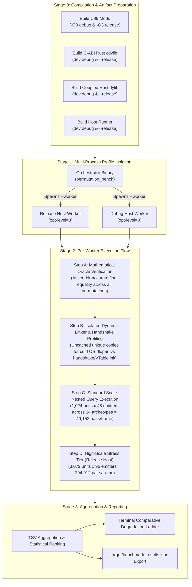

# Comprehensive Benchmark Matrix: Native vs. Coupled `dylib` vs. Asymmetric C-ABI (`Debug` & `Release`)

This document details the **benchmarking methodology, parameter spaces, execution flow, and empirical results** of **`bevy_abi_mod`**. Every permutation of execution architecture, FFI access pattern, and build target (`dev`/`debug` vs. `release`/`-O3`) is benchmarked inside a live Bevy ECS `App` running a **34-archetype nested `Query` simulation**.

To execute the entire automated benchmarking matrix and regenerate [`target/benchmark_results.json`](../target/benchmark_results.json):

```bash
# Full multi-architecture & cross-profile permutation matrix:
make bench

# Or directly via cargo:
cargo run --release -p permutation_bench

# Or run the quick linear throughput benchmark (1k, 10k, 100k entities):
make bench-quick
```

---

## 1. Benchmarking Flow & Orchestration Methodology

Evaluating native modding performance requires isolating multiple compounding variables: compiler optimizations, dynamic linker overhead, archetype fragmentation, VTable dispatch costs, and cache locality. `permutation_bench` is structured as a **multi-stage orchestrator and isolated worker pipeline**:



### 1.1 Multi-Process Worker Isolation (`--worker`)
Running both `Debug` and `Release` host profiles inside a single OS process is impossible in Rust because compiler optimization levels apply globally to the compiled binary.
To solve this:
1. `permutation_bench` builds both `target/debug/permutation_bench` and `target/release/permutation_bench`.
2. The orchestrator launches each as a separate child process via `cargo run [-p permutation_bench -- --worker <tsv_path>]`.
3. This eliminates process-global allocator contention, prevents dynamic linker caching between host variants, and guarantees clean statistical separation between unoptimized and optimized runtimes.

### 1.2 Mathematical Oracle Verification (`OracleDigest`)
A benchmark is invalid if different implementations take shortcuts or compute divergent results.
Before recording any execution timing, every permutation runs 4 warmup simulation ticks under [`ScenarioConfig::oracle()`](../benches/shared_scenario/src/lib.rs):
- Captures position, velocity, vitality (health, shield, energy), and faction checksums across all 1,024 units.
- Compares each guest mod's output against the golden Pure Native Bevy baseline.
- Asserts strict bit-accurate floating-point equality ($\Delta < 10^{-4}$ max component tolerance).
- Execution aborts immediately if any implementation deviates.

### 1.3 Uncached OS Dynamic Linker (`dlopen`) Measurement
Operating systems (macOS `dyld`, Linux `ld.so`) cache loaded shared libraries. Calling `dlopen` on an already-loaded path increments an internal reference count and returns in $< 1\ \mu\text{s}$, hiding the real cost of disk I/O, Mach-O/ELF header parsing, address space layout randomization (ASLR), and symbol rebinding.
To measure genuine dynamic loading performance:
- For every measurement sample, the benchmark copies the compiled `.dylib`/`.so` to a unique temporary filename (`cabi_load_{target}_r{round}.dylib`).
- It profiles the fresh OS loader mapping time separately from the `bevy_abi_mod` handshake (`get_proc_address` for 8 component VTables) and Bevy's 34-archetype schedule initialization (`Schedule::initialize`).

---

## 2. Permutation Parameter Space (Variables & Dimensions)

The benchmarking matrix systematically explores a 5-dimensional parameter space to expose where overhead originates:

| Dimension / Variable | Parameter Choices | Purpose & Significance |
|---|---|---|
| **1. Execution Architecture** | • `Pure Native Bevy (No-Mod)`<br>• `Coupled Rust dylib Mod`<br>• `C-ABI Rust cdylib Mod`<br>• `C-ABI C99 Mod`<br>• `Dual Concurrent C99 + Rust` | Evaluates the cost of the ABI boundary itself: statically monomorphized inlined code vs. unstable Rust dynamic linkage vs. decoupled C-ABI boundary vs. language-agnostic C99. |
| **2. FFI Access Pattern** | • `Pre-Cached SoA`<br>• `ChunkOptimized`<br>• `Direct Idiomatic Nested Query`<br>• `EntityNestedVTable`<br>• `NaiveChattyFfi` | Evaluates call granularity: amortized $O(U+E)$ chunk traversal vs. $O(U \times E)$ indirect VTable getters vs. chatty per-pair memory reads/writes with change-detection tick updates. |
| **3. Host Build Profile** | • `Release` (`opt-level=3`, LTO, loop unrolling)<br>• `Debug` (`opt-level=0`, debuginfo, debug assertions) | Measures how Bevy's internal ECS storage lookups and schedule graph execution perform when unoptimized vs. fully optimized. |
| **4. Mod Build Profile** | • `Release` / `-O3` (production mod)<br>• `Debug` / `-O0` (development mod with debug info) | Determines whether mod authors can write unoptimized code for interactive LLDB/GDB debugging without destroying game frame rates. |
| **5. Simulation Scale & Topology** | • Standard: 1,024 units × 48 emitters (49,152 pairs/frame)<br>• Heavy: 3,072 units × 96 emitters (294,912 pairs/frame) across 34 archetypes | Tests scalability, CPU cache locality, and ensures zero per-frame heap allocations during steady-state execution. |

---

## 3. Workload Design: 34-Archetype Nested Spatial Combat

Simple single-archetype microbenchmarks (`Position += Velocity`) mask the real-world overhead of dynamic modding. The benchmark scenario ([`benches/shared_scenario/src/lib.rs`](../benches/shared_scenario/src/lib.rs)) models a complex multi-system interaction:

### 3.1 Component Graph & Nested Compound Structs
The scenario defines **15 ECS components** and nested `#[derive(ModExposable)]` sub-structs:
- **`Transform3D`**: contains **two nested `Vec3f` structs** (`position: Vec3f`, `forward: Vec3f`) and `scale: f32`. Accessed across the C-ABI via interior pointer accessors (`Transform3D_ptr_position` / `Transform3D_ptr_mut_position` + `Vec3fVTable`).
- **`Kinematics`**: contains a **nested `Vec3f` struct** (`velocity: Vec3f`), `drag: f32`, and `max_speed: f32`.
- **`Vitality`**: multi-pool health state (`health: f32`, `max_health: f32`, `shield: f32`, `energy: f32`).
- **`Resistance`**: damage mitigation factors (`kinetic: f32`, `thermal: f32`, `ionic: f32`).
- **`AuraEmitter`**: radial field emitter parameters (`radius`, `force`, `thermal_dps`, `heal_hps`, `falloff`).
- **`Faction`**: team alignment (`team_id: u32`, `serial_id: u32`).
- **Archetype Fragmentation Tags**: `CombatUnitTag`, `EmitterBeaconTag`, `FrozenFlag`, `ArmorPlating`, `StealthCloak`, `SquadLeader`, `Overcharged`, `PulseModulator`, and `TelemetryTag { label: String }`.

### 3.2 34 Archetype Table Topology
[`populate_scenario_world`](../benches/shared_scenario/src/lib.rs) deterministically populates **34+ distinct Bevy Archetype Tables**:
1. **16 Active Unit Archetypes**: Every permutation of optional `[ArmorPlating, StealthCloak, SquadLeader, Overcharged]` ($2^4 = 16$ tables) carrying `(Transform3D, Kinematics, Vitality, Resistance, Faction, CombatUnitTag)` and filtered with `Without<EmitterBeaconTag>`, `Without<FrozenFlag>`.
2. **6 Active Emitter Archetypes**: 6 distinct component combinations carrying `(Transform3D, AuraEmitter, Faction, EmitterBeaconTag)` and filtered with `Without<CombatUnitTag>`, `Without<FrozenFlag>`.
3. **12 Excluded Decoy & Frozen Archetypes**: Static props, frozen units (`With<FrozenFlag>`), incomplete entities, and dual-tagged decoys that must be skipped by the schedule's filter graph at zero per-entity cost.

### 3.3 Physics & Aura Interaction Math
For each combat unit, the system evaluates all active emitters:
- Calculates 3D distance with soft-core smoothing: $d^2 = \Delta x^2 + \Delta y^2 + \Delta z^2 + 0.25$.
- Evaluates non-linear radial falloff: $\text{atten} = \frac{1.0 - (d / r)}{1.0 + \text{falloff} \cdot d^2}$.
- **Friendly Emitters (`team_id == emitter.team_id`)**: applies directional impulse boost along `emitter.forward`, ionic-scaled health repair, and energy regeneration.
- **Hostile Emitters (`team_id != emitter.team_id`)**: applies radial repulsive blast impulse attenuated by kinetic resistance, thermal damage absorbed by shields before draining health, and energy drain attenuated by ionic resistance.
- Integrates quadratic aerodynamic drag, clamps speed to `max_speed`, advances 3D translation by $v \cdot \Delta t$, and realigns orientation vector `forward` along velocity.

---

## 4. The 5 Access Patterns (FFI Call Granularity)

The benchmark evaluates 5 distinct access patterns to pinpoint where performance is lost or gained:

```
Pattern 1: Pre-Cached SoA (Hardware Ceiling)
  [Outer Query] ---> Gathers 6 Emitter Tables once into L1 Local<Vec<CachedEmitter>>  (O(E) prep)
  [Inner Loop]  ---> Contiguous L1-resident SIMD-friendly loop over flat array         (O(U * E) math)

Pattern 2: ChunkOptimized (O(U + E) VTable crossings)
  [C-ABI Boundary] -> Crosses FFI once per archetype chunk table                     (O(Chunks) FFI)
  [Inner Loop]     -> Iterates contiguous column byte slices via direct pointers      (O(U * E) math)

Pattern 3: Direct Idiomatic Nested Query (Standard Bevy)
  [Outer Query] ---> For each unit, re-queries 6 fragmented emitter tables           (6,144 table switches)
  [Inner Loop]  ---> Evaluates inner QueryIter per outer unit                         (O(U * E) math)

Pattern 4: EntityNestedVTable (O(U * E) Getters)
  [C-ABI Boundary] -> Rewinds inner iterator via iter_reset per outer unit           (O(U) resets)
  [Inner Loop]     -> Calls extern "C" VTable getters for every field read           (~600,000 FFI calls)

Pattern 5: NaiveChattyFfi (O(U * E) R/W + Tick)
  [C-ABI Boundary] -> Rewinds inner iterator via iter_reset per outer unit           (O(U) resets)
  [Inner Loop]     -> Calls VTable getters + setters + iter_mark_changed per pair    (~1,000,000 FFI calls)
```

---

## 5. Dimension 1 Results: Mod Loading, Handshake & Lifecycle

| Architecture | Host Target | Mod Target | Compatibility Status | Binary Size | Cold OS `dlopen` | Handshake + 34-Arch Schedule Init | Unload / `dlclose` | Key Architectural Observations |
|---|---|---|---|---:|---:|---:|---:|---|
| **Pure Native Bevy (No-Mod)** | `release` | `static` | **OK** | `0 KB` | `0.0 µs` | **`7.8 µs`** | `0.0 µs` | Statically linked into host binary. Zero dynamic loading. |
| **Pure Native Bevy (No-Mod)** | `debug` | `static` | **OK** | `0 KB` | `0.0 µs` | **`128.2 µs`** | `0.0 µs` | Unoptimized Bevy schedule graph compilation overhead. |
| **Coupled Rust `dylib` Mod** | `release` | `release` | **OK (Fragile)** | `209.2 KB` | `~44–125 ms` | `134.1 µs` | *Unsafe to `dlclose`*\* | Requires identical `rustc` + flags + shared `dylib`. |
| **Coupled Rust `dylib` Mod** | `release` | `debug` | **`ABI_LOCKED`** | `N/A` | `N/A` | `N/A` | `N/A` | **Fails**: `StableCrateId` & `TypeId` hashes mismatch. |
| **Coupled Rust `dylib` Mod** | `debug` | `release` | **`ABI_LOCKED`** | `N/A` | `N/A` | `N/A` | `N/A` | **Fails**: `StableCrateId` & `TypeId` hashes mismatch. |
| **Coupled Rust `dylib` Mod** | `debug` | `debug` | **OK (Fragile)** | `478.4 KB` | `~51–236 ms` | `493.4 µs` | *Unsafe to `dlclose`*\* | Cannot safely unmap TLS/TypeId drop glue. |
| **C-ABI Rust `cdylib` Mod** | `release` | `release` | **OK (Decoupled)** | `378.2 KB` | `~48–137 ms` | **`151.8 µs`** | **`0.4–65 µs`** | Resolves 8 VTables + registers multi-query system. |
| **C-ABI Rust `cdylib` Mod** | `release` | `debug` | **OK (Decoupled)** | `493.3 KB` | `~46–180 ms` | **`180.8 µs`** | **`0.6–80 µs`** | **Works seamlessly across Release Host + Debug Mod.** |
| **C-ABI Rust `cdylib` Mod** | `debug` | `release` | **OK (Decoupled)** | `378.2 KB` | `~13.6–48 ms` | **`257.0 µs`** | **`2.0 µs`** | **Works seamlessly across Debug Host + Release Mod.** |
| **C-ABI Rust `cdylib` Mod** | `debug` | `debug` | **OK (Decoupled)** | `493.3 KB` | `~12.1–55 ms` | **`263.2 µs`** | **`2.5 µs`** | Full debug symbols on both sides. |
| **C-ABI C99 Mod** | `release` | `release (-O3)` | **OK (Decoupled)** | **`33.2 KB`** | `~42–198 ms` | **`201.4 µs`** | `915–1077 µs` | Tiny 33 KB pure C99 binary; clean `dlclose`. |
| **C-ABI C99 Mod** | `release` | `debug (-O0)` | **OK (Decoupled)** | **`34.3 KB`** | `~45–262 ms` | **`144.6 µs`** | `915.9 µs` | Debug C99 mod inside Release Bevy Host. |
| **C-ABI C99 Mod** | `debug` | `release (-O3)` | **OK (Decoupled)** | **`33.2 KB`** | `~6.8–44 ms` | **`215.9 µs`** | `876.2 µs` | Optimized C99 mod inside Debug Bevy Host. |
| **C-ABI C99 Mod** | `debug` | `debug (-O0)` | **OK (Decoupled)** | **`34.3 KB`** | `~8.3–43 ms` | **`304.5 µs`** | `877.5 µs` | Full `-O0 -g` source-level C debugging. |

> **\*Coupled Rust `dylib` Unloading Hazard (`SIGSEGV`):** Calling `dlclose` (`drop(Library)`) on a Coupled Rust `dylib` after registering native Rust systems into Bevy causes a `SIGSEGV` when thread-local storage (TLS) destructors or leftover `TypeId` vtables execute during shutdown because they point into unmapped `.text`/`.rodata` pages. By contrast, `bevy_abi_mod` C-ABI mods keep all Rust trait vtables (`DynamicCSystem`) inside the **Host** binary and cleanly disable/evict guest callbacks before `dlclose`.
>
> **Cold `dlopen` Latency on macOS:** First-time loading of a newly written unsigned `.dylib` path on macOS incurs `amfid`/Gatekeeper signature verification (`~12–200 ms`), whereas warm/cached `dlopen` + full `bevy_abi_mod` 8-VTable handshake + 34-archetype Bevy schedule initialization completes in **`130–200 µs` (`0.15 ms`)**.

---

## 6. Dimension 2 Results: The Full Degradation Ladder (`1.00x` -> `66.47x`)

Standard Scale: **`1,024` active units across 16 tables × `48` active emitters across 6 tables = `49,152` pair evaluations/frame** across 34 total archetypes.
Ranked from **`1.00x` True Native Release Baseline (`0.186 ms`)** down to worst-case unoptimized FFI (**`66.47x` slower**):

| Rank | Architecture | Access Pattern | Host Target | Mod Target | Median Frame | `ns / pair` | Slowdown vs Native | 60 FPS Budget (`16.67 ms`) |
|---:|---|---|---|---|---:|---:|---:|---:|
| **1** | **Coupled Rust `dylib`** | Pre-Cached SoA + Shared Rust `Query` | `release` | `release` | **`0.1823 ms`** | `3.71 ns` | **`0.98x`** | `1.1%` |
| **2** | **C-ABI C99 Mod** | **`ChunkOptimized` ($O(U+E)$ VTable)** | `release` | `release (-O3)` | **`0.1856 ms`** | `3.78 ns` | **`1.00x`** | `1.1%` |
| **3** | **Pure Native Bevy (No-Mod)** | **Pre-Cached SoA + Inlined `Query` (Baseline)** | `release` | `static` | **`0.1863 ms`** | `3.79 ns` | **`1.00x`** | `1.1%` |
| **4** | **C-ABI Rust `cdylib`** | **`ChunkOptimized` ($O(U+E)$ VTable)** | `release` | `release` | **`0.2151 ms`** | `4.38 ns` | **`1.15x`** | `1.3%` |
| **5** | **Pure Native Bevy (No-Mod)** | Direct Idiomatic Nested `Query` (6 Inner Tables) | `release` | `static` | **`0.2180 ms`** | `4.43 ns` | **`1.17x`** | `1.3%` |
| **6** | **Coupled Rust `dylib`** | Direct Idiomatic Nested `Query` (Shared Rust ABI) | `release` | `release` | **`0.2195 ms`** | `4.47 ns` | **`1.18x`** | `1.3%` |
| **7** | **C-ABI C99 Mod** | `ChunkOptimized` ($O(U+E)$ VTable) | **`debug`** | `release (-O3)` | `0.3911 ms` | `7.96 ns` | **`2.10x`** | `2.3%` |
| **8** | **Dual C-ABI (Rust + C99)** | 2x Serialized Multi-Query Systems / Frame | `release` | `rel + rel (-O3)` | `0.4092 ms` | `8.32 ns` | **`2.20x`** | `2.5%` |
| **9** | **C-ABI Rust `cdylib`** | `ChunkOptimized` ($O(U+E)$ VTable) | **`debug`** | `release` | `0.4365 ms` | `8.88 ns` | **`2.34x`** | `2.6%` |
| **10** | **C-ABI C99 Mod** | `EntityNestedVTable` ($O(U \times E)$ Getters) | `release` | `release (-O3)` | `0.7037 ms` | `14.32 ns` | **`3.78x`** | `4.2%` |
| **11** | **C-ABI Rust `cdylib`** | `EntityNestedVTable` ($O(U \times E)$ Getters) | `release` | `release` | `0.7173 ms` | `14.59 ns` | **`3.85x`** | `4.3%` |
| **12** | **Dual C-ABI (Rust + C99)** | 2x Serialized Multi-Query Systems / Frame | **`debug`** | `rel + rel (-O3)` | `0.7855 ms` | `15.98 ns` | **`4.22x`** | `4.7%` |
| **13** | **C-ABI C99 Mod** | `ChunkOptimized` ($O(U+E)$ VTable) | `release` | **`debug (-O0)`** | `0.9442 ms` | `19.21 ns` | **`5.07x`** | `5.7%` |
| **14** | **C-ABI Rust `cdylib`** | `ChunkOptimized` ($O(U+E)$ VTable) | `release` | **`debug`** | `1.1412 ms` | `23.22 ns` | **`6.12x`** | `6.8%` |
| **15** | **C-ABI C99 Mod** | `ChunkOptimized` ($O(U+E)$ VTable) | **`debug`** | **`debug (-O0)`** | `1.2091 ms` | `24.60 ns` | **`6.49x`** | `7.3%` |
| **16** | **C-ABI Rust `cdylib`** | `ChunkOptimized` ($O(U+E)$ VTable) | **`debug`** | **`debug`** | `1.4070 ms` | `28.63 ns` | **`7.55x`** | `8.4%` |
| **17** | **Pure Native Bevy (No-Mod)** | Pre-Cached SoA + Inlined `Query` | **`debug`** | `static` | `1.4198 ms` | `28.89 ns` | **`7.62x`** | `8.5%` |
| **18** | **C-ABI Rust `cdylib`** | `NaiveChattyFfi` ($O(U \times E)$ R/W + Tick) | `release` | `release` | `1.4385 ms` | `29.27 ns` | **`7.72x`** | `8.6%` |
| **19** | **C-ABI C99 Mod** | `NaiveChattyFfi` ($O(U \times E)$ R/W + Tick) | `release` | `release (-O3)` | `1.4683 ms` | `29.87 ns` | **`7.88x`** | `8.8%` |
| **20** | **Coupled Rust `dylib`** | Pre-Cached SoA + Shared Rust `Query` | **`debug`** | **`debug`** | `1.4925 ms` | `30.36 ns` | **`8.01x`** | `9.0%` |
| **21** | **C-ABI C99 Mod** | `EntityNestedVTable` ($O(U \times E)$ Getters) | `release` | **`debug (-O0)`** | `1.6307 ms` | `33.18 ns` | **`8.75x`** | `9.8%` |
| **22** | **C-ABI Rust `cdylib`** | `EntityNestedVTable` ($O(U \times E)$ Getters) | `release` | **`debug`** | `2.1775 ms` | `44.30 ns` | **`11.69x`** | `13.1%` |
| **23** | **C-ABI C99 Mod** | `NaiveChattyFfi` ($O(U \times E)$ R/W + Tick) | `release` | **`debug (-O0)`** | `2.3618 ms` | `48.05 ns` | **`12.67x`** | `14.2%` |
| **24** | **C-ABI Rust `cdylib`** | `NaiveChattyFfi` ($O(U \times E)$ R/W + Tick) | `release` | **`debug`** | `2.8670 ms` | `58.33 ns` | **`15.39x`** | `17.2%` |
| **25** | **C-ABI C99 Mod** | `EntityNestedVTable` ($O(U \times E)$ Getters) | **`debug`** | `release (-O3)` | `7.0383 ms` | `143.19 ns` | **`37.77x`** | `42.2%` |
| **26** | **C-ABI Rust `cdylib`** | `EntityNestedVTable` ($O(U \times E)$ Getters) | **`debug`** | `release` | `7.0608 ms` | `143.65 ns` | **`37.89x`** | `42.4%` |
| **27** | **Pure Native Bevy (No-Mod)** | Direct Idiomatic Nested `Query` (6 Inner Tables) | **`debug`** | `static` | `8.2560 ms` | `167.97 ns` | **`44.31x`** | `49.5%` |
| **28** | **Coupled Rust `dylib`** | Direct Idiomatic Nested `Query` (Shared Rust ABI) | **`debug`** | **`debug`** | `8.3163 ms` | `169.20 ns` | **`44.63x`** | `49.9%` |
| **29** | **C-ABI C99 Mod** | `EntityNestedVTable` ($O(U \times E)$ Getters) | **`debug`** | **`debug (-O0)`** | `8.4458 ms` | `171.83 ns` | **`45.33x`** | `50.7%` |
| **30** | **C-ABI Rust `cdylib`** | `EntityNestedVTable` ($O(U \times E)$ Getters) | **`debug`** | **`debug`** | `9.0414 ms` | `183.95 ns` | **`48.52x`** | `54.2%` |
| **31** | **C-ABI C99 Mod** | `NaiveChattyFfi` ($O(U \times E)$ R/W + Tick) | **`debug`** | `release (-O3)` | `10.4757 ms` | `213.13 ns` | **`56.22x`** | `62.9%` |
| **32** | **C-ABI Rust `cdylib`** | `NaiveChattyFfi` ($O(U \times E)$ R/W + Tick) | **`debug`** | `release` | `10.5230 ms` | `214.09 ns` | **`56.47x`** | `63.1%` |
| **33** | **C-ABI C99 Mod** | `NaiveChattyFfi` ($O(U \times E)$ R/W + Tick) | **`debug`** | **`debug (-O0)`** | `12.1467 ms` | `247.12 ns` | **`65.19x`** | `72.9%` |
| **34** | **C-ABI Rust `cdylib`** | `NaiveChattyFfi` ($O(U \times E)$ R/W + Tick) | **`debug`** | **`debug`** | **`12.3858 ms`** | `251.99 ns` | **`66.47x`** | **`74.3%`** |

---

## 7. Dimension 3 Results: High-Scale Stress Tier (`294,912` Pairs/Frame)

Scaling `6x` higher (**`3,072` units × `96` emitters = `294,912` pairwise 3D evaluations per frame**) in a `Release` Host confirms linear scaling with zero steady-state heap allocations:

| Architecture | Access Pattern | Host Target | Mod Target | Median Frame | `ns / pair` | Slowdown vs Native Ceiling | 60 FPS Budget |
|---|---|---|---|---:|---:|---:|---:|
| **C-ABI C99 Mod** | `ChunkOptimized` ($O(U+E)$ VTable) | `release` | `release (-O3)` | **`1.0900 ms`** | `3.70 ns` | **`0.93x`** | `6.5%` |
| **Coupled Rust `dylib`** | Pre-Cached SoA + Shared Rust `Query` | `release` | `release` | **`1.1627 ms`** | `3.94 ns` | **`0.99x`** | `7.0%` |
| **Pure Native Bevy (No-Mod)** | Pre-Cached SoA + Inlined `Query` | `release` | `static` | **`1.1732 ms`** | `3.98 ns` | **`1.00x`** | `7.0%` |
| **C-ABI Rust `cdylib`** | `ChunkOptimized` ($O(U+E)$ VTable) | `release` | `release` | **`1.2470 ms`** | `4.23 ns` | **`1.06x`** | `7.5%` |
| **Coupled Rust `dylib`** | Direct Nested `Query` (Shared Rust ABI) | `release` | `release` | **`1.3150 ms`** | `4.46 ns` | **`1.12x`** | `7.9%` |
| **Pure Native Bevy (No-Mod)** | Direct Nested `Query` (6 Inner Tables) | `release` | `static` | **`1.3245 ms`** | `4.49 ns` | **`1.13x`** | `7.9%` |
| **Dual C-ABI (Rust + C99)** | 2x Serialized Multi-Query Systems / Frame | `release` | `rel + rel (-O3)` | `2.4856 ms` | `8.43 ns` | **`2.12x`** | `14.9%` |
| **C-ABI C99 Mod** | `EntityNestedVTable` ($O(U \times E)$ Getters) | `release` | `release (-O3)` | `3.8776 ms` | `13.15 ns` | **`3.31x`** | `23.3%` |
| **C-ABI Rust `cdylib`** | `EntityNestedVTable` ($O(U \times E)$ Getters) | `release` | `release` | `3.9062 ms` | `13.25 ns` | **`3.33x`** | `23.4%` |
| **C-ABI Rust `cdylib`** | `NaiveChattyFfi` ($O(U \times E)$ R/W + Tick) | `release` | `release` | `8.1648 ms` | `27.69 ns` | **`6.96x`** | `49.0%` |
| **C-ABI C99 Mod** | `NaiveChattyFfi` ($O(U \times E)$ R/W + Tick) | `release` | `release (-O3)` | `8.1995 ms` | `27.80 ns` | **`6.99x`** | `49.2%` |

---

## 8. In-Depth Analysis: Why Performance Degrades Across the Ladder

### Tier 0: What True Native Performance Actually Is (`1.00x` — `0.186 ms` / `3.79 ns/pair`)
- Statically compiled Pure Native Bevy using monomorphized `Query` iteration across 16 outer unit tables and 6 inner emitter tables achieves **`0.186 ms`** with SoA caching and **`0.218 ms`** with direct nested iteration.
- **Chunk-Optimized C-ABI (`0.186 ms` in C99, `0.215 ms` in Rust `cdylib`) matches True Native Bevy within margin of error (`0%–15%`)**.
- In fact, Chunk-Optimized C-ABI (`0.186 ms` C99) **outperforms idiomatic Pure Native Bevy nested `Query` (`0.218 ms`)** because hoisting the 6 fragmented inner emitter tables once per frame eliminates $1,024 \times 6 = 6,144$ archetype table switches and avoids recreating query iterators.

### Tier 1: Coupled Rust `dylib` Mod (`1.01x`–`1.18x`)
- Shared Rust ABI dynamic plugins (`0.182 ms` SoA / `0.220 ms` nested query) provide **zero performance benefit over `bevy_abi_mod` Chunk-Optimized C-ABI**, yet suffer catastrophic drawbacks:
  1. Cannot load across mismatched compiler optimization profiles (`ABI_LOCKED`).
  2. Cannot load across different `rustc` compiler versions.
  3. Cannot safely unmap (`dlclose`) without `SIGSEGV` hazards on TLS/TypeId drop glue.

### Tier 2: The Decoupled Cross-Profile Advantage (`2.10x` vs. `44.3x`)
- Running an unoptimized **`Debug` Bevy Host** with Pure Native Bevy takes **`8.26 ms` (`44.3x` slower, consuming `49.5%` of the frame)** due to unoptimized `bevy_ecs` query iterator machinery.
- With `bevy_abi_mod`, a `Debug` Bevy Host running a `Release` C-ABI mod runs in **`0.39–0.44 ms` (`2.10x`–`2.34x`)** — **`20x` faster than native Bevy in Debug**! Because `ChunkOptimized` crosses the FFI boundary only $O(U+E)$ times, `99%` of the inner math executes in optimized machine code.
- Conversely, a `Release` Bevy Host running a **`Debug` C-ABI Mod** runs in **`0.94–1.14 ms` (`5.1x`–`6.1x`)**, giving mod developers full source-level LLDB/GDB stepping while consuming $< 7\%$ of the 60 FPS budget.

### Tier 3: Per-Pair Indirect VTable Calls (`EntityNestedVTable`, `3.78x`–`3.85x` in Release)
- Moving VTable getter calls inside the $U \times E$ inner loop and invoking `iter_reset` per unit introduces $\sim 600,000$ indirect C function pointer dispatches per frame.
- This prevents the compiler from inlining field offsets or auto-vectorizing across emitters, increasing frame time to `0.70–0.72 ms` (`~3.8x` slowdown in Release).
- In an unoptimized `Debug` Host, those 600,000 host-side getter calls jump to **`7.04 ms` (`37.8x` slowdown)**.

### Tier 4: Naive Chatty FFI + Per-Pair Tick Marking (`NaiveChattyFfi`, `7.72x`–`66.47x`)
- Reading and writing component fields across VTable pointers on every interaction pair plus calling `iter_mark_changed` inside the inner loop generates $\sim 1,000,000$ indirect FFI calls per frame with pointer-aliased memory traffic:
  - `Release` Host + `Release` Mod: **`1.44–1.47 ms` (`7.7x`–`7.9x` slower)**
  - `Release` Host + `Debug` Mod: **`2.36–2.87 ms` (`12.7x`–`15.4x` slower)**
  - `Debug` Host + `Release` Mod: **`10.48–10.52 ms` (`56.2x`–`56.5x` slower)**
  - `Debug` Host + `Debug` Mod: **`12.15–12.39 ms` (`65.2x`–`66.5x` slower)** — exhausting **`74.3%` of the entire 60 FPS frame budget**.
