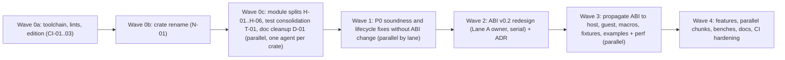

# bevy_abi_mod: Staff-Level Self-Review and Swarm Improvement Plan

> I wrote this project, so this is a review of my own decisions. The code compiles, clippy is clean, and the test count is impressive. Even so, a careful look shows **real soundness holes in the safe guest API**, **lifecycle paths that can jump into unmapped code**, an **ABI surface that grew by accretion instead of design**, and **hot paths that do string hashing per call**. This document turns each of those into a numbered work item that a swarm of agents can pick up without having to rediscover the reasoning.

---

## 0. How to Use This Plan (read first, every agent)

### 0.1 Global rules for every worker
1. Before touching code, read [spec.md](../spec.md), [GEMINI.md](../GEMINI.md), and **your item in full**.
2. **One item per branch or PR.** The title must start with the item ID, e.g. `[S-02] Remove caller-supplied count from GuestChunkIter`.
3. **Stay inside your lane's files** (see §0.3). If you must edit another lane's file, post on the board first and keep that edit minimal.
4. The ABI and guest crates must **never** depend on `bevy*`. Re-check this after every change: `cargo tree -p bevy_abi_mod_sys -p bevy_abi_mod_guest_sys -p bevy_abi_mod_guest | grep -v bevy_abi_mod | grep -i bevy` must print nothing.
5. Every new `unsafe` block needs a `// SAFETY:` comment, and every `unsafe fn` needs a `# Safety` doc section. Removing `unsafe` beats documenting it.
6. Every bug-fix item adds a **regression test** named `regression_<item_id>_<short_name>` (e.g. `regression_s05_stale_vtable_after_unload`).
7. ABI changes must update **all** of these in the same PR: `bevy_abi_mod_sys`, `include/bevy_abi_mod.h`, `bevy_abi_mod_guest_sys`, `bevy_abi_mod_guest`, the C fixture mod, the Rust fixture mod, and `spec.md`.
8. **Definition of done** (run all of them):
   ```bash
   cargo fmt --all -- --check
   cargo clippy --workspace --all-targets -- -D warnings
   cargo test --workspace
   make test-c99
   MIRIFLAGS="-Zmiri-tree-borrows" cargo +nightly miri test -p bevy_abi_mod_sys -p bevy_abi_mod_guest_sys -p bevy_abi_mod_guest
   ```
9. Wave 0 items must not change behavior. Pure moves and renames only, and the test suite must pass unchanged.
10. **We are pre-1.0. Breaking changes are allowed** in Wave 2 (ABI bumps to `0.2`). Do not add compatibility aliases for 0.1.

### 0.2 Item format
Each item has: **ID · Severity (P0 critical … P3 nice) · Effort (S ≤ 0.5 day, M ≤ 2 days, L > 2 days) · Lane · Wave · Depends on**, followed by **Problem** (with evidence links), **Change** (steps), and **Acceptance**.

### 0.3 Lanes and file ownership
| Lane | Owns | Notes |
|---|---|---|
| **A: ABI (`-sys`)** | `crates/bevy_abi_mod_sys/**`, `include/bevy_abi_mod.h` | `#![no_std]`, zero external deps. Single owner in Wave 2. All ABI design decisions go through this lane. |
| **B: Host FFI (`-sys`)** | `crates/bevy_abi_mod_host_sys/src/{chunk_iter,commands}.rs`, future `ffi/**` | Every host `extern "C"` entry point and raw pointer bridge. |
| **C: Host Core (`-sys` + Safe Host)** | `crates/bevy_abi_mod_host_sys/src/{dynamic_system,registry,host,lib}.rs`, `crates/bevy_abi_mod_host/**` (`#![forbid(unsafe_code)]`), `crates/bevy_abi_mod/**` (`#![forbid(unsafe_code)]`) | Low-level loader/registry/system internals in `bevy_abi_mod_host_sys`; safe Bevy plugin & facade in `bevy_abi_mod_host` / `bevy_abi_mod`. |
| **D: Guest SDK (`-sys` + Safe Guest)** | `crates/bevy_abi_mod_guest_sys/**`, `crates/bevy_abi_mod_guest/**` | Zero Bevy deps. Raw FFI trampolines/state/slice helpers in `bevy_abi_mod_guest_sys`; safe ergonomic SDK in `bevy_abi_mod_guest` (`#![forbid(unsafe_code)]` after S-01..S-03). |
| **E: Macros** | `crates/bevy_abi_mod_macros/**` | Proc-macro crate (`#[derive(ModExposable, AbiPod)]`), zero Bevy deps. |
| **F: Tests** | `crates/*/tests/**`, `tests/**` (fixtures) | |
| **G: Tooling/Docs** | `Cargo.toml`, `.github/**`, `Makefile`, `scripts/**`, `docs/**`, root `*.md` | |
| **H: Examples/Bench** | `examples/**`, `benches/**`, `crates/bevy_abi_mod_host/benches/**` | |

### 0.4 Wave plan


### 0.5 Top 10 to fix first (my most serious mistakes)
| # | ID | One-line summary |
|---|---|---|
| 1 | S-02 | Safe `GuestChunkIter` methods take a caller-supplied `count`, so safe Rust can read out of bounds. |
| 2 | S-01 | Safe public constructors over raw pointers (`ChunkSlice::new`, `GuestChunkIter::new`, …) let safe code dereference any address. |
| 3 | S-03 | Typed column, resource and insert APIs are bounded by `Copy` instead of `AbiPod`, so a `bool`, `char` or enum read from host bytes is UB. |
| 4 | S-05 | Guest VTable pointers stay in `GLOBAL_SYMBOLS` and the registry after `dlclose` (dangling pointers). |
| 5 | S-06 | A failed `bevy_abi_mod_init` leaves armed drop trampolines pointing into an unloaded library. |
| 6 | S-04 | Padding bytes get read as `&[u8]` on the insert path (uninit-memory UB). |
| 7 | L-04 | `unsafe fn unload_mod` is reachable from a `ResMut<ModHost>` running in parallel with guest systems. |
| 8 | L-05 | Named ordering sets are global across mods, silently dropped when no other system in the batch uses ordering, and leaked on unload. |
| 9 | C-02 | `MIN_V1_SIZE = size_of::<Self>()` defeats the whole `struct_size` versioning scheme. |
| 10 | C-01 | Six system descriptors, six aliases and seven registration functions where one extensible descriptor would do. |

---

## A. Soundness and Undefined Behavior (P0)

### 1. [S-01] Safe constructors over raw pointers in `bevy_abi_mod_guest` (`+ bevy_abi_mod_guest_sys`)
**P0 · S · Lane D · Wave 1**
- **Problem:** These are all safe `pub fn`s that store a raw pointer which later *safe* methods dereference or pass to the host:
  - [`GuestChunkIter::new`/`with_reset`/`with_bridges`](../crates/bevy_abi_mod_guest/src/lib.rs)
  - [`GuestCommandQueue::new`/`with_ext`](../crates/bevy_abi_mod_guest/src/lib.rs)
  - [`ChunkSlice::new`](../crates/bevy_abi_mod_guest/src/lib.rs) followed by safe [`as_typed_slice`](../crates/bevy_abi_mod_guest/src/lib.rs)
  - [`ChunkSliceMut::new`](../crates/bevy_abi_mod_guest/src/lib.rs)

  For example, `ChunkSlice::new(0x1234 as _, 4, 1).as_typed_slice::<u32>()` is UB in 100% safe code. The rustdoc example at L1718-1728 even teaches this pattern.
- **Change:**
  1. Make each of these constructors `pub unsafe fn` with a `# Safety` section, or `pub(crate)` if no external caller needs it.
  2. Keep [`SystemContext`](../crates/bevy_abi_mod_guest/src/lib.rs) and `MultiQueryContext` as the only safe entry points.
  3. Update the doctests and tests to use `unsafe {}` with SAFETY comments.
- **Acceptance:** No safe public function in `bevy_abi_mod_guest` (`+ bevy_abi_mod_guest_sys`) accepts a raw pointer that is later dereferenced (verify by grepping `pub fn .*\*(const|mut)`). All tests pass.

### 2. [S-02] Caller-supplied `count` in safe `GuestChunkIter` APIs (out-of-bounds read/write)
**P0 · M · Lane D · Wave 1 · Depends on S-01**
- **Problem:** Several safe methods take a `count` that the host never validates:
  - [`entities_slice(count)`](../crates/bevy_abi_mod_guest/src/lib.rs)
  - [`readonly_slice`/`mutable_slice(index, count)`](../crates/bevy_abi_mod_guest/src/lib.rs)
  - [`split_slices(.., count)`](../crates/bevy_abi_mod_guest/src/lib.rs)
  - `columns_mut`, [`read_write`](../crates/bevy_abi_mod_guest/src/lib.rs), `write_2`, `optional_*`

  `iter.next_chunk(); iter.read_write::<f32,f32>(0, 1, 1 << 20)` builds a 1M-element slice over a 3-element column. `Chunk` already does this correctly by tracking `count` itself.
- **Change:**
  1. Add a `current_len: usize` field to `GuestChunkIter`. Set it in `next_chunk()`, and reset it to 0 in `reset()` and on exhaustion.
  2. Remove every `count` parameter from the `GuestChunkIter` methods and use `current_len` instead. Alternatively, move the typed accessors so they exist only on `Chunk`.
  3. If raw variants with an explicit count are still needed, keep them as `unsafe fn *_unchecked`.
- **Acceptance:** Add `regression_s02_count_cannot_exceed_chunk`, which shows a safe call can never produce a slice longer than the chunk (passing an oversized count must not compile, or must return `None`).

### 3. [S-03] Typed views bounded by `Copy` instead of `AbiPod`
**P0 · M · Lane D (+A for re-exports) · Wave 1**
- **Problem:** These generic bounds are `T: Copy`:
  - [`ChunkSlice::as_typed_slice<T: Copy>`](../crates/bevy_abi_mod_guest/src/lib.rs), [`ChunkSliceMut::as_typed_slice`/`into_typed_slice`](../crates/bevy_abi_mod_guest/src/lib.rs)
  - `Chunk::column<T: Copy>` and `read_write<R: Copy, W: Copy>`
  - [`resource<R: Copy>`](../crates/bevy_abi_mod_guest/src/lib.rs), plus the same method on `SystemContext` and `MultiQueryContext`
  - [`insert_slice`/`insert_value<T: Copy>`](../crates/bevy_abi_mod_guest/src/lib.rs), `insert_runtime_component<T: Copy>`

  `bool`, `char`, `NonZeroU32`, `&'static T` and fieldless enums are all `Copy`. Host bytes are not guaranteed to be valid values of those types, so this is UB. spec §2.2.6 even promises "typed column slices restricted to `T: AbiPod` (D5)", but the code does not do that.
- **Change:**
  1. Replace `Copy` with `bevy_abi_mod_sys::AbiPod` in every one of these bounds.
  2. Make `GuestComponent: AbiPod`.
  3. Let guest authors derive `AbiPod` through an optional `derive` feature on `bevy_abi_mod_guest` (`+ bevy_abi_mod_guest_sys`) that pulls in `bevy_abi_mod_macros` (it has no Bevy dependency; update the crate-boundary table in GEMINI.md).
  4. Add `compile_fail` doctests for `bool` and enums.
- **Acceptance:** `chunk.column::<bool>(0)` fails to compile. Miri passes.

### 4. [S-04] Uninitialized padding read as `&[u8]` on the insert path
**P0 · S · Lane B (+D) · Wave 1**
- **Problem:** The host does [`slice::from_raw_parts(data, len).to_vec()`](../crates/bevy_abi_mod_host_sys/src/commands.rs), and [`InsertRawFn`](../crates/bevy_abi_mod_host_sys/src/registry.rs) takes `&[u8]`. Guests pass `#[repr(C)]` structs with padding (`{u8, u32}`). Forming a `&[u8]` over uninit padding bytes is UB.
- **Change:**
  1. Copy the bytes with `ptr::copy_nonoverlapping` into an `AlignedBuffer` (reuse the dynamic-path type) for the static path too.
  2. Change `InsertRawFn` to `unsafe fn(&mut World, Entity, *const u8)` and use `read_unaligned` inside.
  3. Never build a `&[u8]` over guest-provided component bytes.
- **Acceptance:** `regression_s04_padded_struct_insert` passes under `cargo miri test` with tree borrows.

### 5. [S-05] Dangling guest pointers after unload (`GLOBAL_SYMBOLS` and registry)
**P0 · M · Lane C · Wave 1**
- **Problem:** [`GLOBAL_SYMBOLS`](../crates/bevy_abi_mod_host_sys/src/registry.rs) is populated with dynamic-component VTable pointers that live inside the guest library ([registry.rs L638-L646](../crates/bevy_abi_mod_host_sys/src/registry.rs)). Nothing ever removes them, and [`try_unload_mod`](../crates/bevy_abi_mod_host/src/plugin.rs) does not touch `RegisteredComponent.vtable_ptr` or `drop_fn` either. After `dlclose`, any guest that resolves `"<Name>_vtable"` gets a pointer into unmapped `.rodata`.
- **Change:**
  1. Add `owner: Option<ModId>` to `RegisteredComponent`.
  2. On unload, null `vtable_ptr` and `drop_fn` and remove the owner's symbols. Keep the `ComponentId` binding so a reload can rebind it.
  3. Stop inserting guest-owned pointers into `GLOBAL_SYMBOLS` (C-04 deletes it entirely later).
- **Acceptance:** `regression_s05_stale_vtable_after_unload`: load a mod, unload it, resolve the symbol, and get null.

### 6. [S-06] Failed init leaves armed drop trampolines and registry entries pointing into an unloaded library
**P0 · M · Lane C · Wave 1**
- **Problem:** On `InitFailed`/`InitPanicked`, [host.rs L364-L378](../crates/bevy_abi_mod_host_sys/src/host.rs) returns early and `lib` is dropped (`dlclose`). However, `is_active` is still `true` inside the drop-trampoline snapshot ([allocate_drop_trampoline](../crates/bevy_abi_mod_host_sys/src/dynamic_system.rs)), and the World's `ModRegistry` still lists the component. If anyone later inserts that component and despawns the entity, the host calls `drop_fn` in unmapped code. The same applies to the [`try_load_mod_strict`](../crates/bevy_abi_mod_host/src/plugin.rs) rollback.
- **Change:**
  1. Add an RAII `LoadTransaction` that records everything a load registers.
  2. On any `Err` or drop-without-commit: set `is_active = false`, roll back the registry entries it added, and only then drop the `Library`.
- **Acceptance:** `regression_s06_init_failure_rolls_back` uses a C fixture that registers a drop-bearing component and then returns an error. Inserting and despawning that component afterwards must not crash or leave dangling registry entries.

### 7. [S-07] Registration entry points trust `host_context`; `register_component` fakes success
**P0 · S · Lane B/C · Wave 1**
- **Problem:**
  - [`host_register_component`](../crates/bevy_abi_mod_host_sys/src/dynamic_system.rs) returns `FfiResult::OK` and does **nothing** when no init context is active.
  - `register_system*` casts `host_context` straight to `&mut ModInitContext` ([L1416](../crates/bevy_abi_mod_host_sys/src/dynamic_system.rs), [L1613](../crates/bevy_abi_mod_host_sys/src/dynamic_system.rs)). A guest that caches `host_context` and calls register from a system later gets a use-after-free.
- **Change:**
  1. Give `ModInitContext` a `#[repr(C)]` header `{magic: u64, generation: u32}`.
  2. In every registration entry point, validate that header **and** that the pointer equals the active context.
  3. Return `INVALID_STATE` (new code, C-07) on mismatch. Until C-07 lands, use `PERMISSION_DENIED`.
- **Acceptance:** Calling register outside init returns an error. The test passes under ASan using the C fixture.

### 8. [S-08] Opaque-handle type confusion and stale handles
**P1 · M · Lane B · Wave 3 · Depends on C-01**
- **Problem:** Every iterator and command entry point casts the handle blindly ([chunk_iter.rs L700](../crates/bevy_abi_mod_host_sys/src/chunk_iter.rs), [commands.rs L114](../crates/bevy_abi_mod_host_sys/src/commands.rs)). Passing a command queue to an iterator function, or keeping a handle after the callback returns, is silent UB.
- **Change:**
  1. Put a `#[repr(C)]` header `{magic: u32, generation: u32}` first in `HostChunkIter` and `CommandQueueBridge`.
  2. Check the magic in debug builds and under a `strict-ffi-checks` feature.
  3. Poison the magic in `Drop`.
- **Acceptance:** A fuzz test that passes wrong handle types gets null or an error back. Criterion shows a regression under 1% with the feature off.

### 9. [S-09] Dead and misleading `catch_unwind` around `extern "C"` calls
**P1 · S · Lane C · Wave 1**
- **Problem:** Since Rust 1.81, an unwind escaping an `extern "C"` function **aborts the process**. That makes the host-side `catch_unwind` at [L1053](../crates/bevy_abi_mod_host_sys/src/dynamic_system.rs), [L1117](../crates/bevy_abi_mod_host_sys/src/dynamic_system.rs), [L1163](../crates/bevy_abi_mod_host_sys/src/dynamic_system.rs) and [host.rs L268/L360](../crates/bevy_abi_mod_host_sys/src/host.rs) unreachable for guest panics. spec §2.2.7 claims otherwise.
- **Change:**
  1. Remove those `catch_unwind` calls.
  2. Document the contract: "a guest must never unwind; a `panic=abort` guest aborts the process".
  3. Fix spec §2.2.7 and docs/GUEST_MOD_GUIDE.md.
- **Acceptance:** No `catch_unwind` wraps an FFI call in host `src/`. Docs are updated.

### 10. [S-10] `Entity`→`FfiEntity` layout punning is not guarded against Bevy upgrades
**P2 · S · Lane B · Wave 1**
- **Problem:** [chunk_iter.rs L340](../crates/bevy_abi_mod_host_sys/src/chunk_iter.rs) and L388-394/L498-504 cast `*const Entity` to `*const FfiEntity`. This is correct today, because Bevy 0.20 orders the fields by endianness, but nothing checks it, so a Bevy bump could silently scramble entity IDs.
- **Change:**
  1. Add const assertions on size and align.
  2. Add a test that, for many sampled entities, checks `transmute_copy::<Entity,u64>(&e) == e.to_bits()`.
  3. Add a CI Miri job on `s390x-unknown-linux-gnu` (big-endian) for `bevy_abi_mod_host_sys --lib`.
- **Acceptance:** The test exists and runs in CI.

### 11. [S-11] Blanket `unsafe impl Send/Sync` on aggregates
**P1 · M · Lane C/B · Wave 1**
- **Problem:** `unsafe impl Send/Sync` is applied to whole aggregates: [DynamicCSystem](../crates/bevy_abi_mod_host_sys/src/dynamic_system.rs), [RegisteredComponent/ModRegistry](../crates/bevy_abi_mod_host_sys/src/registry.rs), and [AlignedBuffer](../crates/bevy_abi_mod_host_sys/src/commands.rs). They are justified by a "mod contract" that is written nowhere, and the C header says nothing about threading. Foreign components are also registered with `is_send_and_sync = true` ([L1822-L1833](../crates/bevy_abi_mod_host_sys/src/dynamic_system.rs)).
- **Change:**
  1. Wrap raw pointers in narrow newtypes (`SymbolAddress` already exists; add `GuestUserData`, `GuestFnPtr`). Only those newtypes carry `unsafe impl`, and each impl gets a SAFETY comment.
  2. Remove the impls from the aggregates.
  3. Write the threading contract into the header and the guide: callbacks may run on any worker thread, and never concurrently for the same system.
- **Acceptance:** `grep -c "unsafe impl Send"` in host `src/` drops to newtypes only. The threading section exists in spec and header.

---

## B. Lifecycle and Hot Reload

### 12. [L-01] `Startup` systems from runtime-loaded mods never run
**P1 · S · Lane C · Wave 1**
- **Problem:** [plugin.rs L184](../crates/bevy_abi_mod_host/src/plugin.rs) adds them to `Startup` even after `Startup` has already run.
- **Change:**
  1. Track a `StartupCompleted` resource set in `PostStartup`.
  2. If it is set, run the mod's startup systems once right after load in a temporary schedule.
- **Acceptance:** A test loads a mod after `app.update()`, and its startup system runs exactly once.

### 13. [L-02] Init/shutdown asymmetry and process-global guest state
**P1 · L · Lanes A→C,D,F · Wave 2/3**
- **Problem:** `init` runs once per load (per World), but `shutdown(NULL)` runs only when the last instance unloads ([host.rs L259-L276](../crates/bevy_abi_mod_host_sys/src/host.rs)). Guests keep process globals: [`GUEST_ALLOCATIONS`](../crates/bevy_abi_mod_guest/src/lib.rs) and the [C fixture's `g_*` atomics](../tests/asymmetric_c_mod/mod.c). Multi-World use, or reload while another instance is loaded, makes state collide.
- **Change:**
  1. Change the ABI to `init(..., void** instance_out)` and `shutdown(void* instance)`, called once per instance.
  2. Move bevy_abi_mod_guest_sys's allocation list into the instance.
  3. Keep the `SharedLibState` refcount only to order `dlclose`.
- **Acceptance:** Loading the same library into two Worlds and unloading one leaves the other working, with each instance's closures freed at its own unload.

### 14. [L-03] Shadow copying belongs in the core loader
**P1 · M · Lane C · Wave 3**
- **Problem:** `dlopen` caches by path/inode, and Windows locks the file. Hot reload of a library rebuilt at the same path is unreliable. Each example ships its own shadow copy instead ([examples/04 mod_manager.rs L81-L105](../examples/04_visual_game/src/mod_manager.rs)).
- **Change:**
  1. Add `LoadOptions { shadow_copy: bool, shadow_dir: Option<PathBuf> }`.
  2. Copy to a unique filename on each load and delete it on unload.
  3. Port examples 04 and 05 to use it.
- **Acceptance:** A test builds two variants of a tiny C mod (returning different constants) at the same path; reload picks up the new code.

### 15. [L-04] Unloading must require exclusive `World` access
**P0 · S · Lane C · Wave 1**
- **Problem:** [`ModHost::unload_mod`](../crates/bevy_abi_mod_host_sys/src/host.rs) is a `pub unsafe fn` on a `Resource`. Any parallel system holding `ResMut<ModHost>` can `dlclose` while guest code is running. [`LoadedMod`](../crates/bevy_abi_mod_host_sys/src/host.rs) also exposes `pub library` and `pub shutdown_fn`.
- **Change:**
  1. Make `ModHost`'s load/unload `pub(crate)`.
  2. Expose only `World`/`App`/`Commands` APIs, which require `&mut World` (see B-02).
  3. Make the `LoadedMod` fields private and add read-only getters (`id`, `name`, `path`).
- **Acceptance:** Downstream code cannot call `dlclose`-causing APIs without exclusive world access (a compile-fail doc test).

### 16. [L-05] Named ordering sets: global namespace, silently dropped, leaked
**P0 · M · Lane C · Wave 1**
- **Problem:** Three bugs in the ordering-set code ([plugin.rs L44-L206](../crates/bevy_abi_mod_host/src/plugin.rs)):
  - (a) `ModNamedSystemSet(String)` is shared by all mods, so two mods' `"movement"` systems get wired together.
  - (b) A system joins its named set **only if some system in the same batch declares ordering** (`has_ordering`, L199-205), so a later mod's `after("x")` silently matches nothing.
  - (c) Named sets are never removed on unload.
- **Change:**
  1. Always place every system in `ModNamedSystemSet { mod_name, system_name }`.
  2. Treat unqualified names as same-mod, and support a `"other_mod::system"` syntax for cross-mod ordering.
  3. Log a warning or return an error for unresolved targets.
  4. Remove the named sets on unload.
- **Acceptance:** Three regression tests, one per bug.

### 17. [L-06] Drop-trampoline pool: unbounded leak and process-wide 1024 cap
**P1 · M · Lane C · Wave 3**
- **Problem:** [dynamic_system.rs L64-L266](../crates/bevy_abi_mod_host_sys/src/dynamic_system.rs):
  - Retired snapshots are never freed (L89, L222).
  - Slots are never reclaimed when a World drops.
  - The 1024 cap is shared across all Worlds and reloads.
  - Running out returns `INTERNAL_ERROR`.
- **Change:**
  1. Store `ArcSwapOption<DropSlotSnapshot>` per slot (the `arc-swap` crate gives wait-free reads with safe reclamation), or use crossbeam-epoch.
  2. Free a World's slots from the `Drop` of a World-owned guard resource.
  3. Return `CAPACITY_EXCEEDED` when the pool is full.
  4. Write an ADR explaining why trampolines exist (Bevy's drop hook has no context pointer) and consider an upstream Bevy PR.
- **Acceptance:** A loom model test of publish, read and reclaim. 10k reload cycles keep memory flat (measured by a counting allocator in the test).

### 18. [L-07] One source of truth for the registry: copy-on-write snapshot with a generation
**P1 · M · Lane C · Wave 3**
- **Problem:** `init_ctx.registry` (an `Arc` clone) and the World's `ModRegistry` resource are both mutated ([L1736-L1858](../crates/bevy_abi_mod_host_sys/src/dynamic_system.rs)). Each system does `Arc::new(world_reg.clone())` in [initialize](../crates/bevy_abi_mod_host_sys/src/dynamic_system.rs), and the loader clones it again ([host.rs L463](../crates/bevy_abi_mod_host_sys/src/host.rs)).
- **Change:**
  1. Make the World resource `ModRegistry { snapshot: Arc<RegistrySnapshot>, generation: u64 }`.
  2. Mutations clone the snapshot, apply the change, and bump the generation.
  3. Systems hold the `Arc` and refresh only when the generation changes.
  4. Use `Arc<str>` for names.
- **Acceptance:** No full registry clone per system. A bench showing system initialize cost with 1k registered components.

### 18b. [L-08] Mandatory mod manifest; real mod identity
**P1 · M · Lane A→C,D · Wave 2**
- **Problem:** The version symbol is [optional](../crates/bevy_abi_mod_host_sys/src/host.rs), the mod name is just the file path (L396), and `ModId` is documented as "generational" but isn't ([L231-L233](../crates/bevy_abi_mod_host_sys/src/host.rs)).
- **Change:**
  1. Require `bevy_abi_mod_manifest() -> const BamManifest*` with fields `{struct_size, abi_version, name, version, flags}`.
  2. Reject libraries that do not export it.
  3. Fill `LoadedModInfo` from the manifest.
  4. Make `ModId(u64)` monotonic and fix its doc.
- **Acceptance:** A library without a manifest fails with `ModLoadError::MissingManifest`.

---

## C. ABI Contract Design (Wave 2, Lane A owns; others propagate in Wave 3)

> Lane A writes `docs/adr/0002-abi-v0.2.md` covering C-01…C-13 **before** coding, posts it on the board for review, and then implements it in one PR. Lanes B/C/D/E/F/H port in Wave 3.

### 19. [C-01] Collapse the descriptor matrix into one extensible `SystemDesc`
**P1 · L · Lane A · Wave 2**
- **Problem:** Today there are six descriptor structs ([abi_contract L979-L1582](../crates/bevy_abi_mod_sys/src/lib.rs)), six `V2/V3` aliases, six registration function types plus `register_system_in_schedule`, and two near-identical host parsers ([L1327-L1431](../crates/bevy_abi_mod_host_sys/src/dynamic_system.rs) vs [L1519-L1628](../crates/bevy_abi_mod_host_sys/src/dynamic_system.rs)). A single-query system is just a multi-query system with N=1.
- **Change:** Replace all of it with one descriptor:
  ```c
  typedef struct BamSystemDesc {
    uint32_t struct_size; uint32_t flags;                 // flags: MAIN_THREAD, ...
    const char* name;
    const BamQueryDesc* queries; size_t query_count;      // each = terms[] (+ resources)
    BamSystemFn callback; void* user_data;                // callback(BamSystemCtx*, user_data)
    BamScheduleId schedule; uint32_t reserved0;           // must be 0
    const char* const* after;  size_t after_count;
    const char* const* before; size_t before_count;
    BamRunIfFn run_if; void* run_if_user_data;            // NULL = always
  } BamSystemDesc;
  ```
  Keep a single `register_system(ctx, desc)` and delete every other variant.
- **Acceptance:** One parser in the host. The header, guest SDK and fixtures are ported (Wave 3). The spec descriptor section is rewritten.

### 20. [C-02] Freeze the minimum struct sizes
**P0 · S · Lane A (+D) · Wave 1** (this does not need the redesign)
- **Problem:** `MIN_V1_SIZE = size_of::<Self>()` for [HostApi L1827](../crates/bevy_abi_mod_sys/src/lib.rs), [SystemDescriptor L1299](../crates/bevy_abi_mod_sys/src/lib.rs) and [MultiQuerySystemDescriptor L999](../crates/bevy_abi_mod_sys/src/lib.rs). Appending any field raises the minimum and rejects every older guest. On the guest side, [`GuestApp::from_raw`](../crates/bevy_abi_mod_guest/src/lib.rs) requires the full `size_of::<HostApi>()`, so new guests reject old hosts too.
- **Change:**
  1. Define each minimum as `offset_of!(Self, last_v1_field) + size_of::<FieldTy>()`, frozen with const asserts for 32-bit and 64-bit.
  2. Make the guest check only the offsets of the functions it actually calls.
- **Acceptance:** A unit test appends a dummy field to a test copy of the struct and shows that old sizes are still accepted.

### 21. [C-03] One discovery mechanism: a complete versioned `HostApi`
**P1 · M · Lane A · Wave 2**
- **Problem:** `HostApi` covers only 8 functions. Everything else is looked up by string, under duplicate alias names: `"cmd_spawn_empty"`/`"host_cmd_spawn_empty"`, and four names for the resource accessors ([registry.rs L216-L343](../crates/bevy_abi_mod_host_sys/src/registry.rs)). Guests use fallback chains ([guest_sdk L435-L637](../crates/bevy_abi_mod_guest/src/lib.rs)).
- **Change:**
  1. Put every core function in `BamHostApi` as `Option<fn>` slots, grouped (iter, commands, resources, registration, diagnostics).
  2. Keep `get_proc_address` only for game-defined custom symbols and component VTables, namespaced as `"bam.v0.<name>"`.
  3. Delete all aliases.
- **Acceptance:** `ModRegistry::new()` registers zero built-in symbols.

### 22. [C-04] Context-carrying symbol resolution; delete thread-locals and the global fallback
**P1 · M · Lanes A→C · Wave 2/3 · Depends on C-03**
- **Problem:** [`GetProcAddressFn(name)`](../crates/bevy_abi_mod_sys/src/lib.rs) takes no context, so the host relies on the thread-local [`CURRENT_REGISTRY`](../crates/bevy_abi_mod_host_sys/src/registry.rs), the global `GLOBAL_SYMBOLS`, and the [`ACTIVE_INIT_CONTEXT`](../crates/bevy_abi_mod_host_sys/src/dynamic_system.rs) thread-local. This breaks when guests resolve from their own threads, leaks state across Worlds, and forces tests onto one thread.
- **Change:**
  1. Change the signature to `get_proc_address(const BamHostCtx*, const char*)`.
  2. Remove `CURRENT_REGISTRY`, `GLOBAL_SYMBOLS` and `ACTIVE_INIT_CONTEXT`.
  3. Route the registry through the handles, which already carry it.
- **Acceptance:** No `thread_local!` or global symbol map remains in host `src/`. T-03 can then run tests in parallel.

### 23. [C-05] Pre-resolved handles instead of strings in hot paths
**P1 · M · Lane A→B,D · Wave 2/3**
- **Problem:** [`cmd_insert_component(name)`](../crates/bevy_abi_mod_host_sys/src/commands.rs) and [`res_readonly(iter, name)`](../crates/bevy_abi_mod_host_sys/src/chunk_iter.rs) do UTF-8 validation plus a SipHash lookup on every call.
- **Change:**
  1. Add `resolve_component(ctx, name_or_uuid) -> BamComponent(u32)` to call at init.
  2. Change commands to `cmd_insert(queue, entity, BamComponent, data, len)`.
  3. Address resources by their declaration index in the query: `res_ptr(iter, decl_index)`.
  4. Keep name-based helpers only in the guest SDK, where they can be cached.
- **Acceptance:** Criterion bench "10k inserts/frame" improves at least 2x. No string lookups remain on per-call paths.

### 24. [C-06] Correct version semantics for 0.x
**P1 · S · Lane A · Wave 1**
- **Problem:** [`abi_version_is_compatible`](../crates/bevy_abi_mod_sys/src/lib.rs) treats a 0.x minor bump as additive, which is the opposite of Cargo SemVer. [`pack_abi_version`](../crates/bevy_abi_mod_sys/src/lib.rs) silently masks overflow.
- **Change:**
  1. When `major == 0`, require the minor versions to match exactly.
  2. Const-assert the ranges in `pack_abi_version`.
  3. Update the compatibility-matrix tests and `standalone_c_test.c`.
- **Acceptance:** Tests cover 0.1 vs 0.2 (incompatible) and 1.1 vs 1.2 (compatible).

### 25. [C-07] `FfiResult` taxonomy and alias cleanup
**P1 · S · Lane A (+B/C uses) · Wave 1**
- **Problem:** `INTERNAL_ERROR` is used for plain validation failures: null or placeholder entity and size mismatch ([commands.rs L134-L142](../crates/bevy_abi_mod_host_sys/src/commands.rs), [L190-L203](../crates/bevy_abi_mod_host_sys/src/commands.rs)), row out of range ([chunk_iter.rs L804-L806](../crates/bevy_abi_mod_host_sys/src/chunk_iter.rs)), bad schedule or alignment ([L1505](../crates/bevy_abi_mod_host_sys/src/dynamic_system.rs), [L1703-L1711](../crates/bevy_abi_mod_host_sys/src/dynamic_system.rs)). `INVALID_VERSION` is used for an invalid schedule ([L1164](../crates/bevy_abi_mod_sys/src/lib.rs)). PascalCase aliases double the namespace ([L201-L219](../crates/bevy_abi_mod_sys/src/lib.rs), L503-522, L868-879).
- **Change:**
  1. Add the codes `INVALID_ARGUMENT`, `OUT_OF_RANGE`, `NOT_FOUND`, `INVALID_STATE`, `INVALID_ENTITY`, `CAPACITY_EXCEEDED`, `UNSUPPORTED`.
  2. Remap every call site listed above.
  3. Delete the PascalCase aliases.
  4. (Wave 2) Add `last_error(ctx, buf, cap) -> size_t` for human-readable diagnostics.
- **Acceptance:** `grep -n "INTERNAL_ERROR" crates/host_runtime/src` lists only genuine internal faults.

### 26. [C-08] Use `Option<fn>` for every foreign callback field; delete byte-probing validators
**P2 · S · Lane A · Wave 2**
- **Problem:** [`validate_raw_slot`](../crates/bevy_abi_mod_sys/src/lib.rs) and the [HostApi probe](../crates/bevy_abi_mod_sys/src/lib.rs) read function pointers as `usize`, which assumes `sizeof(fn) == sizeof(usize)`.
- **Change:**
  1. Declare every foreign-supplied fn field as `Option<F>`. All-zero is then valid, so `ExtensibleStruct` reduces to "all fields zero-valid".
  2. After reading, check `.is_some()` and drop `validate_raw_slot`.
- **Acceptance:** `validate_raw_slot` is removed. Miri passes.

### 27. [C-09] Reject unknown `flags` bits now
**P2 · S · Lane A · Wave 1**
- **Problem:** The `flags` fields are "reserved" ([L1087-L1089](../crates/bevy_abi_mod_sys/src/lib.rs)) but never validated, so they can never safely be given meaning later.
- **Change:** Make `validate()` return `UNSUPPORTED` for any unknown bit.
- **Acceptance:** A test passes a non-zero flag and gets an error.

### 28. [C-10] Component identity: namespaced names and a strong UUID
**P1 · M · Lanes A, E, D · Wave 2**
- **Problem:** [`ComponentUuid::from_name`](../crates/bevy_abi_mod_sys/src/lib.rs) hashes the bare name with two FNV lanes that share a multiplier, which is weak for 128 bits. The derive uses the struct ident ([mod_derive L1319](../crates/bevy_abi_mod_macros/src/lib.rs)), and the guest uses the bare name ([guest_sdk L2085](../crates/bevy_abi_mod_guest/src/lib.rs)). So `Position` in two mods **must** collide.
- **Change:**
  1. Make canonical names `"<namespace>::<Name>"`: the host uses `module_path!()` or `#[mod_component(name=…)]`; the guest uses the manifest name.
  2. Compute the UUID with a const 128-bit hash (const xxh3-128 or SipHash-2-4-128) over the namespaced name plus a layout fingerprint `(size, align, field-schema hash)`.
  3. Support an explicit `#[mod_component(uuid = "…")]`.
- **Acceptance:** Two mods each defining `Health` coexist. A layout change produces a different UUID and a clear collision error.

### 29. [C-11] Trim the `AbiPod` primitive set
**P2 · S · Lane A · Wave 2**
- **Problem:** [`u128/i128/usize/isize`](../crates/bevy_abi_mod_sys/src/lib.rs) are marked cross-language POD. In practice `u128` alignment differs between compilers and targets, C99 has no `__int128`, and `usize` is platform-sized.
- **Change:** Keep these types as `FfiLayout` (same-process raw insertion is fine) but make them non-`AbiPod`, or gate them behind a documented per-target policy.
- **Acceptance:** A compile-fail test shows `u128` is not `AbiPod`.

### 30. [C-12] Single-source the C header and prefix the C namespace
**P1 · M · Lane A + G · Wave 2**
- **Problem:** The [523-line header](../include/bevy_abi_mod.h) is hand-maintained alongside the Rust definitions. C type names like `FfiResult` and `HostApi` pollute the global C namespace. `.gitignore` contains `bevy_abi_mod.h`, which matches the tracked file.
- **Change:**
  1. Add `cargo xtask header`, which generates the header with cbindgen (or an emitter) together with `_Static_assert(offsetof…)` lines computed from Rust `offset_of!`.
  2. Add a CI job that fails on diff.
  3. Prefix every C identifier with `Bam`/`BAM_`.
  4. Remove the `.gitignore` entry.
- **Acceptance:** `xtask header && git diff --exit-code include/` passes in CI.

### 31. [C-13] Column/resource introspection for type-confusion checks
**P2 · S · Lanes A→B,D · Wave 2/3**
- **Problem:** The guest picks `T` per column index, and the only check is stride and alignment.
- **Change:**
  1. Add `iter_column_info(iter, i) -> {component: BamComponent, uuid, size, align, mode}`.
  2. In the guest SDK, check `T::UUID` when `T: GuestComponent`, and return `None` on mismatch.
- **Acceptance:** Requesting the wrong component type returns `None`.

---

## D. Performance and Concurrency

### 32. [P-01] Per-row column lookup in tick filters
**P1 · M · Lane B · Wave 3**
- **Problem:** [`row_matches_dense_tick_filters`](../crates/bevy_abi_mod_host_sys/src/chunk_iter.rs) and the [archetypal variant](../crates/bevy_abi_mod_host_sys/src/chunk_iter.rs) call `table.get_column(id)` for **every row and every filter**.
- **Change:**
  1. Resolve each table's tick slices once per table into a stack array.
  2. Skip a whole table when every filter column's summary tick is older than `last_run`.
  3. Run a tight branch-light scan over the rows.
- **Acceptance:** A new Criterion bench, `Changed<T>` over 100k entities with 1%, 50% and 100% changed, is at least 5x faster at 1%, with identical results in the T-05 parity test.

### 33. [P-02] Sparse-set queries yield one-entity chunks
**P1 · L · Lanes A,B · Wave 3**
- **Problem:** When any data column is sparse, [each chunk is one entity](../crates/bevy_abi_mod_host_sys/src/chunk_iter.rs), which costs one FFI round-trip plus column repopulation per entity.
- **Change:** Add an indirect column mode, `iter_column_rows(iter, i) -> const uint8_t* const*` (per-row pointer array held in a reused host scratch `Vec`). A chunk can then cover a whole archetype run. Expose `Chunk::rows::<T>()` in the guest.
- **Acceptance:** A sparse bench with 10k entities is at least 10x faster.

### 34. [P-03] `HostChunkIter` footprint and per-chunk clearing
**P2 · S · Lane B · Wave 3**
- **Problem:**
  - Each iterator holds 32 × `Option<ActiveColumn>` (about 1.5 KB); a multi-query system carries 8 of them (about 12 KB of stack).
  - All 32 are cleared up to three times per chunk ([L551-L558](../crates/bevy_abi_mod_host_sys/src/chunk_iter.rs), L588-590, L641-643).
  - `column_is_non_data` repeats an O(n²) scan on every chunk ([L560-L579](../crates/bevy_abi_mod_host_sys/src/chunk_iter.rs)).
- **Change:**
  1. Precompute the list of data-column indices at `initialize`.
  2. Store column state as parallel arrays (`data_ptrs`, `tick_slices`) sized to the term count.
  3. Clear only the prefix that is in use.
- **Acceptance:** A bench of 1000 small tables shows at least a 20% improvement in per-chunk overhead.

### 35. [P-04] `iter_column_mutable` re-marks every tick on every call
**P2 · S · Lane B · Wave 3**
- **Problem:** [L767-L776](../crates/bevy_abi_mod_host_sys/src/chunk_iter.rs) loops over every row's change tick each time the function is called.
- **Change:**
  1. Keep a per-chunk "already marked" bitmask so ticks are marked once.
  2. Add `iter_column_mutable_untracked` plus `mark_changed_range(i, start, len)` for fine-grained writers.
- **Acceptance:** Calling the function twice per chunk costs the same as calling it once (bench).

### 36. [P-05] Command path: allocations and archetype moves
**P1 · M · Lanes A,B · Wave 3 · Depends on C-05**
- **Problem:**
  - Every insert does `to_vec` or `alloc`, boxes a closure, and looks up the name ([commands.rs L170-L279](../crates/bevy_abi_mod_host_sys/src/commands.rs)). This contradicts spec §5's "zero-allocation hot path".
  - Spawning and then inserting K components causes K archetype moves.
- **Change:**
  1. Give each system a bump arena that is reused across frames.
  2. Add a batched `cmd_spawn(queue, const BamComponent*, const void* const* data, size_t n)` that applies via `insert_by_ids` straight into the final archetype.
- **Acceptance:** Steady-state allocations are zero (counting-allocator test). The spawn-with-4-components bench is at least 3x faster.

### 37. [P-06] Per-call `Mutex::try_lock` in guest closures
**P2 · S · Lane D · Wave 3**
- **Problem:** [guest_sdk L2382-L2416](../crates/bevy_abi_mod_guest/src/lib.rs), L2452 and L2495 take a lock on every system call.
- **Change:** Replace the lock with an `UnsafeCell` plus an `AtomicBool` re-entrancy guard (lock-free, no poisoning). The SAFETY comment must cite Bevy's guarantee that one system instance never runs concurrently with itself.
- **Acceptance:** Microbench improves. A test calling the trampoline re-entrantly gets `ACCESS_CONFLICT`.

### 38. [P-07] Host-driven parallelism inside a system (feature)
**P2 · L · Lanes A,B,D · Wave 4**
- **Problem:** A guest has no safe way to process chunks in parallel.
- **Change:**
  1. Add `par_for_each_chunk(iter, chunk_fn, user_data)` to the host API. The host splits the matched tables or rows over Bevy's `ComputeTaskPool`, giving each task a lightweight iterator over a disjoint range.
  2. Add `ctx.par_chunks(|chunk| …)` to the guest SDK with an `F: Fn + Sync` bound.
  3. Commands from parallel tasks need either per-task queues merged in order, or a read-only restriction.
- **Acceptance:** Results match the sequential version on the parity suite. Throughput scales at least 3x on 8 cores for a compute-heavy bench.

### 39. [P-08] Reduce clones and hashing in the registry
**P2 · S · Lane C · Wave 3 · Depends on L-07**
- **Problem:** The registry clones and hashes more than it needs to (see [L1778](../crates/bevy_abi_mod_host_sys/src/dynamic_system.rs) and L1848).
- **Change:** Switch to `bevy_platform::collections::HashMap` (foldhash) and `Arc<str>` keys.
- **Acceptance:** The registration bench improves.

### 40. [P-09] Duplicate archetype matching
**P2 · S · Lane C · Wave 3**
- **Problem:** [`update_archetypes`](../crates/bevy_abi_mod_host_sys/src/dynamic_system.rs) updates the `QueryState` **and** runs its own scan with a bitset.
- **Change:** Use `QueryState::matched_tables()` and `matched_archetypes()`, which exist in bevy_ecs 0.20.1 (`query/state.rs` L165-170). Delete `matched_table_bits`.
- **Acceptance:** Parity tests stay green and the code is simpler.

### 41. [P-10] Allocation in `System::name()`
**P3 · S · Lane C · Wave 1**
- **Problem:** [L753-L755](../crates/bevy_abi_mod_host_sys/src/dynamic_system.rs) builds a new `DebugName` on every call.
- **Change:** Store the `DebugName` once and return a clone of it.
- **Acceptance:** `name()` no longer allocates.

---

## E. Bevy Integration and Host API

### 42. [B-01] Shrink the host API: Rust errors only, options structs
**P1 · M · Lane C · Wave 3**
- **Problem:** The host has 6 `ModHost` load variants ([host.rs L407-L503](../crates/bevy_abi_mod_host_sys/src/host.rs)), 15 `ModAppExt` methods with duplicate `FfiResult` and `try_` forms ([plugin.rs L246-L321](../crates/bevy_abi_mod_host/src/plugin.rs)), and 10 panic/try twin registration methods ([registry.rs L418-L515](../crates/bevy_abi_mod_host_sys/src/registry.rs)). `load_mod` with a fresh registry also throws away the registered systems (L412-416).
- **Change:** Replace them with:
  - `load_mod(path) -> Result<ModId, ModLoadError>`
  - `load_mod_with(path, LoadOptions{schedule_override, strict, shadow_copy, error_policy})`
  - `unload_mod(id) -> Result<(), ModLoadError>`
  - `register_mod_component::<T>(ComponentOptions::default().with_default().opaque()) -> Result<…>`

  Delete every Rust-facing API that returns `FfiResult`, along with `From<ModLoadError> for FfiResult`.
- **Acceptance:** The public API surface (`cargo public-api`) shrinks by at least 40%. Examples and tests are ported.

### 43. [B-02] `World`-level and `Commands`-level APIs for runtime (un)loading
**P1 · M · Lane C · Wave 3**
- **Problem:** Everything requires `App` ([plugin.rs L323-L619](../crates/bevy_abi_mod_host/src/plugin.rs)), so games cannot load or unload mods from inside systems.
- **Change:**
  1. Add a `ModWorldExt` on `&mut World` that implements the core logic, and make `App` delegate to it.
  2. Add `Commands::load_mod`/`unload_mod`, which queue exclusive commands.
  3. Insert schedules through the `Schedules` resource.
- **Acceptance:** A test loads and then unloads a mod from an exclusive system mid-run.

### 44. [B-03] De-duplicate `register_*` in `plugin.rs`
**P3 · S · Lane C · Wave 1**
- **Problem:** Eight near-identical bodies at [L324-L425](../crates/bevy_abi_mod_host/src/plugin.rs).
- **Change:** Move the shared body into one private generic helper.
- **Acceptance:** No behavior change; the file is shorter by about 80 lines.

### 45. [B-04] Silent system-initialization failures
**P1 · M · Lane C · Wave 1**
- **Problem:** [`initialize`](../crates/bevy_abi_mod_host_sys/src/dynamic_system.rs) returns `SystemAccess::None` and disables the system for seven different reasons, recording only missing names. Conflicts are found only at schedule initialization, long after the guest's `register_system` call returned `OK`.
- **Change:**
  1. Add `enum SystemInitError { TooManyTerms, InvalidMode{index}, UnknownComponent(String), KindMismatch(String), SelfConflict{a,b} }`.
  2. Store it on the system and emit it as `ModSystemFaulted`, or log it.
  3. Run every registry-independent check inside `register_system` so the guest gets an error back synchronously.
- **Acceptance:** A test for each error variant.

### 46. [B-05] Error policy: real logging and re-enabling
**P2 · S · Lane C · Wave 3**
- **Problem:** `Log` uses [`eprintln!`](../crates/bevy_abi_mod_host_sys/src/dynamic_system.rs), and quarantine is permanent with no way to re-enable.
- **Change:**
  1. Log through `tracing` (`bevy_log` facade).
  2. Add a `ModQuarantine` resource with `reenable(mod_id, system_name)`.
  3. Keep fault counters in `LoadedModInfo`.
- **Acceptance:** A test quarantines a system, re-enables it, and sees it run again.

### 47. [B-06] Schedules: drop the duplicate enum and support game-defined schedules
**P2 · M · Lanes A,C · Wave 3**
- **Problem:** [`ModSchedule`](../crates/bevy_abi_mod_host_sys/src/dynamic_system.rs) duplicates `ScheduleLabelId` and supports only the six built-in schedules.
- **Change:**
  1. Keep only `ScheduleId` on the wire.
  2. Add a host `ModScheduleMap` resource and `app.register_mod_schedule(id, MyLabel)`, with IDs ≥ 1024 reserved for the game.
- **Acceptance:** A test runs a guest system in a custom schedule.

### 48. [B-07] Main-thread affinity flag for non-thread-safe guests
**P2 · S · Lanes A,C · Wave 3**
- **Problem:** A C guest with plain globals cannot safely run on Bevy's worker threads, and there is no way to say so.
- **Change:** Add a `BAM_SYSTEM_MAIN_THREAD` descriptor flag that maps to `SystemStateFlags::NON_SEND`.
- **Acceptance:** A test checks that the system runs on the main thread.

### 49. [B-08] Storage and mutability flags for dynamic components
**P3 · S · Lanes A,C · Wave 3**
- **Problem:** Dynamic components are always `Table`-stored and mutable ([L1822-L1833](../crates/bevy_abi_mod_host_sys/src/dynamic_system.rs)).
- **Change:** Add descriptor flags `SPARSE_SET` and `IMMUTABLE`.
- **Acceptance:** Tests for both flags.

### 50. [B-09] Each event type is both an `Event` and a `Message`, written twice
**P3 · S · Lane C · Wave 3**
- **Problem:** `ModSystemFaulted`, `ModLoaded` and `ModUnloaded` are derived as both and written to both paths ([dynamic_system.rs L367-L378](../crates/bevy_abi_mod_host_sys/src/dynamic_system.rs), [plugin.rs L62-L86](../crates/bevy_abi_mod_host/src/plugin.rs)).
- **Change:** Pick one model (Messages for buffered reading, plus observers through a single `trigger`), document the choice, and remove the double write.
- **Acceptance:** Each event is emitted through exactly one path.

---

## F. Guest SDK Ergonomics

### 51. [G-01] Separate the raw and safe layers; remove bridge VTable layering
**P2 · M · Lane D · Wave 3 · Depends on C-03**
- **Problem:** `CommandBridgeVTable`, `CommandBridgeVTableExt` and `ResourceBridgeVTable`, plus the alias fallbacks ([L396-L637](../crates/bevy_abi_mod_guest/src/lib.rs)), exist only because of the string discovery that C-03 removes.
- **Change:**
  1. Create a `guest_sdk::raw` module that re-exports the ABI.
  2. Add one `Host` struct per instance that caches the `BamHostApi` table.
  3. Delete the bridge VTables.
- **Acceptance:** The guest has no string-based lookups of core functions.

### 52. [G-02] Builder API for systems
**P1 · M · Lane D · Wave 3 · Depends on C-01**
- **Problem:** `add_system`, `add_system_if`, `add_multi_query_system` and `add_multi_query_system_if` ([L2685-L2960](../crates/bevy_abi_mod_guest/src/lib.rs)) are near-duplicates. `GuestApp` also cannot express a schedule or ordering at all.
- **Change:** Replace them with a single builder: `app.system(c"move").query(|q| q.write::<Pos>().read::<Vel>()).schedule(ScheduleId::UPDATE).after(c"spawn").run_if(|| true).build(|ctx| …)`.
- **Acceptance:** The old methods are removed and the fixtures are ported.

### 53. [G-03] Typed queries without magic column indices
**P2 · L · Lane D · Wave 4**
- **Problem:** Guests must write things like `read_write::<Velocity, Position>(1, 0)` ([docs L56](../crates/bevy_abi_mod_guest/src/lib.rs)), which is error-prone.
- **Change:** Add `ctx.query::<(&mut Pos, &Vel)>()`, with the term order derived from the tuple via `GuestComponent` and checked at registration.
- **Acceptance:** Example 02 is rewritten without index literals.

### 54. [G-04] The C contract must live entirely in `bevy_abi_mod_sys`
**P1 · S · Lanes A,B,D · Wave 1**
- **Problem:** `CmdSpawnEmptyFn`, `CmdDespawnFn` and `CmdInsertComponentFn` are defined twice, in [guest_sdk L400-L414](../crates/bevy_abi_mod_guest/src/lib.rs) and [host commands.rs L88-L102](../crates/bevy_abi_mod_host_sys/src/commands.rs), and not in the contract crate.
- **Change:**
  1. Move them into `bevy_abi_mod_sys`.
  2. Re-export them from the other two crates.
- **Acceptance:** `grep "type Cmd.*Fn"` matches only `bevy_abi_mod_sys`.

### 55. [G-05] Document and test `panic = "abort"` guests
**P2 · S · Lanes D,F · Wave 3**
- **Problem:** `catch_guest_panic` does nothing under `panic=abort`, and nothing tells guest authors.
- **Change:**
  1. Document the contract in the guide.
  2. Add a fixture build with `panic=abort` and a test (in a subprocess) showing the process aborts cleanly.
- **Acceptance:** The guide and the test exist.

### 56. [G-06] Centralize symbol transmutes; remove unsafe calls from safe functions
**P2 · S · Lane D · Wave 1**
- **Problem:** `transmute::<*const c_void, F>` is repeated about 10 times ([L451-L633](../crates/bevy_abi_mod_guest/src/lib.rs)). The safe `resolve(get_proc_address)` calls an arbitrary function pointer inside `unsafe` blocks that have no SAFETY comments.
- **Change:**
  1. Add one `unsafe fn resolve_fn<F: Copy>(gpa, name) -> Option<F>` with a size assertion.
  2. Make every `resolve` function `unsafe fn`.
- **Acceptance:** `clippy::undocumented_unsafe_blocks` passes on `bevy_abi_mod_guest` (`+ bevy_abi_mod_guest_sys`).

### 57. [G-07] Decide how droppable guest components work
**P2 · S · Lane D · Wave 3**
- **Problem:** [`register_runtime_component<T: 'static>`](../crates/bevy_abi_mod_guest/src/lib.rs) registers non-`Copy` types with a drop trampoline, but every insert API requires `Copy`, so such components can never be inserted. That is dead complexity.
- **Change:** Recommended: allow only `AbiPod` guest dynamic components, and route non-POD data through host-owned components (`insert_default` plus VTable setters). Alternatively, add `insert_owned::<T>(value)`, which moves the value and calls `mem::forget`.
- **Acceptance:** A consistent API, with the chosen rule documented.

---

## G. Proc-Macro (`bevy_abi_mod_macros`)

### 58. [M-01] Hardcoded `::bevy_abi_mod_sys::` paths
**P1 · S · Lane E · Wave 1**
- **Problem:** The generated code ([L1308-L1336](../crates/bevy_abi_mod_macros/src/lib.rs) and throughout) breaks for users who depend only on `bevy_abi_mod_host` (`+ bevy_abi_mod_host_sys`) (which re-exports the contract) and will break after N-01.
- **Change:**
  1. Use the `proc-macro-crate` crate to find the facade or contract crate.
  2. Support an override, `#[mod_component(crate = path)]`.
- **Acceptance:** A test crate that depends only on the facade compiles.

### 59. [M-02] Generated `extern "C"` functions pollute the user's module
**P1 · S · Lane E · Wave 1**
- **Problem:** Functions like `pub unsafe extern "C" fn Position_get_x` land at the call site ([L647-L702](../crates/bevy_abi_mod_macros/src/lib.rs)). That triggers the `non_snake_case` lint, takes over names, and risks symbol clashes under `export_symbols`.
- **Change:**
  1. Emit the functions inside `const _: () = { … };` with `#[allow(non_snake_case)]`.
  2. Make `export_symbols` use `#[unsafe(export_name = "bam_<ns>_<Struct>_get_<field>")]`.
- **Acceptance:** Deriving on two structs with the same name in different modules compiles without warnings.

### 60. [M-03] Copy-paste codegen arms
**P2 · M · Lane E · Wave 3**
- **Problem:** The five field-kind arms (bool, primitive, string, vec, nested) at [L613-L1233](../crates/bevy_abi_mod_macros/src/lib.rs) are about 120 lines each and nearly identical.
- **Change:** Describe each kind with an `AccessorSpec { kind, getter_sig, setter_sig, body }` and generate from one function.
- **Acceptance:** Expansion snapshots (with `insta`) are byte-identical before and after.

### 61. [M-04] Setters fail silently
**P2 · S · Lanes E,A · Wave 2/3**
- **Problem:** Null pointers, invalid UTF-8 and similar errors make setters silently do nothing ([L765-L767](../crates/bevy_abi_mod_macros/src/lib.rs), [L892-L897](../crates/bevy_abi_mod_macros/src/lib.rs), L930).
- **Change:** Make every setter return `FfiResult` (an ABI change in the v0.2 bundle).
- **Acceptance:** A test passing invalid UTF-8 gets `INVALID_UTF8` back.

### 62. [M-05] VTable header for identity and versioning
**P2 · S · Lanes E,A · Wave 2**
- **Problem:** The generated [VTable struct](../crates/bevy_abi_mod_macros/src/lib.rs) has no header, so guests cannot check what they received.
- **Change:** Prepend the fields `struct_size: u32, abi_version: u32, uuid: ComponentUuid`.
- **Acceptance:** The guest SDK validates the header in `resolve_vtable`.

### 63. [M-06] Type classification is purely syntactic
**P3 · S · Lane E · Wave 3**
- **Problem:** [`classify_type`](../crates/bevy_abi_mod_macros/src/lib.rs) matches the last path segment, so a user type named `String`, or a type alias, is misclassified.
- **Change:**
  1. Document that explicit `#[mod_field(...)]` wins.
  2. Add trait-based assertions so a misclassified type fails to compile instead of producing wrong accessors.
  3. Add tests for `std::string::String` and for aliases.
- **Acceptance:** A spoofed `String` type does not compile.

### 64. [M-07] Generate C (and Zig) declarations per component
**P2 · M · Lanes E,G · Wave 4**
- **Problem:** C fixtures mirror VTable structs by hand ([asymmetric_c_mod/mod.c](../tests/asymmetric_c_mod/mod.c)).
- **Change:**
  1. Emit an `ExposableComponent::C_DECL: &str` from the derive.
  2. Add `cargo xtask gen-component-headers`, which writes `include/generated/*.h`.
- **Acceptance:** The C fixture includes the generated header. CI fails on diff.

### 65. [M-08] Switch compile-fail tests to `trybuild`
**P3 · S · Lanes E,F · Wave 1**
- **Problem:** [compile_fail_tests.rs](../crates/bevy_abi_mod_macros/tests/compile_fail_tests.rs) (694 lines) shells out to `rustc`.
- **Change:** Move the cases to `trybuild` with `.stderr` snapshots.
- **Acceptance:** Every existing case is covered and the file shrinks by at least 70%.

---

## H. Naming

### 66. [N-01] Split into `-sys` unsafe FFI vs. idiomatic safe Rust crates and add facade crate
**P1 · M · Lane G (solo) · Wave 0b**
- **Problem:** `bevy_abi_mod_sys`, `bevy_abi_mod_macros`, `bevy_abi_mod_host` (`+ bevy_abi_mod_host_sys`) and `bevy_abi_mod_guest` (`+ bevy_abi_mod_guest_sys`) are generic names that would collide on crates.io and mix raw `unsafe` FFI internals with high-level safe Rust APIs.
- **Change:**
  1. Split and rename into 7 workspace crates under `crates/`:
     - `bevy_abi_mod_sys` (from `bevy_abi_mod_sys`): `#![no_std]`, zero external deps, pure C-ABI contract.
     - `bevy_abi_mod_host_sys` (extracted from `bevy_abi_mod_host` (`+ bevy_abi_mod_host_sys`)): isolates all host `unsafe` FFI internals (`chunk_iter`, `commands`, `dynamic_system`, `registry`, `host`, `HOST_API`).
     - `bevy_abi_mod_host` (safe public host crate): `#![forbid(unsafe_code)]` Bevy plugin, events, sets, `ModAppExt`, `prelude`.
     - `bevy_abi_mod_guest_sys` (extracted from `bevy_abi_mod_guest` (`+ bevy_abi_mod_guest_sys`)): zero Bevy deps; isolates all guest `unsafe` trampolines, lifecycle cells, symbol resolution, and raw slice/command/resource bridges.
     - `bevy_abi_mod_guest` (idiomatic Rust guest SDK): zero Bevy deps; high-level ergonomic guest builder, contexts, chunks, `export_mod!`, `prelude`.
     - `bevy_abi_mod_macros` (from `bevy_abi_mod_macros`): `#[derive(ModExposable, AbiPod)]`.
     - `bevy_abi_mod` (new top-level host facade crate): `#![forbid(unsafe_code)]`, re-exporting `bevy_abi_mod_host`, `ModExposable`, `AbiPod`, `bevy_abi_mod_sys`, and `prelude`.
  2. Update `GEMINI.md`, CI, `Makefile`, `scripts/run_e2e_tests.sh`, examples, benches, and all `use` paths.
- **Acceptance:** `bevy_abi_mod_host` and `bevy_abi_mod` enforce `#![forbid(unsafe_code)]`, zero Bevy deps in `bevy_abi_mod_sys` / `bevy_abi_mod_guest_sys` / `bevy_abi_mod_guest`, workspace builds cleanly, and every test passes.

### 67. [N-02] Consistent type vocabulary (applied with the Wave 2 ABI bump)
**P2 · M · All lanes · Wave 2/3**

| Current | Proposed | Why |
|---|---|---|
| `DynamicCSystem` | `GuestSystem` | It is not specific to C. |
| derive `ModExposable` + trait `ExposableComponent` + `GuestComponent` | `ModComponent` (host) / `GuestComponent` (guest) | Three names for one concept. |
| `FfiLayout` | `RawInsertable` | Describes the capability. |
| `IS_POD` | `IS_ABI_POD` | Matches the trait name. |
| `ModComponentDescriptor` + alias `DynamicComponentDescriptor` | `ComponentDesc` (C: `BamComponentDesc`) | One name per type. |
| `SystemDescriptorV2/V3`, `MultiQuerySystemDescriptorV2/V3` | deleted (C-01) | Aliases. |
| `HostChunkIter` / `RawChunkIter` / `GuestChunkIter` | `HostIter` / `BamIter` / `ChunkIter` | Layer-specific prefixes. |
| `CommandQueueBridge` | `HostCommands` | |
| `ModInitContext` | `LoadContext` | |
| `ModSchedule` + `ScheduleLabelId` | `ScheduleId` | Removes the duplicate. |
| `FfiBool = u8` + `ffi_bool_to_rust` | `#[repr(transparent)] struct FfiBool(u8)` with `From<bool>`/`get()` | Type safety. |
| `HostApi::LEGACY_64_SIZE` | deleted | Dead constant. |
| `MAX_QUERY_COMPONENTS` / `MAX_SYSTEM_QUERIES` / `MAX_GUEST_MULTI_QUERIES` | `MAX_TERMS_PER_QUERY` / `MAX_QUERIES_PER_SYSTEM`, single source in the ABI crate | Accurate names, no duplicates. |

- **Acceptance:** None of the old names remain in the repo (`grep`). The migration guide (D-04) lists every rename.

### 68. [N-03] Behavior-based test names
**P2 · S · Lane F · Wave 0c (with T-01)**
- **Problem:** Test names like `challenger_m3_2_empirical_stress.rs`, `m1_engine_bridge_tests.rs`, `phase3_stress_challenge.rs` and `validation_gate_2.rs` record project history, not behavior.
- **Change:** Rename files and functions after the behavior they verify (`scheduling::parallel_disjoint_writes`, …).
- **Acceptance:** No `m\d|challenger|phase\d|gate` remains in test paths.

### 69. [N-04] Remove ticket IDs and hype from code comments
**P3 · S · All lanes · Wave 0c**
- **Problem:** Comments such as "D3 soundness guard", "D8 fix", "D10 fix", "Phase 3/4", "Milestone 4", "100% well-defined", and exclamation marks (12+ hits in `src/`) mean nothing to new readers.
- **Change:** Replace each with the actual reason, or a link to an ADR.
- **Acceptance:** `grep -rnE "D[0-9]+ (fix|soundness)|Phase [0-9]|Milestone|100%" crates/*/src` returns nothing.

---

## I. Module Hierarchy and Crate Layout (Wave 0c: pure moves, no behavior change)

### 70. [H-01..H-04] Split the monolithic files
**P1 · M each · Lanes A, D, B+C, E in parallel · Wave 0c**
- **H-01 `bevy_abi_mod_sys`:** `version.rs`, `primitives/{bool,entity,slice,uuid}.rs`, `access.rs`, `iter.rs`, `commands.rs`, `system.rs`, `component.rs`, `host_api.rs`, `extensible.rs`, `traits.rs`, with tests in `src/tests/layout.rs`.
- **H-02 `bevy_abi_mod_guest_sys` + `bevy_abi_mod_guest`:** split `bevy_abi_mod_guest_sys` (`lifecycle.rs`, `trampolines.rs`, `resolve.rs`, `raw_commands.rs`, `raw_iter.rs`, `register.rs`) and `bevy_abi_mod_guest` (`macros.rs`, `commands.rs`, `iter/{chunk_iter,chunk,slice}.rs`, `component.rs`, `app/{builder,context,multi_query}.rs`, `prelude.rs`).
- **H-03 `bevy_abi_mod_host_sys` + `bevy_abi_mod_host` (`dynamic_system.rs` mixes six concerns):** in `bevy_abi_mod_host_sys`: `ffi/{iter,commands,register,proc_address,host_api}.rs`, `system/{guest_system,query_group,access_builder,error_policy}.rs`, `registry/{catalog,symbols,collision}.rs`, `loader/{mod_host,shared_lib,error}.rs`, `drop_trampoline.rs`, `schedule.rs`; in `bevy_abi_mod_host`: `plugin.rs`, `events.rs`, `app_ext.rs`.
- **H-04 `bevy_abi_mod_macros`:** `attrs.rs`, `classify.rs`, `codegen/{mod,bool,primitive,string,vec,nested,vtable}.rs`, `abi_pod.rs`.
- **Acceptance:** `git diff --stat` shows only moves and `mod`/`use` edits. Rustdoc output is unchanged (compare `cargo public-api` before and after).

### 71. [H-05] Narrow the public surface; gate test hooks
**P1 · S · Lane C · Wave 0c**
- **Problem:** [lib.rs L59-L90](../crates/bevy_abi_mod_host_sys/src/lib.rs) exports internals: `CURRENT_REGISTRY`, `GLOBAL_SYMBOLS`, `reset_drop_trampolines_for_testing`, the `host_*` FFI functions, and `HostChunkIter`.
- **Change:**
  1. Make internals `pub(crate)`.
  2. Expose the FFI entry points only through the `HOST_API` table.
  3. Put test hooks behind `feature = "test-utils"`.
- **Acceptance:** `cargo public-api` diff is reviewed. No `#[doc(hidden)] pub` test hooks remain.

### 72. [H-06] Workspace layout
**P2 · S · Lane G/H · Wave 0c**
- **Change:**
  1. Move the Criterion bench inside its crate. Today it is referenced through `path = "../../benches/chunk_throughput.rs"` in host Cargo.toml.
  2. Move the fixture mods to `tests/fixtures/mods/{rust_basic,c_basic,…}`.
  3. Exclude the heavy examples (wgpu, winit, avian3d, ratatui) from `default-members` so `cargo test` stays fast.
  4. Rename `gemini.md` to `GEMINI.md` (it is referenced with that case and must work on case-sensitive filesystems).
- **Acceptance:** `cargo test` (default members) builds no wgpu or avian.

---

## J. Errors and Observability

### 73. [E-01] Tracing spans and diagnostics
**P2 · M · Lane C · Wave 4**
- **Change:**
  1. Add a `tracing` span per guest system call, tagged with `mod`, `system`, and the chunk and entity counts.
  2. Add an optional `diagnostics` feature that registers `bevy_diagnostic` paths per mod: CPU time, faults, commands queued.
- **Acceptance:** The diagnostics feature appears in an example; overhead is under 2% with the feature off.

### 74. [E-02] Idiomatic error types
**P3 · S · Lane C · Wave 3**
- **Change:**
  1. Derive the error types with `thiserror` and implement `source()` (e.g. on `DlOpen`, keep the `libloading::Error`).
  2. Remove `ModLoadError::to_ffi_result` ([host.rs L105-L126](../crates/bevy_abi_mod_host_sys/src/host.rs)).
- **Acceptance:** The error chain is visible with `{:#}`.

---

## K. Testing

### 75. [T-01] Consolidate 30 integration-test binaries into four or fewer and remove overlap
**P1 · M · Lane F · Wave 0c**
- **Problem:** `crates/bevy_abi_mod_host/tests/` has 30 binaries, each linking all of Bevy (slow CI). The `adversarial_*`, `challenger_*`, `m1_*` and `phase3_*` suites overlap heavily with the e2e tiers.
- **Change:**
  1. Restructure into `tests/{ffi,scheduling,lifecycle,e2e}/main.rs`, with modules inside each.
  2. Write `docs/TEST_MATRIX.md`, mapping each behavior to the tests that cover it.
  3. Delete duplicates only after the matrix shows they are covered elsewhere.
- **Acceptance:** Link time drops by at least 60%. The coverage percentage does not drop (T-12).

### 76. [T-02] Hermetic fixtures: no `cargo`/`make`/`gcc` inside tests
**P1 · M · Lanes F,G · Wave 1**
- **Problem:** Tests shell out to build tools while they run: [common/mod.rs L92-L124](../crates/bevy_abi_mod_host/tests/common/mod.rs), [challenger_m3_adversarial.rs L89-L150](../crates/bevy_abi_mod_host/tests/challenger_m3_adversarial.rs), challenger_m5_1 L1438, c_vtable_interop L65, uuid_parity L52. Parallel tests race on the same artifacts, which is why `--test-threads=1` is used everywhere.
- **Change:**
  1. Add `cargo xtask fixtures`, which builds every fixture into `target/fixtures/` and writes a manifest.
  2. Tests read `BAM_FIXTURE_DIR` and fail fast with a helpful message if it is missing.
- **Acceptance:** `cargo test --workspace` runs with default parallelism. No test file contains `Command::new`.

### 77. [T-03..T-12] Test-quality upgrades
**Lane F unless noted**

| ID | Wave | Task | Acceptance |
|---|---|---|---|
| **T-03** | 3 | Remove global state (after C-04 and L-06) and delete `reset_drop_trampolines_for_testing`. | The CI test job passes without `--test-threads=1`. |
| **T-04** | 1 | Remove wall-clock assertions ([tier1_features.rs L656-L738](../crates/bevy_abi_mod_host/tests/e2e_suite/tier1_features.rs), `benchmarks.rs` as a `#[test]`) and move them to benches. | `grep elapsed crates/*/tests` finds no `assert!`. |
| **T-05** | 3 | Proptest differential parity: random term sets (mode × storage × archetype population × change history) compared against native Bevy `QueryBuilder` iteration: entities visited, order within each table, and the tick effects. | 1k cases per CI run, plus a nightly long run. |
| **T-06** | 4 | Add real `cargo-fuzz` targets: `read_descriptor::<T>`, system-descriptor parsing, `cmd_*` with arbitrary bytes, `parse_cstr_name_array`. Rename `fuzz_abi_boundaries.rs` to `boundary_validation.rs` (it is a table-driven test, not a fuzzer). | 10 minutes of fuzzing per target nightly, and the corpus is committed. |
| **T-07** | 3 | `loom` model tests for the drop-trampoline publish/reclaim protocol and the `is_active` guard, plus a ThreadSanitizer CI job (nightly, `-Zsanitizer=thread -Zbuild-std`) over the multi-threaded scheduler tests. | Both jobs are green. |
| **T-08** | 4 | True asymmetry matrix: Rust guests built with a *different* toolchain (MSRV/stable/nightly via per-fixture `rust-toolchain.toml`), `opt-level` 0 and 3, `panic=abort`, plus C++17 and Zig guests. | CI matrix job passes. |
| **T-09** | 1-3 | One regression test per S-xx and L-xx item. | The test names map 1:1 to item IDs. |
| **T-10** | 2 | Generated layout test: emit `offsetof` checks for every ABI struct from Rust into C and compile them. Also `cargo check -p bevy_abi_mod_sys --target i686-unknown-linux-gnu` and `wasm32-unknown-unknown`, plus Miri on big-endian. | CI jobs exist. |
| **T-11** | 1 | `compile_fail` doctests for every safety-relevant bound (`bool` is not `AbiPod`, wrong lifetimes in `Chunk`, …). | At least 10 doctests. |
| **T-12** | 4 | Coverage with `cargo llvm-cov`, gated in CI. | ≥ 85% line coverage on `ffi/` and `system/`. |

---

## L. Tooling and CI

### 78. [CI-01..CI-06]
| ID | Wave | Task |
|---|---|---|
| **CI-01** | 0a | Add `[workspace.lints]`. Rust: `unsafe_op_in_unsafe_fn="deny"`, `missing_docs="warn"`, `unreachable_pub="warn"`. Clippy: `undocumented_unsafe_blocks="deny"`, `missing_safety_doc="deny"`, `multiple_unsafe_ops_per_block="warn"`, `ptr_as_ptr`, `cast_ptr_alignment`, `transmute_ptr_to_ptr`. Every crate gets `lints.workspace = true`, and the per-file `#![deny]` duplicates are removed. |
| **CI-02** | 0a | Migrate to edition 2024 (`#[unsafe(no_mangle)]`, unsafe-op lint on by default). Declare `rust-version`; the code uses `is_multiple_of`, so it is ≥ 1.87. Add `rust-toolchain.toml` and an MSRV CI job. |
| **CI-03** | 0a | Commit the root `Cargo.lock`: `.gitignore` excludes `/Cargo.lock` even though the workspace ships binaries and examples. Fix the `.gitignore` line `bevy_abi_mod.h`. |
| **CI-04** | 4 | Add `cargo-deny` (advisories, licenses, duplicate Bevy versions), `cargo-semver-checks` on the ABI crate, `RUSTDOCFLAGS=-D warnings cargo doc`, `typos`, and `cargo public-api` diff review. Move the heavy examples into a separate CI job. |
| **CI-05** | 1 | The Makefile, `scripts/run_e2e_tests.sh` and `ci.yml` repeat the same commands. Replace them with a single `cargo xtask` (`ci`, `fixtures`, `header`, `bench`, `miri`) and make the Makefile a thin wrapper. |
| **CI-06** | 3 | Expand Miri coverage: the safe API of `bevy_abi_mod_guest` (`+ bevy_abi_mod_guest_sys`), and the host FFI unit tests through a mock iterator. Add `-Zmiri-strict-provenance` where it is feasible. |

---

## M. Documentation

### 79. [D-01..D-06]
| ID | Wave | Task |
|---|---|---|
| **D-01** | 0c | Remove process artifacts from the repo root. [PROJECT.md](../PROJECT.md) contains "Owned by M1…". [TEST_READY.md](../TEST_READY.md) contains the stale "ALL TESTS PASSING 275/275" and refers to a missing `ORIGINAL_REQUEST.md`. Move TEST_INFRA.md into `docs/testing.md` after updating it. |
| **D-02** | 2-3 | Make spec.md accurate and authoritative. Fix these false claims: host-side panic isolation (S-09), "zero heap allocations" (P-05), "strict per-World isolation" (C-04), "generational ModId" (L-08). Add sections on the threading contract, handle lifetimes, the **threat model** ("native mods are fully trusted; this is not a sandbox; use WASM for untrusted content"), and the versioning policy. |
| **D-03** | 2 | Add ADRs in `docs/adr/`: 0001 drop trampolines, 0002 ABI v0.2, 0003 handles vs. names, 0004 panic policy, 0005 instance lifecycle. |
| **D-04** | 3 | Add `CHANGELOG.md` and `docs/MIGRATION_0.1_TO_0.2.md` (covering every N-02 rename and C-xx change). |
| **D-05** | 3 | Rustdoc pass. Every public item is documented, every `unsafe fn` has `# Safety`, and the examples compile. Tone down the wording ("Hardware-Speed", "100%", exclamation marks). |
| **D-06** | 4 | Turn the guides into an mdBook (Rust guest, C guest, host integration, hot reload, performance tuning). Trim the README to a quickstart that works when copy-pasted. |

---

## N. Examples, Benchmarks, Features

### 80. [X-01..X-03, F-01..F-05]
| ID | Wave | Task |
|---|---|---|
| **X-01** | 3 | Port every example to the v0.2 builder, manifest and core shadow-copy APIs. Delete the duplicated `mod_manager.rs` logic in examples 04 and 05. Each example README states the single concept it teaches. |
| **X-02** | 4 | Add minimal C++17 and Zig guest examples. Supporting those languages is claimed but never exercised. |
| **X-03** | 4 | Unify `benches/chunk_throughput.rs`, `permutation_bench` (1453 lines) and `tests/benchmarks.rs` into canonical scenarios: iterate 1k/10k/100k, `Changed` at 1%, a command burst, sparse queries, and spawn-with-4. Add `iai-callgrind` for deterministic CI regression gates, and record baselines with machine specs in `docs/BENCHMARKS.md`. |
| **F-01** | 4 | Hot-reload state transfer: optional `save_state(instance, writer)` and `restore_state(instance, bytes, len)`. The host owns the blob. |
| **F-02** | 4 | Let guests read and write Bevy `Messages`, addressed by handle. |
| **F-03** | 4 | Random per-entity access: `get(ctx, entity, component) -> ptr`, using the access the system declared. Today only iteration is possible. |
| **F-04** | 4 | Guest component hooks and observers (`on_add`, `on_remove`). |
| **F-05** | 4 | Ordering against host system sets: a guest says `after("host::physics")`, resolved through a host-registered `ModVisibleSet` map. |

---

## Appendix A: Lane × wave assignment (for the coordinator)

| Wave | Lane A | Lane B | Lane C | Lane D | Lane E | Lane F | Lane G | Lane H |
|---|---|---|---|---|---|---|---|---|
| 0a | | | | | | | CI-01, CI-02, CI-03 | |
| 0b | | | | | | | N-01 (solo, all files) | |
| 0c | H-01 | H-03 (ffi) | H-03 (core), H-05 | H-02 | H-04 | T-01, N-03 | D-01, H-06, N-04 | |
| 1 | C-02, C-06, C-07, C-09, G-04 | S-04, S-07, S-10 | S-05, S-06, S-09, S-11, L-01, L-04, L-05, B-03, B-04, P-10 | S-01, S-02, S-03, G-06 | M-01, M-02, M-08 | T-02, T-04, T-09, T-11 | CI-05 | |
| 2 | C-01, C-03, C-04, C-05, C-08, C-10, C-11, C-12, C-13, L-08, M-05 (contract), N-02, ADR | | | | M-04 (contract) | T-10 | D-03 | |
| 3 | | S-08, P-01..P-05 | L-03, L-06, L-07, B-01, B-02, B-05..B-09, P-08, P-09, E-02, C-04 (impl) | G-01, G-02, G-05, G-07, P-06, L-02 | M-03, M-04, M-06 | T-03, T-05, T-07, fixture port | D-02, D-04, D-05, CI-06 | X-01 |
| 4 | P-07 (contract) | P-07 | E-01, F-* | G-03, P-07 | M-07 | T-06, T-08, T-12 | CI-04, D-06 | X-02, X-03 |

## Appendix B: Hotspots where lanes collide
Only one agent may hold each of these files per wave. Claim it on the board before editing.
- `crates/bevy_abi_mod_host_sys/src/dynamic_system.rs` (or `system/**` after H-03)
- `crates/bevy_abi_mod_guest/src/lib.rs` and `crates/bevy_abi_mod_guest_sys/src/lib.rs` (or `app/**` after H-02)
- `include/bevy_abi_mod.h`
- `spec.md`
- `tests/asymmetric_c_mod/mod.c`
- the `tests/asymmetric_rust_mod` fixture
