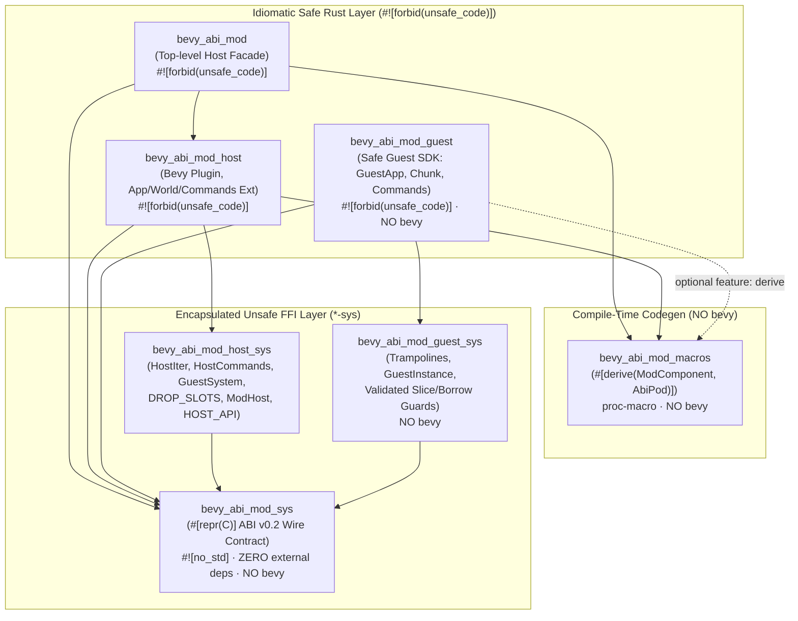

# ADR 0006: Unsafe `-sys` FFI Layer vs. `#![forbid(unsafe_code)]` Safe Rust Crate Architecture

- **Status:** Accepted
- **Date:** 2026-11-11
- **Tracking Items:** `N-01`, `H-05`, `S-01`, `S-02`, `S-03`, `G-04`, `D-02`
- **Target Crates:** Workspace-wide (`crates/bevy_abi_mod*`)

---

## 1. Context & Problem Statement

In v0.1, the workspace consisted of four crates (`abi_contract`, `mod_derive`, `host_runtime`, `guest_sdk`):

1. **Unbounded `unsafe` audit surface:** `host_runtime` mixed raw `UnsafeWorldCell` pointer arithmetic, `OwningPtr` construction, `libloading` `dlsym` casts, and `extern "C"` callbacks in the same crate as high-level Bevy `Plugin`, `App` extensions, and `SystemSet` types. Similarly, `guest_sdk` mixed `extern "C"` trampolines and `slice::from_raw_parts_mut` inside high-level user iterator types (`Chunk`, `SystemContext`). Neither public crate could enforce `#![forbid(unsafe_code)]`.
2. **Soundness gaps in safe guest APIs (`S-01`, `S-02`, `S-03`):**
   - `Chunk::components::<u64>(col)` in safe Rust trusted `size` and `align` without verifying component `ComponentUuid` (`S-01`, `C-13`), enabling safe-Rust type confusion (`f64` -> `NonZeroU64` / pointer-like bit patterns).
   - `Chunk::components_mut::<T>(0)` took `&self` instead of tracking per-column dynamic borrows, allowing safe guest code to obtain two simultaneous `&mut [T]` slices to the same column (`S-02` — immediate aliasing UB!).
   - Safe `MultiQueryContext` / `GuestChunkIter::reset` allowed re-entering or advancing an iterator while a `ChunkSlice` from the previous chunk was still alive (`S-03`).
3. **Leaked FFI internals in public rustdoc (`H-05`, `G-04`):** `host_runtime` publicly exported `host_*` C functions, `HostChunkIter`, `CURRENT_REGISTRY`, and `GLOBAL_SYMBOLS`, while `guest_sdk` duplicated raw command `extern "C" fn` typedefs instead of sharing them from the ABI crate (`G-04`).

---

## 2. Decision: 7-Crate Layered Workspace Architecture

We split the workspace into **seven crates** along two orthogonal axes:
1. **Role / Dependency Isolation:** Shared `#![no_std]` wire contract (`_sys`) vs. Host (`bevy_ecs`/`bevy_app`) vs. Guest (**zero** `bevy*` dependencies).
2. **Safety Boundary:** Low-level `*-sys` crates that encapsulate 100% of `unsafe` FFI and raw pointer invariants vs. high-level idiomatic Rust crates enforcing **`#![forbid(unsafe_code)]`**.

### 2.1 Dependency & Safety Graph



---

### 2.2 Per-Crate Responsibilities, Allowed Dependencies & Safety Contracts

| Crate | `#![no_std]` | `#![forbid(unsafe_code)]` | `bevy*` Allowed? | Allowed Dependencies & Core Responsibility |
|---|---|---|---|---|
| **`bevy_abi_mod_sys`** | **Yes** | No (`unsafe trait`, `FfiSlice::as_slice`, `read_extensible_struct`) | **NEVER** | **Zero external dependencies.** Pure `#[repr(C)]` ABI v0.2 types (`BamManifest`, `BamHostApi`, `BamSystemDesc`, `BamQueryDesc`, `BamTermDesc`, `ComponentDesc`, `BamColumnInfo`, `VTableHeader`), `FfiResult`, `FfiBool`, `FfiEntity`, `BamComponent`, `ComponentUuid`, `ExtensibleStruct`, and `unsafe` traits `AbiPod` + `RawInsertable`. |
| **`bevy_abi_mod_macros`** | N/A (`proc-macro`) | Yes (proc-macro host code uses zero `unsafe`) | **NEVER** | `syn`, `quote`, `proc-macro2`, `proc-macro-crate`. Implements `#[derive(ModComponent)]` (host component VTable + raw ops codegen) and `#[derive(AbiPod)]` (shared by both host and guest via zero-Bevy dependency!). |
| **`bevy_abi_mod_host_sys`** | No (`std`) | No (100% of host `unsafe` lives here; `#![deny(unsafe_op_in_unsafe_fn)]`) | **Yes** (`bevy_ecs`, `bevy_app`) | `bevy_ecs`, `bevy_app`, `libloading`, `arc-swap`, `tracing`, `bevy_abi_mod_sys`. Implements `HOST_API` (`extern "C"` functions), `HostIter` (`UnsafeWorldCell` dense/sparse chunk iteration), `HostCommands` (`CommandArena`, `OwningPtr`), `GuestSystem` (`System` impl, `FilteredAccessSet`), `DROP_SLOTS` (`ADR 0001`), `ModRegistry` (`ADR 0003`), and `ModHost` (`ADR 0005`). Exposes **safe** soundness-encapsulated functions to `bevy_abi_mod_host`. |
| **`bevy_abi_mod_host`** | No (`std`) | **YES (`#![forbid(unsafe_code)]`)** | **Yes** (`bevy_ecs`, `bevy_app`) | `bevy_app`, `bevy_ecs`, `bevy_abi_mod_host_sys`, `bevy_abi_mod_sys`, `bevy_abi_mod_macros`. Public Bevy plugin (`AbiModPlugin`, `ConfiguredAbiModPlugin`), `ModAppExt`, `ModWorldExt`, `ModCommandsExt`, lifecycle `Message`s (`ModLoaded`, `ModUnloaded`, `ModSystemFaulted`), `ModNamedSystemSet`, `ModSystemSet`, `LoadOptions`, `ModErrorPolicy`, and `prelude`. |
| **`bevy_abi_mod`** | No (`std`) | **YES (`#![forbid(unsafe_code)]`)** | **Yes** (via `bevy_abi_mod_host`) | `bevy_abi_mod_host`, `bevy_abi_mod_macros`, `bevy_abi_mod_sys`. Single Cargo dependency for Bevy host applications (`use bevy_abi_mod::prelude::*;`). |
| **`bevy_abi_mod_guest_sys`** | No (`std`) | No (100% of guest `unsafe` lives here; `#![deny(unsafe_op_in_unsafe_fn)]`) | **NEVER** | **Depends ONLY on `bevy_abi_mod_sys`.** Implements `GuestInstance` (`ADR 0005`), `catch_guest_*` (`ADR 0004`), `extern "C"` init/shutdown/system/run_if/drop trampolines, validated column slice/row materialization, dynamic borrow-tracking cells, and raw command/resource FFI wrappers. |
| **`bevy_abi_mod_guest`** | No (`std`) | **YES (`#![forbid(unsafe_code)]` in Wave 1 `S-01..S-03`)** | **NEVER** | `bevy_abi_mod_guest_sys`, `bevy_abi_mod_sys`, optional `bevy_abi_mod_macros` (`derive` feature). Safe idiomatic Rust guest SDK: `GuestPlugin`, `GuestApp`, `SystemBuilder`, `SystemContext`, `ChunkIter`, `Chunk`, `ChunkSlice<'a, T>`, `ChunkSliceMut<'a, T>`, `GuestCommands`, `GuestComponent`, `export_mod!`, and `prelude`. |

---

### 2.3 Key Boundary Design Patterns

#### 1. Safe Registration Bridge Between `bevy_abi_mod_host` and `bevy_abi_mod_host_sys`
Because `bevy_abi_mod_host` enforces `#![forbid(unsafe_code)]`, it cannot write `unsafe { ... }` blocks when registering host components or unloading mods. Instead, `bevy_abi_mod_host_sys` exposes safe entry points whose soundness preconditions are discharged by Rust's type system:

```rust
// In `bevy_abi_mod_host_sys`:
/// Implemented by `#[derive(ModComponent)]` (generated code lives in the user's crate or
/// invokes `bevy_abi_mod_host_sys::ComponentRegistration::for_pod::<Self>()`).
pub trait ModComponent: bevy_ecs::component::Component + RawInsertable + Default {
    const CANONICAL_NAME: &'static str;
    const UUID: ComponentUuid;
    fn vtable_ptr() -> Option<(&'static str, *const core::ffi::c_void)>;
}

pub fn register_host_component<T: ModComponent>(world: &mut bevy_ecs::world::World);
pub fn register_host_resource<R: bevy_ecs::resource::Resource + RawInsertable>(
    world: &mut bevy_ecs::world::World,
    canonical_name: &'static str,
    uuid: ComponentUuid,
);
pub fn load_mod_into_world(
    world: &mut bevy_ecs::world::World,
    path: &std::path::Path,
    options: &LoadOptions,
) -> Result<ModId, ModLoadError>;
pub fn unload_mod_from_world(
    world: &mut bevy_ecs::world::World,
    id: ModId,
) -> Result<LoadedModInfo, ModLoadError>;
```

`bevy_abi_mod_host`'s `ModAppExt`, `ModWorldExt`, and `ModCommandsExt` call these functions in 100% safe Rust.

#### 2. Closing the Safe-Rust Soundness Loops in `bevy_abi_mod_guest_sys` (`S-01`, `S-02`, `S-03`)
To enforce `#![forbid(unsafe_code)]` on `bevy_abi_mod_guest` truthfully (not merely hiding unsound casts inside `bevy_abi_mod_guest_sys`!), `bevy_abi_mod_guest_sys` enforces three runtime + lifetime invariants before returning any safe reference:

1. **UUID & Layout Verification (`S-01`, `C-13`):**
   `ValidatedQueryIter` queries `iter_column_info(iter, term_idx, &mut info)` once when the query starts (cached across chunks for the run) and verifies `info.uuid == T::UUID && info.size == size_of::<T>() && info.align == align_of::<T>()` where `T: AbiPod + GuestComponent`. Mismatches return `None` / `Err(FfiResult::TYPE_MISMATCH)` before `slice::from_raw_parts` is ever called.
2. **Per-Column Dynamic Borrow Tracking (`S-02`):**
   `RawChunkHandle<'iter>` maintains a stack `[ColumnBorrowState; MAX_TERMS_PER_QUERY]` (`Unused | Shared(u16) | Exclusive`, analogous to `RefCell` flags over `0..32` terms). Requesting `column_mut::<T>(0)` twice on the same `Chunk` panics deterministically (caught by `catch_guest_result` -> `FfiResult::PANIC_CAUGHT`) or returns `Err(BorrowError)` on `try_column_mut`, preventing `&mut [T]` aliasing UB in safe Rust!
3. **Lifetime-Bound Chunk Exclusivity (`S-03`):**
   `ChunkIter::next_chunk(&mut self) -> Option<Chunk<'_>>` and `ChunkIter::reset(&mut self)` take **`&mut self`**, and `SystemContext::query(&mut self, idx)` borrows the query slot exclusively (or tracks active borrows via `Cell` flags across distinct query indices `q0 != q1`), making it a compile-time borrow-checker error in safe Rust to hold a `ChunkSlice<'chunk, T>` across `next_chunk()` or `reset()`.

#### 3. Explicit Native DLL Trust Model (`D-02`)
`#![forbid(unsafe_code)]` in `bevy_abi_mod_host` and `bevy_abi_mod_guest` guarantees:
- **Guest guarantee:** A Rust mod author writing safe Rust against `bevy_abi_mod_guest` (with a compliant host) cannot trigger Undefined Behavior through the SDK API.
- **Host guarantee:** A host game author writing safe Rust against `bevy_abi_mod` cannot violate Bevy's borrow rules, `dlclose` invariants, or pointer provenance through the host API — **given a non-malicious ABI-compliant shared library**.
- **Explicit non-goal (`D-02`):** Loading a native `.dll`/`.so`/`.dylib` maps executable machine code directly into the host OS process (`LoadLibraryW` / `dlopen`). `load_mod` is intentionally ergonomic (safe signature, matching `bevy_asset` plugin ergonomics) rather than `unsafe fn`, and its rustdoc prominently documents that native mods are **trusted in-process native code** (not a security sandbox against untrusted/malicious binaries; use OS sandboxing or Wasm for untrusted network-downloaded code).

---

## 3. Visibility & Export Rules (`H-05`)

1. **No leaked FFI functions:** All `extern "C" fn host_*` bridge functions inside `bevy_abi_mod_host_sys` are `pub(crate)` and reachable externally **only** via the static `HOST_API: BamHostApi` table passed to `bevy_abi_mod_init`.
2. **Test utilities gated:** Any internal white-box inspection helpers (such as drop-slot pool active counts for `L-06` leak tests) live behind `#[cfg(any(test, feature = "test-utils"))]` on `bevy_abi_mod_host_sys` — never as `#[doc(hidden)] pub` items on `bevy_abi_mod_host` or `bevy_abi_mod`.
3. **Macro hygiene (`M-02`):** `bevy_abi_mod_macros` resolves crate paths (`::bevy_abi_mod_sys` / `::bevy_abi_mod` / `::bevy_abi_mod_guest`) via `proc-macro-crate` with deterministic fallback and prefixes all generated hidden statics/types with `__bam_` to avoid colliding with user identifiers.

---

## 4. Alternatives Considered

| Alternative | Why Rejected |
|---|---|
| **Keep 4 Crates and Use Internal `mod sys` Submodules** | `#![forbid(unsafe_code)]` is a crate-level guarantee; submodule `#[allow(unsafe_code)]` can be accidentally weakened anywhere in the crate, and Cargo cannot enforce dependency-level isolation (`cargo public-api` / `cargo geiger`) within a single crate. |
| **Separate `bevy_abi_mod_host_macros` and `bevy_abi_mod_guest_macros`** | Unnecessary crate proliferation: keeping `bevy_abi_mod_macros` completely free of `bevy*` dependencies lets both host (`ModComponent`, `AbiPod`) and guest (`AbiPod`) share a single fast-compiling proc-macro crate. |
| **Mark `ModWorldExt::load_mod` as `unsafe fn`** | Forces `#![allow(unsafe_code)]` into every Bevy game crate that uses `bevy_abi_mod`, defeating `#![forbid(unsafe_code)]` in user gameplay code without adding meaningful safety checks at the call site (`D-02`). |

---

## 5. Consequences & Verification Criteria

1. **Zero-Bevy CI Gate (`CI-01`):**
   ```bash
   test -z "$(cargo tree -p bevy_abi_mod_sys -p bevy_abi_mod_guest_sys -p bevy_abi_mod_guest -p bevy_abi_mod_macros | grep -i bevy)"
   ```
   MUST pass on every PR.
2. **`#![no_std]` Target Check (`CI-01`):**
   ```bash
   cargo check -p bevy_abi_mod_sys --target thumbv7em-none-eabihf
   ```
   verifies zero accidental `std` or `alloc` leakage in the wire contract crate.
3. **`#![forbid(unsafe_code)]` Enforcement:**
   - Wave 0b+: `crates/bevy_abi_mod_host/src/lib.rs` and `crates/bevy_abi_mod/src/lib.rs` contain `#![forbid(unsafe_code)]` at line 1.
   - Wave 1 (`S-01..S-03`): `crates/bevy_abi_mod_guest/src/lib.rs` contains `#![forbid(unsafe_code)]` at line 1.
4. **Public API Audit (`H-05`):** `cargo public-api -p bevy_abi_mod -p bevy_abi_mod_host -p bevy_abi_mod_guest` contains zero raw `host_*` FFI functions and zero `#[doc(hidden)] pub` test hooks.
