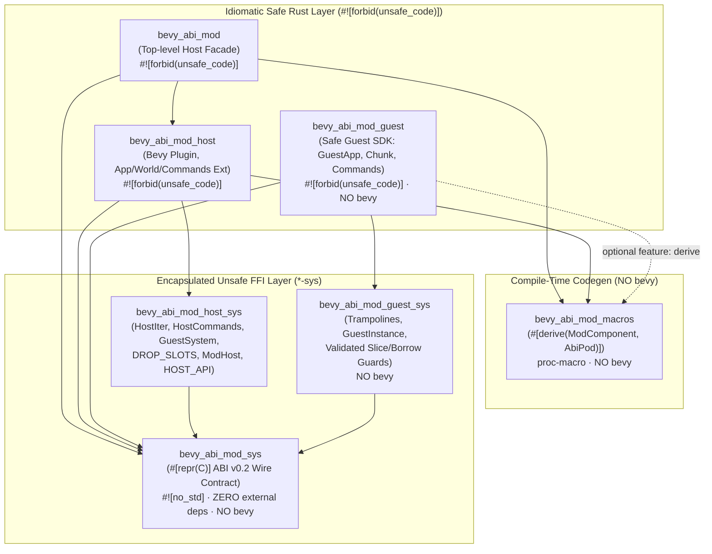

# ADR 0006: Unsafe `-sys` FFI Layer vs. `#![forbid(unsafe_code)]` Safe Rust Crate Architecture

- **Status:** Accepted
- **Date:** 2026-11-11
- **Target Crates:** Workspace-wide (`crates/bevy_abi_mod*`)

---

## 1. Context & Problem Statement

In v0.1, the workspace consisted of four crates (`abi_contract`, `mod_derive`, `host_runtime`, `guest_sdk`):

1. **Unbounded `unsafe` audit surface:** `host_runtime` mixed raw `UnsafeWorldCell` pointer arithmetic, `OwningPtr` construction, `libloading` `dlsym` casts, and `extern "C"` callbacks in the same crate as high-level Bevy `Plugin`, `App` extensions, and `SystemSet` types. Similarly, `guest_sdk` mixed `extern "C"` trampolines and `slice::from_raw_parts_mut` inside high-level user iterator types (`Chunk`, `SystemContext`). Neither public crate could enforce `#![forbid(unsafe_code)]`.
2. **Soundness gaps in safe guest APIs:**
   - **Safe constructors over raw pointers:** Public `pub fn` constructors (`GuestChunkIter::new` / `with_reset` / `with_bridges`, `GuestCommandQueue::new` / `with_ext`, `ChunkSlice::new`, `ChunkSliceMut::new`) stored caller-supplied raw pointers in safe Rust that subsequent safe methods dereferenced (`ChunkSlice::new(0x1234 as _, 4, 1).as_typed_slice::<u32>()` -> immediate UB in 100% safe Rust).
   - **Caller-supplied `count` on safe iterator slice methods:** Safe `GuestChunkIter` methods (`entities_slice(count)`, `readonly_slice(index, count)`, `mutable_slice(index, count)`, `split_slices(.., count)`, `columns_mut`, `read_write`, `write_2`, `optional_*`) trusted an unvalidated caller-provided `count`, allowing safe code to materialize out-of-bounds slices (`1 << 20` elements over a 3-entity chunk).
   - **`T: Copy` bounds instead of `T: AbiPod`:** Typed views (`ChunkSlice::as_typed_slice`, `ChunkSliceMut::as_typed_slice` / `into_typed_slice`, `Chunk::column`, `read_write`), `resource<R>`, and `insert_slice` / `insert_value` / `insert_runtime_component` bounded `T: Copy` rather than `T: AbiPod`, allowing `bool`, `char`, `NonZeroU32`, `&'static T`, and fieldless enums to be constructed from arbitrary host bytes in safe Rust.
3. **Leaked FFI internals in public rustdoc:** `host_runtime` publicly exported `host_*` C functions, `HostChunkIter`, `CURRENT_REGISTRY`, and `GLOBAL_SYMBOLS`, while `guest_sdk` duplicated raw command `extern "C" fn` typedefs instead of sharing them from the ABI crate.

---

## 2. Decision: 7-Crate Layered Workspace Architecture

We split the workspace into **seven crates** along two orthogonal axes:
1. **Role / Dependency Isolation:** Shared `#![no_std]` wire contract (`_sys`) vs. Host (`bevy_ecs`/`bevy_app`) vs. Guest (**zero** `bevy*` dependencies).
2. **Safety Boundary:** Low-level `*-sys` crates that encapsulate 100% of `unsafe` FFI and raw pointer invariants vs. high-level idiomatic Rust crates enforcing **`#![forbid(unsafe_code)]`**.

### 2.1 Dependency & Safety Graph



---

### 2.2 Per-Crate Responsibilities, Allowed Dependencies & Safety Contracts

| Crate | `#![no_std]` | `#![forbid(unsafe_code)]` | `bevy*` Allowed? | Allowed Dependencies & Core Responsibility |
|---|---|---|---|---|
| **`bevy_abi_mod_sys`** | **Yes** | No (`unsafe trait`, `FfiSlice::as_slice`, `read_extensible_struct`) | **NEVER** | **Zero external dependencies.** Pure `#[repr(C)]` ABI v0.2 types (`BamManifest`, `BamHostApi`, `BamSystemDesc`, `BamQueryDesc`, `BamTermDesc`, `ComponentDesc`, `BamColumnInfo`, `VTableHeader`), `FfiResult`, `FfiBool`, `FfiEntity`, `BamComponent`, `ComponentUuid`, `ExtensibleStruct`, safe metadata trait `ModComponent`, and `unsafe` traits `AbiPod` + `RawInsertable`. |
| **`bevy_abi_mod_macros`** | N/A (`proc-macro`) | Yes (proc-macro host code uses zero `unsafe`) | **NEVER** | `syn`, `quote`, `proc-macro2`, `proc-macro-crate`. Implements `#[derive(ModComponent)]` (host component VTable + raw ops codegen) and `#[derive(AbiPod)]` (shared by both host and guest via zero-Bevy dependency!). |
| **`bevy_abi_mod_host_sys`** | No (`std`) | No (100% of host `unsafe` lives here; `#![deny(unsafe_op_in_unsafe_fn)]`) | **Yes** (`bevy_ecs`, `bevy_app`) | `bevy_ecs`, `bevy_app`, `libloading`, `arc-swap`, `tracing`, `bevy_abi_mod_sys`. Implements `HOST_API` (`extern "C"` functions), `HostIter` (`UnsafeWorldCell` dense/sparse chunk iteration), `HostCommands` (`CommandArena`, `OwningPtr`), `GuestSystem` (`System` impl, `FilteredAccessSet`), `DROP_SLOTS` (`ADR 0001`), `ModRegistry` (`ADR 0003`), and `ModHost` (`ADR 0005`). Exposes **safe** soundness-encapsulated functions to `bevy_abi_mod_host`. |
| **`bevy_abi_mod_host`** | No (`std`) | **YES (`#![forbid(unsafe_code)]`)** | **Yes** (`bevy_ecs`, `bevy_app`) | `bevy_app`, `bevy_ecs`, `bevy_abi_mod_host_sys`, `bevy_abi_mod_sys`, `bevy_abi_mod_macros`. Public Bevy plugin (`AbiModPlugin`, `ConfiguredAbiModPlugin`), `ModAppExt`, `ModWorldExt`, `ModCommandsExt`, lifecycle `Message`s (`ModLoaded`, `ModUnloaded`, `ModSystemFaulted`), `ModNamedSystemSet`, `ModSystemSet`, `LoadOptions`, `ModErrorPolicy`, and `prelude`. |
| **`bevy_abi_mod`** | No (`std`) | **YES (`#![forbid(unsafe_code)]`)** | **Yes** (via `bevy_abi_mod_host`) | `bevy_abi_mod_host`, `bevy_abi_mod_macros`, `bevy_abi_mod_sys`. Single Cargo dependency for Bevy host applications (`use bevy_abi_mod::prelude::*;`). |
| **`bevy_abi_mod_guest_sys`** | No (`std`) | No (100% of guest `unsafe` lives here; `#![deny(unsafe_op_in_unsafe_fn)]`) | **NEVER** | **Depends ONLY on `bevy_abi_mod_sys`.** Implements `GuestInstance` (`ADR 0005`), `catch_guest_*` (`ADR 0004`), `extern "C"` init/shutdown/system/run_if/drop trampolines, validated column slice/row materialization, dynamic borrow-tracking cells, and raw command/resource FFI wrappers. |
| **`bevy_abi_mod_guest`** | No (`std`) | **YES (`#![forbid(unsafe_code)]`)** | **NEVER** | `bevy_abi_mod_guest_sys`, `bevy_abi_mod_sys`, optional `bevy_abi_mod_macros` (`derive` feature). Safe idiomatic Rust guest SDK: `GuestPlugin`, `GuestApp`, `SystemBuilder`, `SystemContext`, `ChunkIter`, `Chunk`, `ChunkSlice<'a, T>`, `ChunkSliceMut<'a, T>`, `GuestCommands`, `GuestComponent`, `export_mod!`, and `prelude`. |

---

### 2.3 Key Boundary Design Patterns

#### 1. `ModComponent` Placement in `bevy_abi_mod_sys` & Safe Host Registration Bridge
`ModComponent` (replacing `ExposableComponent`) lives in **`bevy_abi_mod_sys`** with `: Sized + 'static` — **not** in `bevy_abi_mod_host_sys` and **without** `bevy_ecs::component::Component`, `RawInsertable`, or `Default` supertraits:
- Components containing `String`, `Vec<T>`, `bool`, `#[mod_field(skip)]`, or `#[mod_component(opaque)]` are **not** `RawInsertable` (`IS_ABI_POD = false`, `IS_RAW_INSERTABLE = false`), yet must still expose VTable accessors via `#[derive(ModComponent)]`.
- `Default` is strictly optional (`ComponentOptions::with_default()` ).
- Nested non-ECS sub-structs and `bevy_abi_mod_macros` remain 100% Bevy-free.

Because `bevy_abi_mod_host` enforces `#![forbid(unsafe_code)]`, `bevy_abi_mod_host_sys` exposes safe registration and lifecycle functions whose soundness preconditions are discharged by trait bounds only on the specific capability being enabled:

```rust
// In `bevy_abi_mod_sys` (zero Bevy dependencies):
pub trait ModComponent: Sized + 'static {
    const CANONICAL_NAME: &'static str;
    const COMPONENT_CSTR: &'static core::ffi::CStr;
    const UUID: ComponentUuid;
    const IS_ABI_POD: bool = false;
    const IS_RAW_INSERTABLE: bool = false;
    type VTable: Copy + 'static;
    fn vtable() -> &'static Self::VTable;
    fn symbols() -> &'static [SymbolEntry];
}

// In `bevy_abi_mod_host_sys` (bounds `Component + ModComponent`; `RawInsertable` / `Default`
// are required ONLY on the opt-in `ComponentOptions` capability builders):
pub struct ComponentOptions<T> { /* ... */ }
impl<T: bevy_ecs::component::Component + ModComponent> ComponentOptions<T> {
    pub const fn new() -> Self { /* VTable / opaque / marker registration */ }
    pub fn with_raw_insert(self) -> Self where T: RawInsertable { /* enables cmd_insert / cmd_spawn */ }
    pub fn with_default(self) -> Self where T: Default { /* enables cmd_insert_default */ }
}

pub fn register_host_component<T: bevy_ecs::component::Component + ModComponent>(
    world: &mut bevy_ecs::world::World,
    options: ComponentOptions<T>,
) -> Result<BamComponent, ModLoadError>;
pub fn load_mod_into_world(
    world: &mut bevy_ecs::world::World,
    path: &std::path::Path,
    options: &LoadOptions,
) -> Result<ModId, ModLoadError>;
pub fn unload_mod_from_world(
    world: &mut bevy_ecs::world::World,
    id: ModId,
) -> Result<LoadedModInfo, ModLoadError>;
```

`bevy_abi_mod_host`'s `ModAppExt`, `ModWorldExt`, and `ModCommandsExt` call these functions in 100% safe Rust.

#### 2. Closing the Safe-Rust Soundness Loops Across `bevy_abi_mod_guest_sys` & `bevy_abi_mod_guest`
To enforce `#![forbid(unsafe_code)]` on `bevy_abi_mod_guest` truthfully (not merely moving unsound functions into `bevy_abi_mod_guest_sys`), the guest boundary enforces:

1. **Raw Pointer Constructors Restricted to `unsafe` / `-sys`:**
   Every constructor over raw FFI pointers (`ChunkIter`, `GuestCommands`, `ChunkSlice`, `ChunkSliceMut`) is `pub unsafe fn` (with `# Safety` invariants) inside `bevy_abi_mod_guest_sys` (or `pub(crate)` internal). `SystemContext` and `MultiQueryContext` constructed by the `bevy_abi_mod_guest_sys` system trampoline are the **only** safe entry points in `bevy_abi_mod_guest` (`grep "pub fn .*\*(const|mut)" crates/bevy_abi_mod_guest/src` returns empty).
2. **Iterator-Tracked `current_len` Replacing Caller `count`:**
   `ChunkIter` tracks `current_len: usize` internally — populated from `iter_next_chunk` and reset to `0` on `reset()` and exhaustion. Every `count` parameter is removed from safe slice/column methods (any explicit-count raw escape hatch lives in `bevy_abi_mod_guest_sys` as `pub unsafe fn *_unchecked`).
3. **Strict `T: AbiPod` Bounds:**
   Every typed column slice (`ChunkSlice::as_typed_slice`, `ChunkSliceMut::as_typed_slice` / `into_typed_slice`, `Chunk::column`, `read_write`), `resource<R>`, and raw command insertion method (`insert_slice`, `insert_value`, `insert_runtime_component`) replaces `T: Copy` with `T: AbiPod`. `GuestComponent` requires `: AbiPod`, and `bevy_abi_mod_guest`'s optional `derive` feature re-exports `bevy_abi_mod_macros::AbiPod` so `chunk.column::<bool>(0)` fails at compile time.
4. **Runtime UUID Introspection & Aliasing Guards:**
   `iter_column_info(iter, term_idx, &mut info)` additionally checks `info.uuid == T::UUID && info.size == size_of::<T>() && info.align == align_of::<T>()` when `T: GuestComponent` (returning `None` on component type confusion), while `&mut self` chunk progression and disjoint column borrow checks prevent aliasing `&mut [T]` slices.

#### 3. Explicit Native DLL Trust Model
`#![forbid(unsafe_code)]` in `bevy_abi_mod_host` and `bevy_abi_mod_guest` guarantees:
- **Guest guarantee:** A Rust mod author writing safe Rust against `bevy_abi_mod_guest` (with a compliant host) cannot trigger Undefined Behavior through the SDK API.
- **Host guarantee:** A host game author writing safe Rust against `bevy_abi_mod` cannot violate Bevy's borrow rules, `dlclose` invariants, or pointer provenance through the host API — **given a non-malicious ABI-compliant shared library**.
- **Explicit non-goal:** Loading a native `.dll`/`.so`/`.dylib` maps executable machine code directly into the host OS process (`LoadLibraryW` / `dlopen`). `load_mod` is intentionally ergonomic (safe signature, matching `bevy_asset` plugin ergonomics) rather than `unsafe fn`, and its rustdoc prominently documents that native mods are **trusted in-process native code** (not a security sandbox against untrusted/malicious binaries; use OS sandboxing or Wasm for untrusted network-downloaded code).

---

## 3. Visibility & Export Rules

1. **No leaked FFI functions:** All `extern "C" fn host_*` bridge functions inside `bevy_abi_mod_host_sys` are `pub(crate)` and reachable externally **only** via the static `HOST_API: BamHostApi` table passed to `bevy_abi_mod_init`.
2. **Test utilities gated:** Any internal white-box inspection helpers (such as drop-slot pool active counts leak tests) live behind `#[cfg(any(test, feature = "test-utils"))]` on `bevy_abi_mod_host_sys` — never as `#[doc(hidden)] pub` items on `bevy_abi_mod_host` or `bevy_abi_mod`.
3. **Macro hygiene:** `bevy_abi_mod_macros` resolves crate paths (`::bevy_abi_mod_sys` / `::bevy_abi_mod` / `::bevy_abi_mod_guest`) via `proc-macro-crate` with deterministic fallback and prefixes all generated hidden statics/types with `__bam_` to avoid colliding with user identifiers.

---

## 4. Alternatives Considered

| Alternative | Why Rejected |
|---|---|
| **Keep 4 Crates and Use Internal `mod sys` Submodules** | `#![forbid(unsafe_code)]` is a crate-level guarantee; submodule `#[allow(unsafe_code)]` can be accidentally weakened anywhere in the crate, and Cargo cannot enforce dependency-level isolation (`cargo public-api` / `cargo geiger`) within a single crate. |
| **Separate `bevy_abi_mod_host_macros` and `bevy_abi_mod_guest_macros`** | Unnecessary crate proliferation: keeping `bevy_abi_mod_macros` completely free of `bevy*` dependencies lets both host (`ModComponent`, `AbiPod`) and guest (`AbiPod`) share a single fast-compiling proc-macro crate. |
| **Mark `ModWorldExt::load_mod` as `unsafe fn`** | Forces `#![allow(unsafe_code)]` into every Bevy game crate that uses `bevy_abi_mod`, defeating `#![forbid(unsafe_code)]` in user gameplay code without adding meaningful safety checks at the call site. |

---

## 5. Consequences & Verification Criteria

1. **Zero-Bevy CI Gate:**
   ```bash
   test -z "$(cargo tree -p bevy_abi_mod_sys -p bevy_abi_mod_guest_sys -p bevy_abi_mod_guest -p bevy_abi_mod_macros | grep -i bevy)"
   ```
   MUST pass on every PR.
2. **`#![no_std]` Target Check:**
   ```bash
   cargo check -p bevy_abi_mod_sys --target thumbv7em-none-eabihf
   ```
   verifies zero accidental `std` or `alloc` leakage in the wire contract crate.
3. **`#![forbid(unsafe_code)]` Enforcement:**
   - Host crates: `crates/bevy_abi_mod_host/src/lib.rs` and `crates/bevy_abi_mod/src/lib.rs` contain `#![forbid(unsafe_code)]` at line 1.
   - Guest SDK crate: `crates/bevy_abi_mod_guest/src/lib.rs` contains `#![forbid(unsafe_code)]` at line 1.
4. **Public API Audit:** `cargo public-api -p bevy_abi_mod -p bevy_abi_mod_host -p bevy_abi_mod_guest` contains zero raw `host_*` FFI functions and zero `#[doc(hidden)] pub` test hooks.
