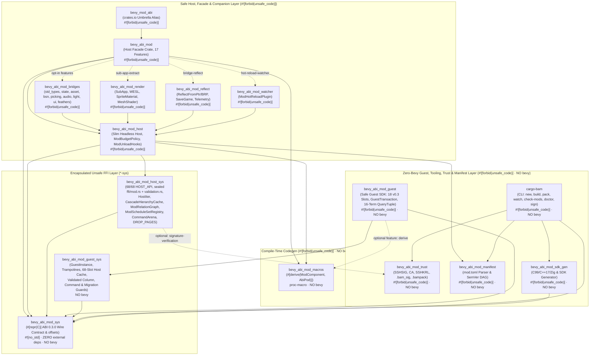

# Specification: `bevy_abi_mod` (`ABI 0.3.0`)
**Asymmetric, Zero-Serialization C-ABI Modding Framework for Bevy ECS (`v0.20+`)**

---

## 1. Vision, Scope & Threat Model

### 1.1 The Problem Space
Dynamically loading native shared libraries (`.so`, `.dylib`, `.dll`) into a Bevy Engine (`v0.20+`) application at runtime must navigate three fundamental systems constraints:
1. **Rust ABI Instability:** Rust intentionally provides no stable cross-compiler ABI. Differences in `rustc` versions, optimization levels, target features, or standard library revisions alter `#[repr(Rust)]` struct layouts, calling conventions, vtable layouts, and symbol mangling.
2. **Allocator Isolation:** Native dynamic libraries link independent heap allocators (for example, Windows per-DLL `HeapAlloc`, `mimalloc`, `jemalloc`, or `libc` `malloc`). Freeing guest-allocated memory on the host allocator—or vice versa—corrupts process heaps.
3. **Frame-Budget Throughput:** Serializing ECS archetype tables to JSON, MessagePack, or Bincode on every frame destroys cache locality and 60/120 Hz frame budgets.

### 1.2 Architectural Approach
`bevy_abi_mod` defines an **asymmetric, zero-serialization `extern "C"` wire contract (`ABI 0.3.0`, `0x0003_0000`)** between a Bevy host and native guest mods written in Rust, ISO C99, C++17/20, or Zig:
1. **Zero Shared Rust ABI Assumptions:** Every wire structure is `#[repr(C)]` or `#[repr(transparent)]` with zero implicit padding, verified at compile time on 64-bit and 32-bit targets in both Rust (`offset_of!`) and ISO C99 (`BAM_STATIC_ASSERT` in `include/bevy_abi_mod.h`).
2. **Versioned Table Handshake & Pre-Resolved Handles:** On load, the host validates the guest's `BamManifest` and passes a self-describing 68-slot `BamHostApi` table (`MIN_V0_2_SIZE = 224` B / `MIN_V0_3_SIZE = size_of = 552` B on 64-bit; `116` B / `280` B on 32-bit) alongside a transactional `BamLoadCtx`. Components, resources, messages, events, assets, and scenes resolve once into 1-based `BamComponent(u32)` handles so per-frame iteration, resource/tick/message operations, random entity/hierarchy lookups, observers, and deferred commands perform zero string parsing or hashing.
3. **Direct Archetype & Sparse-Set Iteration:** Host `Table` columns are exposed directly as contiguous SoA byte slices (and `SparseSet` columns as batched per-row pointer arrays) without copying component payloads.
4. **First-Class Bevy Scheduler Concurrency:** Each registered mod system runs inside a native Bevy `System` (`GuestSystem`) that populates `FilteredAccessSet` read/write locks from pre-resolved `ComponentId`s, allowing Bevy's multi-threaded executor to schedule non-conflicting mod and host systems in parallel.
5. **Per-World Instance Isolation & Deterministic Unloading:** Mods export `bevy_abi_mod_manifest`, `bevy_abi_mod_init(..., &mut instance_out)`, and `bevy_abi_mod_shutdown(instance)`. Each Bevy `World` owns an isolated `BamInstance*`, copy-on-write `ModRegistry` snapshot, transactional `LoadTransaction` rollback, shadow-copy loader support, and lock-free `ArcSwapOption` drop trampolines.

### 1.3 Threat Model & Native Trust Boundary
Native dynamic libraries loaded via `dlopen` / `LoadLibraryW` execute **in-process within the host's virtual address space and hold full operating-system privileges of the host process**. Accordingly:
- **Trusted Native Code:** Native mods are **fully trusted** once mapped. `bevy_abi_mod` is **not** a runtime instruction sandbox against untrusted binaries; malicious machine code in a loaded `.dll`/`.so`/`.dylib` can read arbitrary process memory or invoke arbitrary syscalls.
- **Optional Load-Time Cryptographic Verification (`signature-verification`):** When authenticity and binary integrity are required (e.g., shipping studio/partner DLC or curated official mods), the optional `signature-verification` Cargo feature authenticates every shared library **before** `dlopen` / `LoadLibraryW` using OpenSSH `PROTOCOL.sshsig` detached `.sig` sidecars verified against shipped Ed25519 Root CA public keys (`ssh-ed25519-cert-v01@openssh.com` certificates) or pinned Ed25519 public keys (`ModTrustPolicy`).
- **What `bevy_abi_mod` Isolates:** `bevy_abi_mod` isolates **Rust compiler ABI drift**, **heap allocator boundaries**, **ECS borrow/aliasing rules**, **cross-mod namespace/symbol collisions**, **unwinding panics in default Rust guests**, and **`dlclose` lifecycle hazards** across cooperative or buggy mods.
- **Untrusted User Content Guidance:** Games that accept untrusted user-submitted mods from arbitrary sources should execute untrusted logic inside a **WebAssembly (Wasm)** runtime or an OS-sandboxed out-of-process worker, reserving `bevy_abi_mod` for trusted or cryptographically verified native plugins and studio modules.

---

## 2. Sixteen-Crate Workspace Architecture (`-sys` vs. `#![forbid(unsafe_code)]`)

The workspace comprises **16 workspace crates** (15 library/umbrella crates plus the `cargo-bam` CLI, alongside the `xtask` automation crate). It separates low-level `unsafe` FFI machinery (`*-sys`) from 13 idiomatic `#![forbid(unsafe_code)]` crates, keeps `bevy_abi_mod_host` strictly slim and headless (zero `bevy_render`, `bevy_reflect`, `bevy_scene`, `bevy_asset`, or `notify` dependencies), and strictly keeps `bevy*` out of all wire, macro, trust, manifest, SDK-generator, guest, and CLI crates.

### 2.1 Dependency & Safety Graph



### 2.2 Crate Boundaries & Invariants

| Crate | `#![no_std]` | `#![forbid(unsafe_code)]` | `bevy*` Allowed | Responsibility & Allowed Dependencies |
|---|---|---|---|---|
| `crates/bevy_abi_mod_sys` | Yes | No (`unsafe trait`, `FfiSlice`, `ExtensibleStruct`) | **Never** | **Zero external dependencies.** Defines `ABI_VERSION` (`0.3.0`), `BamManifest`, 68-slot `BamHostApi`, `offsets` (`OFF64_*`/`OFF32_*`/native), `BamSystemDesc`, `BamObserverDesc`, `BamTriggerDesc`, `BamQueryDesc`, `BamTermDesc`, `ComponentDesc`, `BamFieldDesc`, `BamFieldKind`, `BamRequiredComponent`, `BamRelationDesc` (`BAM_RELATION_FLAG_*`), `BamLayoutInfo`, `BamRowMigrateFn`, `BamScheduleSetDesc` (`BAM_SCHEDULE_SET_FLAG_*`), `BamColumnInfo`, `VTableHeader`, `BamComponent`, `BamSystem`, `BamSystemSet`, `BamSymbol`, `ComponentUuid` (SipHash-2-4-128), `FfiResult` (incl. `CYCLE_DETECTED`), `FfiBool`, `FfiOption<T>`, `FfiEntity`, `FfiAssetHandle`, `ModComponent`, `AbiPod`, and `RawInsertable`. |
| `crates/bevy_abi_mod_macros` | N/A (`proc-macro`) | **Yes** | **Never** | `syn`, `quote`, `proc-macro2`, `proc-macro-crate`. Implements `#[derive(ModComponent)]` (hygienic VTable + `SCHEMA_FINGERPRINT` + `BAM_FIELDS` + `require(Comp = expr)` + witness schema + C/Zig codegen across structs, tuple structs, and `#[repr(i8..u64)]` enums) and `#[derive(AbiPod)]` (compile-time zero-padding verification). |
| `crates/bevy_abi_mod_trust` | No (`std`) | **Yes** | **Never** | Pure-Rust Ed25519 OpenSSH `SSHSIG`, CA certificate, `PROTOCOL.krl` (`SSHKRL`), `.bam_sig`, and deterministic binary `.bampack` verification engine (`ed25519-dalek`, `sha2`, `signature`, `ssh-encoding`, `ssh-key`, `thiserror`). |
| `crates/bevy_abi_mod_manifest` | No (`std`) | **Yes** | **Never** | `mod.toml` manifest parser, `ModDependencyGraph` SemVer DAG topological sorter, and mismatch/quarantine types (`bevy_abi_mod_sys`, `semver`, `serde`, `toml`). |
| `crates/bevy_abi_mod_sdk_gen` | No (`std`) | **Yes** | **Never** | Single-source ISO C99 (`include/bevy_abi_mod.h`), C++17 (`bevy_abi_mod.hpp`), Zig (`bevy_abi_mod.zig`), and component header generator (`BAM_EXPORT`, `BAM_RESTRICT`, `BAM_HOST_API_OFFSET_*`). Depends on `bevy_abi_mod_sys`. |
| `crates/bevy_abi_mod_host_sys` | No (`std`) | No (isolates all host `unsafe`) | Yes (core ECS) | `bevy_ecs`, `bevy_app`, `bevy_platform`, `bevy_tasks`, `libloading`, `arc-swap`, `thiserror`, `tracing`, `bevy_abi_mod_sys`, optional `bevy_abi_mod_trust` (`signature-verification`), optional `bevy_reflect` (`bridge-reflect`). Implements all 68/68 `HOST_API` slots, sealed `ffi/mod.rs` + `ffi/validation.rs`, `HostIter`, `CascadeHierarchyCache`, `HostCommands` (`CommandArena` quotas + checkpoints), `ModRelationGraph`, `ModScheduleSetRegistry` / `ModScheduleSetRewirePass`, `BamSymbolTable`, `ModNamedObjects`, `GuestSystem` + `FallbackErrorHandler`, `ModRegistry`, `ModHost`, `DROP_PAGES`, zero-copy reload & `migrate_component_column`, and `ModTrustPolicy`. |
| `crates/bevy_abi_mod_host` | No (`std`) | **Yes** | Yes (**headless only**) | Slim headless Bevy host (`bevy_app`, `bevy_ecs`, `bevy_platform`, optional `bevy_diagnostic`; **zero** `bevy_render`, `bevy_reflect`, `bevy_scene`, `bevy_asset`, or `notify` deps). Provides `AbiModPlugin`, `ModWorldExt`, `ModAppExt`, `ModCommandsExt`, `ModVisibleSets`, `ModUnloadHooks`, `ModBudgetPolicy` / `ModBudgetTelemetry` / `ModBudgetBreach`, `ModDependencyGraph` DAG loading, and `prelude`. |
| `crates/bevy_abi_mod_bridges` | No (`std`) | **Yes** | Yes (opt-in features) | Strictly opt-in Bevy `0.20` bridges (`default = []`): `std_types` + `Disabled`, dynamic `state` slabs (`SubStates` / `ComputedStates`), `asset` + `AssetOverlayPolicy`, `bsn`, `picking` + `input_ext`, `camera_light` (`PanOrbitCamera`, `SolariLighting`), `audio`, and `ui` + `feathers`. |
| `crates/bevy_abi_mod_render` | No (`std`) | **Yes** | Yes (render/material) | `ModSubAppPlugin<L>` cross-world `SubApp` extraction, `ModWeslMaterialPlugin` (`.wesl` shaders + `AlignedVec` `ShaderBuffer`), `ModSpriteMaterialPlugin` (2D `.wesl` `SpriteMaterial` / `ExtendedMaterial2d` & unified `Mesh2d`), and opt-in `ModMeshShaderPlugin` / `ModMeshShaderSubAppPlugin<L>`. |
| `crates/bevy_abi_mod_reflect` | No (`std`) | **Yes** | Yes (reflect/remote) | `ModReflectPlugin` (witness & declarative `BamFieldDesc` `ReflectFromPtr` + `bevy_abi_mod/*` & standard `world.*` BRP + `bevy-settings` TOML), `ModSaveGamePlugin` (`ModSaveArchive` JSON & `BAMSAVE1` binary), and `ModTelemetryPlugin` (`bam/*` BRP + 64-byte `SystemTelemetryDigest64` Unix/loopback stream). |
| `crates/bevy_abi_mod_watcher` | No (`std`) | **Yes** | Yes (`bevy_app`/`ecs`) | Debounced filesystem hot-reload watcher (`ModHotReloadPlugin`, `ModHotReloadWatcher`, `ModHotReloadHistory`) via `notify-debouncer-full` with cascading SemVer DAG reloads. |
| `crates/bevy_abi_mod` | No (`std`) | **Yes** | Yes (via features) | Top-level host facade re-exporting `bevy_abi_mod_host`, derives, `bevy_abi_mod_sys`, optional companion crates (17 opt-in features), and unified `prelude`. |
| `crates/bevy_mod_abi` | No (`std`) | **Yes** | Yes (via `bevy_abi_mod`) | `crates.io` umbrella alias matching `github.com/yaga-simha/bevy_mod_abi`, re-exporting `bevy_abi_mod::*`, `prelude`, and all 17 feature flags 1:1. |
| `crates/bevy_abi_mod_guest_sys` | No (`std`) | No (isolates all guest `unsafe`) | **Never** | Depends **only** on `bevy_abi_mod_sys`. Implements `GuestInstance`, `catch_guest_*` panic guards, `extern "C"` trampolines, all 68 `Host` API slot wrappers with `covers_slot` + `UNSUPPORTED` fallback, lock-free closure re-entrancy guards, and validated column/row/command/migration wrappers. |
| `crates/bevy_abi_mod_guest` | No (`std`) | **Yes** | **Never** | `bevy_abi_mod_guest_sys`, `bevy_abi_mod_sys`, optional `bevy_abi_mod_macros` (`derive`). Safe ergonomic Rust guest SDK covering all 18 ABI `0.3.0` slots: `GuestPlugin`, `GuestApp`, `SystemBuilder`, `ScheduleSetBuilder`, `RelationDescBuilder`, `ObserverBuilder`, `SystemContext`, `ChunkIter`, `Chunk`, `GuestCommands`, `GuestTransaction`, 16-term `QueryTuple`, `Or<(T0..T7)>`, `GuestComponent`, `GuestAssetServer`, `GuestStateBridge`, `GuestScene`, `guest_log!`, `export_mod!`, `raw`, and `prelude`. |
| `crates/cargo-bam` | No (`std`) | **Yes** | **Never** | `bevy_abi_mod_sys`, `bevy_abi_mod_trust`, `bevy_abi_mod_manifest`, `bevy_abi_mod_sdk_gen` plus pure-Rust CLI crates. Standalone developer CLI (`new`, `export-sdk`/`header`, `build`, `pack`, `watch`, `check-mods`, `doctor`, `keygen`, `sign`, `verify`). |

### 2.3 Repository Layout

```text
bevy_abi_mod/
├── Cargo.toml                  # Workspace definition (16 crates + xtask), shared lints, edition 2024
├── spec.md                     # Authoritative ABI 0.3.0 & bevy_bql lowering specification
├── CHANGELOG.md                # Release history (Keep a Changelog)
├── GEMINI.md                   # Engineering rules & Bevy 0.20 coding standards
├── include/
│   ├── bevy_abi_mod.h          # Single-source ISO C99 header generated by `bevy_abi_mod_sdk_gen` / `cargo xtask header`
│   └── generated/              # Component C headers generated by `cargo xtask gen-component-headers`
├── xtask/                      # Workspace automation (`header`, `gen-component-headers`, `fixtures`, `lint`, `ci`, `miri`, `bench`, `sign`)
├── docs/
│   ├── ARCHITECTURE.md         # Architecture & subsystem implementation guide
│   ├── BENCHMARKS.md           # Canonical benchmarks & deterministic regression gates
│   └── book/                   # Developer guide (mdBook)
├── crates/
│   ├── bevy_abi_mod_sys/       # #![no_std] zero-dependency ABI 0.3.0 wire contract & offsets
│   ├── bevy_abi_mod_macros/    # #[derive(ModComponent, AbiPod)]
│   ├── bevy_abi_mod_trust/     # Pure-Rust SSHSIG / CA / SSHKRL / .bam_sig / .bampack engine
│   ├── bevy_abi_mod_manifest/  # Pure-Rust mod.toml parser & SemVer DAG resolver
│   ├── bevy_abi_mod_sdk_gen/   # Single-source C99 / C++17 / Zig & SDK generator
│   ├── bevy_abi_mod_host_sys/  # Isolated unsafe host FFI engine (68/68 live slots)
│   ├── bevy_abi_mod_host/      # Slim headless safe Bevy host + ModBudgetPolicy + tests/{ffi,scheduling,lifecycle,e2e,mod_budgets}
│   ├── bevy_abi_mod_bridges/   # Opt-in Bevy 0.20 bridges (std_types, state, asset, bsn, picking, audio, light, ui, feathers)
│   ├── bevy_abi_mod_render/    # SubApp extraction, .wesl shaders, 2D/3D materials, & mesh shaders
│   ├── bevy_abi_mod_reflect/   # Dynamic reflection/BRP, ModSaveGamePlugin, & ModTelemetryPlugin
│   ├── bevy_abi_mod_watcher/   # Debounced ModHotReloadPlugin filesystem watcher
│   ├── bevy_abi_mod/           # Top-level host facade crate (17 optional features)
│   ├── bevy_mod_abi/           # crates.io umbrella alias matching github.com/yaga-simha/bevy_mod_abi
│   ├── bevy_abi_mod_guest_sys/ # Isolated unsafe guest runtime (zero Bevy deps)
│   ├── bevy_abi_mod_guest/     # Safe Rust guest SDK (zero Bevy deps, full ABI 0.3.0)
│   └── cargo-bam/              # Standalone modder CLI (`new`, `export-sdk`, `build`, `pack`, `watch`, `check-mods`, `doctor`, `keygen`, `sign`, `verify`)
├── fuzz/                       # LibFuzzer targets (`fuzz_sshsig_and_krl`, `fuzz_v03_relations`, `fuzz_bampack_manifest`, etc.)
├── tests/                      # Standalone C99 harness, `bql_wire_contract_test.rs`, `schedule_shuffle_fuzz.rs`, `soak_10k_reloads.rs`
└── examples/                   # Progressive Rust, C99, C++17, Zig, BQL parity, & Bevy 0.20 companion examples (01..10)
```

---

## 3. SemVer Policy, Extensibility & Safety Contracts

### 3.1 ABI SemVer Packing & Compatibility
ABI versions are packed into a 32-bit unsigned integer (`u32` / `uint32_t`) via `(major << 24) | (minor << 16) | patch`, with `const` range assertions (`major <= 255`, `minor <= 255`, `patch <= 65535`):
- Current contract version: `ABI_VERSION = 0x0003_0000` (`0.3.0`, C `BAM_ABI_VERSION`).
- **Pre-1.0 (`major == 0`):** Minor version bumps are breaking under Cargo SemVer. `abi_version_is_compatible(host, guest)` (`bam_version_is_compatible` in C99) requires `host_major == 0 && guest_major == 0 && host_minor == guest_minor`. Patch differences (`0.3.0` vs `0.3.3`) are wire-compatible.
- **Post-1.0 (`major >= 1`):** Minor bumps are strictly additive (`struct_size` extension). Compatibility requires `host_major == guest_major && guest_minor <= host_minor` (patch ignored).

### 3.2 `ExtensibleStruct`, `Option<fn>`, and Flag Validation
1. **Frozen `MIN_V0_2_SIZE` & `MIN_V0_3_SIZE`:** Every extensible `#[repr(C)]` struct (`BamManifest`, `BamHostApi`, `BamQueryDesc`, `BamSystemDesc`, `ComponentDesc`, `BamFieldDesc`, `BamRequiredComponent`, `BamRelationDesc`, `BamLayoutInfo`, `BamScheduleSetDesc`, `VTableHeader`) carries `pub struct_size: u32` at byte offset `0` and defines frozen minimum size constants via `core::mem::offset_of!`. Appending fields in future compatible revisions preserves `MIN_V0_2_SIZE` / `MIN_V0_3_SIZE`; `read_extensible_struct::<T>` copies `min(struct_size, size_of::<T>())` bytes into a zero-initialized `MaybeUninit<T>`.
2. **`Option<unsafe extern "C" fn(...)>` Callback Slots:** Every foreign function-pointer field across the ABI uses `Option<unsafe extern "C" fn(...)>`. Rust's guaranteed null-pointer niche optimization ensures all-bits-zero is a valid `None` on every architecture without `usize` byte-probing.
3. **Forward-Compatible Guest Slot Negotiation:** Guests check `api.struct_size >= BamHostApi::MIN_V0_2_SIZE` (`bam_host_api_copy_bounded` in C99) for mandatory `0.2` slots and use `BamHostApi::covers_slot(offset, slot_size)` (or `bam_host_api_covers_slot(&api, BAM_HOST_API_OFFSET_*, sizeof(...))` in C99) for extended `0.2` / `0.3` slots rather than requiring `api.struct_size >= size_of::<BamHostApi>()`.
4. **Strict Flag & Reserved Word Rejection:** Any unknown bit in a `flags` field (`flags & !KNOWN_FLAGS != 0`) is rejected synchronously with `FfiResult::UNSUPPORTED` (`14`). Any non-zero `reserved0` field is rejected with `FfiResult::INVALID_ARGUMENT` (`8`).

### 3.3 Memory & Allocator Isolation
1. **Owner-Frees Invariant:** Host-allocated memory (`World` columns, `String`/`Vec` component fields, `CommandArena` slabs, `RegistrySnapshot`) is allocated and freed exclusively by the host. Guest-allocated memory (`GuestInstance`, boxed system/`run_if` closures, owned C strings) is allocated by the guest in `bevy_abi_mod_init` and freed exclusively by the guest in `bevy_abi_mod_shutdown(instance)`.
2. **Explicit Slice Views (`FfiSlice<T>` & `StrView`):** Rust fat pointers (`&[T]`, `&str`, `dyn Trait`), `Box`, `Vec`, and `String` never cross `extern "C"`. Contiguous borrows use `FfiSlice<T> { ptr: *const T, len: usize }` (`StrView = FfiSlice<u8>`, C `BamStrView`). Empty C slices `(NULL, 0)` translate safely via `NonNull::dangling()` without triggering null-slice UB.
3. **Self-Aliasing Overlap Protection:** Component `String` and `Vec<T>` VTable setters detect when an incoming `StrView` / `FfiSlice<T>` aliases the component field's existing `[ptr, ptr + capacity)` buffer (for example, passing a `get_*` slice back into `set_*`) and copy through a host-side temporary buffer before mutating in place.
4. **No Raw `enum` or `bool` Hazards Across FFI:** Wire status codes, access modes, and schedules are `#[repr(transparent)]` `u32` newtypes, and booleans use `#[repr(transparent)] pub struct FfiBool(pub u8)` (`0` = false, non-zero = true; `<stdbool.h>` is omitted from `include/bevy_abi_mod.h`). Foreign code writing `2` or `255` cannot construct an invalid Rust `bool` or `enum` discriminant.

### 3.4 Cross-ABI Panic & Unwind Policy
1. **Strict `extern "C"` (`nounwind`) Boundary:** Every function pointer in `bevy_abi_mod_sys` and every generated VTable slot uses `unsafe extern "C" fn(...)` (never `extern "C-unwind"`). Under Rust 1.81+ (`c_unwind` stabilization), `extern "C"` carries the LLVM `nounwind` attribute: an uncaught Rust panic reaching an `extern "C"` boundary aborts the process inside the callee, and unwinding a foreign exception across `nounwind` is Undefined Behavior. Catching an asymmetric guest's `Box<dyn Any + Send>` inside the host would also free guest heap memory on the host allocator.
2. **Zero Host `catch_unwind` Around Foreign Calls:** `bevy_abi_mod_host_sys` and `bevy_abi_mod_host` contain **no** `std::panic::catch_unwind` wrappers around foreign `extern "C"` invocations. Fault signaling across the boundary is strictly value-based via `FfiResult`.
3. **Guest-Side Panic Containment (`panic = "unwind"` vs. `panic = "abort"`):**

| Guest Language / Profile | Fault Inside Callback | Runtime Behavior | Host Observation |
|---|---|---|---|
| **Rust (`panic = "unwind"`, default)** | `panic!(...)` / `.unwrap()` / bounds check | Caught inside the guest `.cdylib` by `bevy_abi_mod_guest_sys::catch_guest_*`; panic payload dropped on the **guest** allocator | Receives `FfiResult::PANIC_CAUGHT` (`3`); discards uncommitted commands, emits `ModSystemFaulted`, and applies `ModErrorPolicy` |
| **Rust (`panic = "abort"`)** | `panic!(...)` / `.unwrap()` / bounds check | `catch_unwind` is a no-op; guest `std` aborts the OS process at the panic site | Immediate deterministic process abort (`SIGABRT` / non-zero exit); zero UB |
| **ISO C99** | Explicit check (`return BAM_RESULT_*`) | Returns `BamResult` by value | Discards uncommitted commands, emits `ModSystemFaulted`, and applies `ModErrorPolicy` |
| **ISO C99** | `abort()` / null dereference | OS signal (`SIGABRT` / `SIGSEGV`) | Process termination (per §1.3 native trust model) |
| **C++17/20** | `try { ... } catch (...) { return BAM_RESULT_PANIC_CAUGHT; }` | Caught and freed inside C++ guest runtime | Receives `BAM_RESULT_PANIC_CAUGHT` (`3`); applies `ModErrorPolicy` |
| **C++17/20** | Uncaught `throw` escaping `extern "C"` | C++ `noexcept` boundary invokes `std::terminate()` | Deterministic process abort |
| **Zig** | Zig `error` mapped to `BamResult` | Returns `BamResult` by value | Applies `ModErrorPolicy` |
| **Zig** | `@panic(...)` / safety check | Zig panic handler aborts process | Deterministic process abort |

### 3.5 Threading & Concurrency Contract
1. **Lifecycle Entry Points:** `bevy_abi_mod_manifest`, `bevy_abi_mod_init`, and `bevy_abi_mod_shutdown` execute sequentially on the thread holding exclusive `&mut World` access.
2. **Multi-Threaded System Execution:** Registered `BamSystemFn` and `BamRunIfFn` callbacks may execute on **any** worker thread in Bevy's `ComputeTaskPool`, **unless** `BAM_SYSTEM_FLAG_MAIN_THREAD` (`1 << 0`) is set on `BamSystemDesc::flags`, which registers a `NON_SEND` constraint pinning that system onto Bevy's main thread.
3. **Single-Instance Mutual Exclusion:** Bevy's scheduler never runs the same `GuestSystem` instance concurrently with itself, and never runs two systems in parallel when their declared `FilteredAccessSet` component/resource accesses conflict. `bevy_abi_mod_guest_sys` enforces single-entry per closure via a lock-free `UnsafeCell<F>` + `AtomicBool` re-entrancy guard (returning `FfiResult::ACCESS_CONFLICT` if invoked re-entrantly). C/C++/Zig mods that share mutable static state across distinct systems capable of running in parallel must synchronize that state or set `BAM_SYSTEM_FLAG_MAIN_THREAD`.
4. **Pointer Newtype Encapsulation:** Raw guest pointers (`user_data`, function pointers, static symbol addresses) are wrapped in narrow newtypes carrying documented `Send`/`Sync` safety proofs rather than blanket `unsafe impl Send/Sync` on host aggregates.

### 3.6 Opaque Handle Lifetimes & Header Validation
Every opaque handle has a strict lexical or session scope and **must never be cached beyond its validity window**:

| Opaque Handle | C Typedef | Issued By | Exact Validity Lifetime |
|---|---|---|---|
| `BamLoadCtx` | `BamLoadCtx*` | Host -> `bevy_abi_mod_init` | Strictly for the synchronous duration of `bevy_abi_mod_init` on the loading thread. Calling `register_component` or `register_system` after `init` returns fails with `FfiResult::INVALID_STATE`. |
| `BamHostCtx` | `const BamHostCtx*` | `load_host_ctx(load_ctx)` or `sys_host_ctx(sys_ctx)` | Valid during `bevy_abi_mod_init` and during any `BamSystemFn` execution on the owning `World`. Carries world-scoped symbol resolution (`get_proc_address`) and per-context `last_error` diagnostics with zero `thread_local!` state. |
| `BamSystemCtx` | `BamSystemCtx*` | Host -> `BamSystemFn` | Strictly for the synchronous duration of that single `BamSystemFn` callback invocation. |
| `BamIter` | `BamIter*` | `sys_query(sys_ctx, idx, &mut iter)` | Strictly for the enclosing `BamSystemFn` invocation. Dense/sparse column pointers returned by `iter_column_*` and `iter_entities` are valid **only** until the next `iter_next_chunk` or `iter_reset` on that `BamIter`, or until `BamSystemFn` returns. |
| `BamCommands` | `BamCommands*` | `sys_commands(sys_ctx, &mut cmds)` | Strictly for the enclosing `BamSystemFn` invocation. |
| `BamInstance` | `BamInstance*` | Guest -> `*instance_out` in `init` | Owned by the guest heap from return of `bevy_abi_mod_init` until the host passes it once to `bevy_abi_mod_shutdown(instance)` during `World::unload_mod` or `World::drop`. (`NULL` is valid for stateless C mods.) |

**Handle Header Validation:** On the host side, `HostIter`, `HostCommands`, `BamSystemCtx`, `LoadContext`, and `BamHostCtx` each begin with a `#[repr(C)]` `{ magic: u32, generation: u32 }` header. Debug builds and builds enabling `feature = "strict-ffi-checks"` verify exact handle magic and active generation on every FFI call and poison the header in `Drop`, catching type confusion (for example casting `BamCommands*` to `BamIter*`) and stale use-after-return pointers deterministically.

---

## 4. ABI `0.3.0` Wire Specification (`bevy_abi_mod_sys` & `include/bevy_abi_mod.h`)

`crates/bevy_abi_mod_sys` is the sole source of truth for the wire contract, exporting target-native and cross-target `BamHostApi` byte offset constants (`bevy_abi_mod_sys::offsets::{<FIELD>, OFF64_*, OFF32_*, SLOT_COUNT, SIZE_64, SIZE_32}`). `crates/bevy_abi_mod_sdk_gen` (invoked by `cargo xtask header` and `cargo bam export-sdk`) generates `include/bevy_abi_mod.h`, `bevy_abi_mod.hpp`, and `bevy_abi_mod.zig` with `BAM_EXPORT`, `BAM_RESTRICT`, `Bam*` type prefixes, `BAM_*` constant prefixes, all 68 `BAM_HOST_API_OFFSET_*` slot offsets, `bam_*` inline helpers, and 64-bit/32-bit `BAM_STATIC_ASSERT` offset/size checks.

### 4.1 Wire Struct Sizes & Alignments (Zero Implicit Padding)

| Rust Type (`bevy_abi_mod_sys`) | C99 Type (`bevy_abi_mod.h`) | 64-bit Size / Align | 32-bit Size / Align | Implicit Padding |
|---|---|---|---|---|
| `FfiBool(pub u8)` | `BamBool` | 1 B / 1 B | 1 B / 1 B | 0 B |
| `FfiOption<T>` | `BAM_OPTION_STRUCT(T, Name)` | `align_to(1 + sizeof(T), alignof(T))` / `alignof(T)` | same | explicit `is_some: FfiBool` + `T` |
| `BamComponent(pub u32)` | `BamComponent` | 4 B / 4 B | 4 B / 4 B | 0 B |
| `BamSystem(pub u32)` | `BamSystem` | 4 B / 4 B | 4 B / 4 B | 0 B |
| `BamSystemSet(pub u32)` | `BamSystemSet` | 4 B / 4 B | 4 B / 4 B | 0 B |
| `BamSymbol(pub u32)` | `BamSymbol` | 4 B / 4 B | 4 B / 4 B | 0 B |
| `BamFieldKind(pub u32)` | `BamFieldKind` | 4 B / 4 B | 4 B / 4 B | 0 B |
| `FfiEntity(pub u64)` | `BamEntity` | 8 B / 8 B | 8 B / 4–8 B | 0 B |
| `FfiChildOf` | `BamChildOf` | 8 B / 8 B | 8 B / 4–8 B | 0 B |
| `FfiAssetHandle` | `BamAssetHandle` | 32 B / 4 B | 32 B / 4 B | 0 B (`reserved0: [u8; 3]`) |
| `FfiAssetLoadState(pub u32)` | `BamAssetLoadState` | 4 B / 4 B | 4 B / 4 B | 0 B |
| `BamEventKind(pub u32)` | `BamEventKind` | 4 B / 4 B | 4 B / 4 B | 0 B |
| `BamChangeTicks` | `BamChangeTicks` | 16 B / 4 B | 16 B / 4 B | 0 B |
| `FfiResult(pub u32)` | `BamResult` | 4 B / 4 B | 4 B / 4 B | 0 B |
| `AccessMode(pub u32)` | `BamAccessMode` | 4 B / 4 B | 4 B / 4 B | 0 B |
| `ScheduleId(pub u32)` | `BamScheduleId` | 4 B / 4 B | 4 B / 4 B | 0 B |
| `ComponentUuid` | `BamComponentUuid` | 16 B / 1 B | 16 B / 1 B | 0 B |
| `FfiSlice<T>` / `StrView` | `BamStrView` / `BamByteSlice` | 16 B / 8 B | 8 B / 4 B | 0 B |
| `BamManifest` | `BamManifest` | 48 B (`MIN_V0_2_SIZE = 32` B) / 8 B | 32 B (`MIN_V0_2_SIZE = 24` B) / 4 B | 0 B (`reserved0`) |
| `BamTermDesc` | `BamTermDesc` | 12 B / 4 B | 12 B / 4 B | 0 B (`flags: u16, or_group: u8, reserved0: u8`) |
| `BamQueryDesc` | `BamQueryDesc` | 24 B / 8 B | 16 B / 4 B | 0 B |
| `BamSystemDesc` | `BamSystemDesc` | 168 B (`MIN_V0_2_SIZE = 104` B) / 8 B | 92 B (`MIN_V0_2_SIZE = 60` B) / 4 B | 0 B (`reserved0`) |
| `BamObserverDesc` | `BamObserverDesc` | 88 B (`MIN_V0_2_SIZE = 48` B) / 8 B | 64 B (`MIN_V0_2_SIZE = 36` B) / 4 B | 0 B (`reserved0..2`) |
| `BamTriggerDesc` | `BamTriggerDesc` | 64 B (`MIN_V0_2_SIZE = 64` B) / 8 B | 48 B (`MIN_V0_2_SIZE = 48` B) / 4 B | 0 B (`reserved0`) |
| `BamFieldDesc` | `BamFieldDesc` | 64 B (`MIN_V0_3_SIZE = 64` B) / 8 B | 36 B (`MIN_V0_3_SIZE = 36` B) / 4 B | 0 B |
| `BamRequiredComponent` | `BamRequiredComponent` | 64 B (`MIN_V0_3_SIZE = 64` B) / 8 B | 48 B (`MIN_V0_3_SIZE = 48` B) / 4 B | 0 B |
| `BamRelationDesc` | `BamRelationDesc` | 56 B (`MIN_V0_3_SIZE = 56` B) / 8 B | 44 B (`MIN_V0_3_SIZE = 44` B) / 4 B | 0 B |
| `BamLayoutInfo` | `BamLayoutInfo` | 64 B (`MIN_V0_3_SIZE = 64` B) / 8 B | 48 B (`MIN_V0_3_SIZE = 48` B) / 4–8 B | 0 B |
| `BamScheduleSetDesc` | `BamScheduleSetDesc` | 48 B (`MIN_V0_3_SIZE = 48` B) / 8 B | 36 B (`MIN_V0_3_SIZE = 36` B) / 4 B | 0 B |
| `ComponentDesc` | `BamComponentDesc` | 176 B (`MIN_V0_2_SIZE = 64` B, `MIN_V0_3_SIZE = 176` B) / 8 B | 104 B (`MIN_V0_2_SIZE = 44` B, `MIN_V0_3_SIZE = 104` B) / 4–8 B | 0 B |
| `BamColumnInfo` | `BamColumnInfo` | 48 B / 8 B | 40 B / 4 B | 0 B (`reserved0`) |
| `VTableHeader` | `BamVTableHeader` | 40 B / 8 B | 32 B / 4 B | 0 B |
| `MappedStringVTable` | `BamMappedStringVTable` | 56 B / 8 B | 40 B / 4 B | 0 B |
| `BamHostApi` | `BamHostApi` | 552 B (`MIN_V0_2_SIZE = 224` B, `MIN_V0_3_SIZE = 552` B) / 8 B | 280 B (`MIN_V0_2_SIZE = 116` B, `MIN_V0_3_SIZE = 280` B) / 4 B | 0 B |

### 4.2 Primitives, Handles, Status Codes & Modes

- **`BamComponent(pub u32)`:** 1-based per-`World` registry handle covering both entity components and singleton resources. `BamComponent::INVALID = Self(0)` (`BAM_COMPONENT_INVALID = 0u`) is the uninitialized/invalid sentinel.
- **`FfiEntity(pub u64)`:** Matches `bevy_ecs::entity::Entity::to_bits()`, verified via compile-time size/alignment assertions and bit-pattern parity tests. `FfiEntity::NULL = Self(0)` (`BAM_ENTITY_NULL = 0ull`) is the canonical invalid entity sentinel (`Entity::try_from_bits(0) == None` in Bevy 0.20+; `Entity::PLACEHOLDER` is rejected on command paths with `FfiResult::INVALID_ENTITY`).
- **`FfiOption<T>` (`BAM_OPTION_STRUCT`):** `#[repr(C)] pub struct FfiOption<T> { pub is_some: FfiBool, pub value: T }` implementing `RawInsertable` and `AbiPod` whenever `T` does (`none()` zero-initializes `MaybeUninit<T>` for `T: AbiPod`).
- **`FfiAssetHandle` (`BamAssetHandle`, `32` B / `align = 4`) & `FfiAssetLoadState(pub u32)` (`BamAssetLoadState`):** Represents an `Option<AssetId>` across FFI with zero implicit padding (`kind: u8` in `{ KIND_NONE = 0, KIND_INDEX = 1, KIND_UUID = 2 }`, `reserved0: [u8; 3]`, `asset_type: BamComponent`, `index: u32`, `generation: u32`, `uuid: ComponentUuid`) and load states `NOT_LOADED (0)`, `LOADING (1)`, `LOADED (2)`, `FAILED (3)`. Disengaged handles use `KIND_NONE = 0` (`Default`) rather than any `AssetId::invalid()` sentinel.
- **`BamEventKind(pub u32)` (`BamEventKind`):** Discriminates observer and trigger event kinds: `CUSTOM (0)`, `ADD (1)`, `INSERT (2)`, `DISCARD (3)`, `REMOVE (4)`, `DESPAWN (5)`, `READY (6)`.
- **`FfiResult(pub u32)` (`BamResult`):**
  - `OK (0)`, `INVALID_COMPONENT (1)`, `ACCESS_CONFLICT (2)`, `PANIC_CAUGHT (3)`, `NULL_POINTER (4)`, `INVALID_UTF8 (5)`, `PERMISSION_DENIED (6)`, `INVALID_VERSION (7)`, `INVALID_ARGUMENT (8)`, `OUT_OF_RANGE (9)`, `NOT_FOUND (10)`, `INVALID_STATE (11)`, `INVALID_ENTITY (12)`, `CAPACITY_EXCEEDED (13)`, `UNSUPPORTED (14)`, `TYPE_MISMATCH (15)`, `CYCLE_DETECTED (16)`, `INTERNAL_ERROR (99)`.
- **`AccessMode(pub u32)` (`BamAccessMode`):**
  - `READ (0)` (`&T`), `WRITE (1)` (`&mut T`), `FILTER_ONLY (2)` (`With<T>`), `WITHOUT (3)` (`Without<T>`), `OPTIONAL_READ (4)` (`Option<&T>`), `OPTIONAL_WRITE (5)` (`Option<&mut T>`), `CHANGED (6)` (`Changed<T> + &T`), `ADDED (7)` (`Added<T> + &T`), `RESOURCE_READ (8)` (`Res<R>`), `RESOURCE_WRITE (9)` (`ResMut<R>`), `MESSAGE_READ (10)` (`MessageReader<M>`), `MESSAGE_WRITE (11)` (`MessageWriter<M>`), `ALLOW (12)` (`Allow<T>`), `HAS (13)` (`Has<T>` — archetypal metadata access synthesizing a 1-byte `FfiBool` presence indicator via `iter_column_readonly`), `REMOVED_READ (14)` (`RemovedComponents<T>` consumed via `iter_read_removed`).
- **`ScheduleId(pub u32)` (`BamScheduleId`):**
  - Built-in schedules: `UPDATE (0)`, `STARTUP (1)`, `PRE_UPDATE (2)`, `POST_UPDATE (3)`, `FIXED_UPDATE (4)`, `LAST (5)`.
  - `6..1024`: Reserved for future built-in Bevy schedules (rejected by `ScheduleId::is_valid()`).
  - `>= ScheduleId::CUSTOM_BASE (1024)`: Game-defined custom schedules registered on the host via `ModScheduleMap` (`register_mod_schedule(id, label)`).
- **Architectural Limits:** `MAX_TERMS_PER_QUERY = 32` (`BAM_MAX_TERMS_PER_QUERY`), `MAX_QUERIES_PER_SYSTEM = 8` (`BAM_MAX_QUERIES_PER_SYSTEM`).

### 4.3 Namespaced `ComponentUuid` (`SipHash-2-4-128`)
`ComponentUuid { pub bytes: [u8; 16] }` (`align = 1` across all 32-bit and 64-bit targets) prevents cross-mod name collisions and detects silent layout drift:
1. **Canonical Namespaced Name (`"<namespace>::<Name>"`):**
   - Host `#[derive(ModComponent)]` defaults to `concat!(module_path!(), "::", stringify!(Ident))`, overridable via `#[mod_component(name = "my_game::Position")]` or `#[mod_component(namespace = "my_game")]`.
   - Guest component registration prefixes unqualified names with the mod's manifest name (`"<manifest.name>::<Name>"`).
2. **Deterministic `const` SipHash-2-4-128:** `ComponentUuid::from_parts(canonical_name, size, align, field_schema_hash)` (mirrored bit-for-bit in C99 by `bam_uuid_from_parts`) hashes `canonical_name || 0xFF || (size as u64).to_le_bytes() || (align as u64).to_le_bytes() || field_schema_hash.to_le_bytes()` under fixed domain keys `SIPHASH_KEY_0 = 0x4241_4d5f_5555_4944` and `SIPHASH_KEY_1 = 0x5630_5f32_5349_5048` (`"BAM_UUIDV0_2SIPH"`).
   - For `#[repr(C)]` `AbiPod` structs, `field_schema_hash` hashes field names, type tags, and byte offsets.
   - For opaque/VTable-only `#[repr(Rust)]` components, `ComponentUuid::from_canonical_name(name)` hashes `(name, 0, 0, 0)` so host internal layout stays encapsulated across `rustc` versions.
   - Explicit UUID overrides are supported via `#[mod_component(uuid = "xxxxxxxx-xxxx-xxxx-xxxx-xxxxxxxxxxxx")]` (`ComponentUuid::parse_hex`).
3. **Collision & Drift Detection:** Re-registering or resolving a canonical name with a mismatched `uuid`, `size`, or `align` fails with `FfiResult::TYPE_MISMATCH` (`15`).

### 4.4 Mandatory Mod Manifest & Entry Points
Every guest shared library must export three `extern "C"` entry points:
1. `bevy_abi_mod_manifest() -> *const BamManifest`: Returns a static `BamManifest { struct_size, abi_version, name, version, flags, reserved0, save_state, restore_state }` (`MIN_V0_2_SIZE = 32` B / `24` B; optional `save_state: Option<BamSaveStateFn>` and `restore_state: Option<BamRestoreStateFn>` appended at offsets `32` and `40` on 64-bit, gated by `covers_slot`). Libraries missing this symbol fail load with `ModLoadError::MissingManifest`. The host validates `BamManifest` **before** calling `init`, populates `LoadedModInfo`, and assigns a strictly monotonic `ModId(u64)` (`1, 2, 3, ...`). During `world.reload_mod(id)`, if `save_state` is present, the host snapshots guest state into a host-owned `Vec<u8>` via `BamStateWriterFn` before `shutdown`, then passes `&blob` to the replacement instance's `restore_state` immediately after `init`.
2. `bevy_abi_mod_init(api: *const BamHostApi, load_ctx: *mut BamLoadCtx, instance_out: *mut *mut BamInstance) -> FfiResult`: Initializes the mod for a single Bevy `World` and writes an optional guest-heap `*mut BamInstance` into `*instance_out`. On non-`OK` return, the guest frees partial guest allocations before returning and the host's `LoadTransaction` rolls back all staged registrations without calling `shutdown`.
3. `bevy_abi_mod_shutdown(instance: *mut BamInstance)`: Invoked once per successful `bevy_abi_mod_init` when that load session unloads from its `World` (or when that `World` drops), strictly after systems, component hooks, and drop trampolines are disarmed and strictly before `dlclose`.

### 4.5 Complete 68-Slot `BamHostApi` (68/68 Live)
All **68/68** engine operations in `BamHostApi` are live and implemented (`552` B on 64-bit / `280` B on 32-bit, with `MIN_V0_2_SIZE = 224` B / `116` B covering the 27 core ABI `0.2` slots, 23 extended `0.2.x` slots at offsets `224..408` / `116..208`, and 18 `ABI 0.3.0` slots at offsets `408..552` / `208..280`, `MIN_V0_3_SIZE = 552` B / `280` B):

| Group | Slot (`BamHostApi`) | Signature Summary & Purpose |
|---|---|---|
| **1. Diagnostics & Custom Symbols** | `get_proc_address` | `(ctx: *const BamHostCtx, name: *const c_char) -> *const c_void` — resolves `"bam.v0.<name>"` symbols and component VTables (`"bam.v0.<canonical_name>.vtable"`). |
| | `last_error` | `(ctx: *const BamHostCtx, buf: *mut c_char, cap: usize) -> usize` — copies NUL-terminated UTF-8 diagnostic message recorded on `ctx` (`snprintf` return convention). |
| **2. Init-Time Registration & Resolution** | `load_host_ctx` | `(load_ctx: *const BamLoadCtx) -> *const BamHostCtx` — extracts world-scoped `BamHostCtx` during `init`. |
| | `register_component` | `(load_ctx: *mut BamLoadCtx, desc: *const ComponentDesc, out: *mut BamComponent) -> FfiResult` — registers a runtime dynamic component. |
| | `resolve_component` | `(ctx: *const BamHostCtx, name: *const c_char, uuid: *const ComponentUuid, out: *mut BamComponent) -> FfiResult` — resolves component/resource to 1-based `BamComponent`, verifying `*uuid` when non-null. |
| | `register_system` | `(load_ctx: *mut BamLoadCtx, desc: *const BamSystemDesc) -> FfiResult` — registers a unified `BamSystemDesc`. |
| **3. System Execution Context** | `sys_host_ctx` | `(sys_ctx: *const BamSystemCtx) -> *const BamHostCtx` — extracts `BamHostCtx` during `BamSystemFn`. |
| | `sys_query` | `(sys_ctx: *mut BamSystemCtx, query_index: usize, out_iter: *mut *mut BamIter) -> FfiResult` — borrows `BamIter` for `0..query_count`. |
| | `sys_commands` | `(sys_ctx: *mut BamSystemCtx, out_cmds: *mut *mut BamCommands) -> FfiResult` — borrows per-system `BamCommands`. |
| **4. Chunk & Sparse-Row Iteration** | `iter_next_chunk` | `(iter: *mut BamIter, out_len: *mut usize) -> FfiBool` — advances to next non-empty chunk, writing entity count to `*out_len`. |
| | `iter_reset` | `(iter: *mut BamIter) -> FfiResult` — rewinds chunk cursor to `0` for nested multi-query loops. |
| | `iter_entities` | `(iter: *const BamIter) -> *const FfiEntity` — returns `[FfiEntity; chunk_len]` pointer. |
| | `iter_column_readonly` | `(iter: *const BamIter, term_index: usize) -> *const u8` — dense `Table` read column pointer (null if absent optional, sparse, filter, or resource). |
| | `iter_column_mutable` | `(iter: *mut BamIter, term_index: usize) -> *mut u8` — dense `Table` write column pointer; marks chunk ticks changed at most once per chunk. |
| | `iter_column_mutable_untracked` | `(iter: *mut BamIter, term_index: usize) -> *mut u8` — dense `Table` write column pointer without marking change ticks. |
| | `iter_mark_changed_range` | `(iter: *mut BamIter, term_index: usize, start_row: usize, row_count: usize) -> FfiResult` — marks `start_row..start_row + row_count` changed. |
| | `iter_column_rows_readonly` | `(iter: *mut BamIter, term_index: usize) -> *const *const u8` — indirect `[*const u8; chunk_len]` row pointers for `SparseSet` read columns. |
| | `iter_column_rows_mutable` | `(iter: *mut BamIter, term_index: usize) -> *const *mut u8` — indirect `[*mut u8; chunk_len]` row pointers for `SparseSet` write columns, marking matched rows changed. |
| | `iter_column_info` | `(iter: *const BamIter, term_index: usize, out_info: *mut BamColumnInfo) -> FfiResult` — introspects `BamComponent`, `AccessMode`, `ComponentUuid`, `size`, `align`, and `storage_flags`. |
| **5. Singleton Resources** | `res_ptr` | `(iter: *const BamIter, term_index: usize) -> *const u8` — `O(1)` read pointer to `RESOURCE_READ`/`RESOURCE_WRITE` term at `term_index`. |
| | `res_mut_ptr` | `(iter: *mut BamIter, term_index: usize) -> *mut u8` — `O(1)` mutable pointer to `RESOURCE_WRITE` term at `term_index` (marks Bevy resource change tick). |
| **6. Deferred Commands** | `cmd_spawn_empty` | `(cmds: *mut BamCommands, out_entity: *mut FfiEntity) -> FfiResult` — atomically reserves a fresh empty `Entity`. |
| | `cmd_spawn` | `(cmds: *mut BamCommands, comps: *const BamComponent, data_ptrs: *const *const u8, count: usize, out_entity: *mut FfiEntity) -> FfiResult` — reserves an `Entity` and queues a single-archetype batched spawn. |
| | `cmd_despawn` | `(cmds: *mut BamCommands, entity: FfiEntity) -> FfiResult` — queues recursive Bevy entity despawn. |
| | `cmd_insert` | `(cmds: *mut BamCommands, entity: FfiEntity, comp: BamComponent, data: *const u8, len: usize) -> FfiResult` — queues raw byte component insertion into `CommandArena`. |
| | `cmd_insert_default` | `(cmds: *mut BamCommands, entity: FfiEntity, comp: BamComponent) -> FfiResult` — queues host-constructed `T::default()` insertion (including non-POD `String`/`Vec` components). |
| | `cmd_remove` | `(cmds: *mut BamCommands, entity: FfiEntity, comp: BamComponent) -> FfiResult` — queues component removal. |
| **7. Extended Iteration, Entity & Messaging Slots (`covers_slot`)** | `par_for_each_chunk` | `(iter: *mut BamIter, chunk_fn: Option<BamChunkTaskFn>, user_data: *mut c_void) -> FfiResult` — partitions matched tables/archetype runs across `ComputeTaskPool::scope`, rejecting re-entrant calls with `ACCESS_CONFLICT`. |
| | `sys_entity_get` | `(sys_ctx: *const BamSystemCtx, query_index: usize, entity: FfiEntity, term_index: usize) -> *const u8` — random per-entity read lookup strictly enforcing declared `FilteredAccessSet` access and query archetype/tick filters. |
| | `sys_entity_get_mut` | `(sys_ctx: *mut BamSystemCtx, query_index: usize, entity: FfiEntity, term_index: usize) -> *mut u8` — random per-entity mutable lookup enforcing `WRITE`/`OPTIONAL_WRITE` access and marking Bevy `Changed<T>` ticks. |
| | `msg_read_batch` | `(iter: *mut BamIter, term_index: usize, out_buf: *mut u8, max_count: usize, out_read: *mut usize) -> FfiResult` — reads buffered POD `Messages<M>` advancing the per-system `MessageCursor<M>`. |
| | `msg_send` | `(iter: *mut BamIter, term_index: usize, data_ptr: *const u8, data_len: usize) -> FfiResult` — writes a POD message to `Messages<M>` declared with `MESSAGE_WRITE`. |
| **8. Extended Resources, Events & Observers (`covers_slot`)** | `msg_write_batch` | `(iter: *mut BamIter, term_index: usize, in_buf: *const u8, count: usize) -> FfiResult` — batch-writes `count` contiguous POD messages into `Messages<M>` declared with `MESSAGE_WRITE`. |
| | `res_ticks` | `(iter: *const BamIter, term_index: usize, out_ticks: *mut BamChangeTicks) -> FfiResult` — reads Bevy change-detection ticks (`added`, `changed`, `last_run`, `this_run`) for a resource term. |
| | `sys_res_ptr` | `(sys_ctx: *const BamSystemCtx, component: BamComponent, out_ticks: *mut BamChangeTicks) -> *const u8` — looks up a shared resource by pre-resolved handle (`ResourceRead`/`ResourceWrite` in `FilteredAccessSet`) and optionally writes `BamChangeTicks`. |
| | `sys_res_mut_ptr` | `(sys_ctx: *mut BamSystemCtx, component: BamComponent, out_ticks: *mut BamChangeTicks) -> *mut u8` — looks up an exclusive mutable resource by pre-resolved handle (`ResourceWrite`), captures prior ticks, and stamps `changed = this_run`. |
| | `register_observer` | `(load_ctx: *mut BamLoadCtx, desc: *const BamObserverDesc) -> FfiResult` — spawns a dynamic `Observer::with_dynamic_runner` watching global `Event`s or target-scoped `EntityEvent`s, flushed immediately into `World` and disarmed/despawned on unload. |
| | `cmd_trigger` | `(cmds: *mut BamCommands, event: BamComponent, target: FfiEntity, data_ptr: *const u8, data_len: usize) -> FfiResult` — queues deferred `world.trigger(...)` or `world.trigger_dynamic*` for pre-resolved host or dynamic events. |
| **9. Extended Entity, Hierarchy, Lifecycle, Asset & Scene Slots (`covers_slot`)** | `cmd_spawn_persistent` | `(cmds: *mut BamCommands, comps: *const BamComponent, data_ptrs: *const *const u8, count: usize, out_entity: *mut FfiEntity) -> FfiResult` — spawns an entity exempt from automatic mod-unload despawn. |
| | `cmd_spawn_batch` | `(cmds: *mut BamCommands, comps: *const BamComponent, column_ptrs: *const *const u8, comp_count: usize, entity_count: usize, out_entities: *mut FfiEntity) -> FfiResult` — columnar multi-entity batch spawn. |
| | `cmd_despawn_all` | `(cmds: *mut BamCommands, terms: *const BamTermDesc, term_count: usize) -> FfiResult` — bulk deferred despawn of entities matching filter-only terms. |
| | `cmd_insert_if_new` | `(cmds: *mut BamCommands, entity: FfiEntity, comp: BamComponent, data: *const u8, len: usize) -> FfiResult` — conditional deferred insertion skipped if `comp` is already present. |
| | `cmd_trigger_ex` | `(cmds: *mut BamCommands, desc: *const BamTriggerDesc) -> FfiResult` — extended custom/lifecycle/propagating trigger dispatch. |
| | `cmd_observe` | `(cmds: *mut BamCommands, desc: *const BamObserverDesc, out_entity: *mut FfiEntity) -> FfiResult` — runtime observer entity spawn disarmed on mod unload. |
| | `iter_read_removed` | `(iter: *mut BamIter, term_index: usize, out_entities: *mut FfiEntity, max_count: usize, out_read: *mut usize) -> FfiResult` — drains `RemovedComponents<T>` entity IDs for `REMOVED_READ` terms. |
| | `sys_entity_children` | `(sys_ctx: *const BamSystemCtx, entity: FfiEntity, relationship_target: BamComponent, out_entities: *mut *const FfiEntity, out_len: *mut usize) -> FfiResult` — zero-copy borrow of contiguous `Children` / `RelationshipTarget` entities (`INVALID` defaults to `Children`) under declared read access. |
| | `asset_load` | `(ctx: *const BamHostCtx, asset_type: BamComponent, path: StrView, out_handle: *mut FfiAssetHandle) -> FfiResult` — initiates an asynchronous untyped asset load pinned to the mod instance. |
| | `asset_get_load_state` | `(ctx: *const BamHostCtx, handle: *const FfiAssetHandle, out_state: *mut FfiAssetLoadState) -> FfiResult` — queries `FfiAssetLoadState` for `handle`. |
| | `asset_release` | `(ctx: *const BamHostCtx, handle: *const FfiAssetHandle) -> FfiResult` — releases a mod-pinned strong asset handle. |
| | `cmd_spawn_scene` | `(cmds: *mut BamCommands, scene_handle: *const FfiAssetHandle, parent: FfiEntity, out_entity: *mut FfiEntity) -> FfiResult` — spawns a BSN / dynamic scene instance and returns its reserved root `FfiEntity`. |
| **10. ABI `0.3.0` Diagnostics, Schema Reflection, Relations, Scheduling & Checkpoints (`covers_slot`, all 18/18 live)** | `log_diagnostic` | `(ctx: *const BamHostCtx, level: u32, message: StrView) -> FfiResult` — emits a structured host `tracing` diagnostic at `BAM_LOG_{TRACE,DEBUG,INFO,WARN,ERROR}` without clobbering `last_error`. |
| | `report_guest_fault` | `(ctx: *const BamHostCtx, message: StrView) -> FfiResult` — records a structured guest fault message on `BamHostCtx`, attaches fault context to any active `GuestSystem` (`ModSystemFaulted`, `ModSystemError`, and Bevy `0.20` `FallbackErrorHandler`), and logs at `error`. |
| | `resolve_component_by_uuid` | `(ctx: *const BamHostCtx, uuid: *const ComponentUuid, out_comp: *mut BamComponent) -> FfiResult` — resolves a registered component/resource strictly by its 128-bit `ComponentUuid` into a 1-based `BamComponent` handle. |
| | `component_layout_info` | `(ctx: *const BamHostCtx, comp: BamComponent, out_info: *mut BamLayoutInfo) -> FfiResult` — writes `uuid`, `schema_fingerprint`, `size`, `align`, `flags`, `fields`, and `field_count` for `comp`. |
| | `register_relation` | `(load_ctx: *mut BamLoadCtx, desc: *const BamRelationDesc, out_comp: *mut BamComponent) -> FfiResult` — registers a typed entity relationship edge descriptor in `ModRegistry` and `ModRelationGraph` with `EXCLUSIVE`, `SYMMETRIC`, `ACYCLIC`, `CASCADE_DELETE`/`CASCADE_DESPAWN`, `CLEANUP_REMOVE`, optional `max_degree`, and optional payload layout; registers sparse-set Bevy `0.20` lifecycle hooks for cascade despawn and edge cleanup. |
| | `intern_symbol` | `(ctx: *const BamHostCtx, symbol: StrView, out_symbol: *mut BamSymbol) -> FfiResult` — interns a UTF-8 string into the reload-stable, lock-free paged `BamSymbolTable`, returning a monotonic `O(1)`-comparable `BamSymbol(u32)` handle (`INVALID_UTF8` on invalid UTF-8). |
| | `bind_named_object` | `(ctx: *const BamHostCtx, name: StrView, entity: FfiEntity) -> FfiResult` — binds a canonical object name to `entity` in `ModNamedObjects` (keyed by name and `ComponentUuid::from_parts(name, 0, 0, 0)`) and strips `ModScoped` so the bound entity persists across mod unload/reload. |
| | `iter_count` | `(iter: *mut BamIter, out_count: *mut usize) -> FfiResult` — non-destructively counts matching entities without advancing `HostIter`. |
| | `iter_up_cascade` | `(iter: *mut BamIter, relation: BamComponent, entity: FfiEntity, term_index: usize, out_ptr: *mut *const c_void, out_owner: *mut FfiEntity) -> FfiResult` — walks upward along `relation` (`BamComponent::INVALID` defaults to `ChildOf`; also supports custom 8B/4B parent components and `ModRelationGraph` edges) backed by the lazy `CascadeHierarchyCache` with Brent's zero-allocation cycle guard until locating `term_index` (writing `NOT_FOUND` and zeroing outputs if absent). |
| | `par_for_each_chunk_readonly` | `(iter: *mut BamIter, chunk_fn: Option<BamChunkTaskFn>, user_data: *mut c_void) -> FfiResult` — zero-arena parallel chunk dispatch across `ComputeTaskPool` (zero per-worker `HostCommands` / `CommandArena` heap allocations); rejects any query containing `WRITE`, `OPTIONAL_WRITE`, `RESOURCE_WRITE`, or `MESSAGE_WRITE` terms with `PERMISSION_DENIED`. |
| | `register_system_handle` | `(load_ctx: *mut BamLoadCtx, desc: *const BamSystemDesc, out_system: *mut BamSystem) -> FfiResult` — registers a system via `BamSystemDesc` and returns its monotonic `BamSystem(u32)` handle for decoupled schedule mounting. |
| | `configure_schedule_set` | `(load_ctx: *mut BamLoadCtx, desc: *const BamScheduleSetDesc, out_set: *mut BamSystemSet) -> FfiResult` — configures a named schedule set in `ModScheduleSetRegistry` with `SEQUENCE` (`.chain()`), `SEQUENCE_WEAK` (`.chain_weak()`), `PARALLEL`, `BEFORE_WEAK`, and `AFTER_WEAK` flags, rejecting cycles with `CYCLE_DETECTED` and returning a monotonic `BamSystemSet(u32)` handle. |
| | `mount_system_in_schedule` | `(load_ctx: *mut BamLoadCtx, system: BamSystem, schedule: ScheduleId, set: BamSystemSet) -> FfiResult` — mounts a registered `BamSystem` into `schedule` under `set`, wired via `ModScheduleSetRewirePass` and supporting schedule-only hot-rewiring without re-initializing `GuestSystem` kernels. |
| | `cmd_checkpoint` | `(cmds: *mut BamCommands, out_checkpoint: *mut usize) -> FfiResult` — snapshots the current `HostCommands` tape length and `CommandArena` watermark as a rollback checkpoint token. |
| | `cmd_rollback` | `(cmds: *mut BamCommands, checkpoint: usize) -> FfiResult` — truncates uncommitted commands back to `checkpoint` in LIFO order, invoking uncommitted dynamic destructors and rewinding `CommandArena`. |
| | `cmd_insert_relation` | `(cmds: *mut BamCommands, entity: FfiEntity, relation: BamComponent, target: FfiEntity, data: *const c_void, data_size: usize) -> FfiResult` — queues deferred insertion of a typed relationship edge `entity --[relation]--> target` with eager self-loop/in-queue `ACYCLIC` checking (`CYCLE_DETECTED`) and transactional checkpoint/rollback support. |
| | `cmd_remove_relation` | `(cmds: *mut BamCommands, entity: FfiEntity, relation: BamComponent, target: FfiEntity) -> FfiResult` — queues deferred removal of `entity --[relation]--> target` (stripping mirror edges for `SYMMETRIC` relations) with transactional checkpoint/rollback support. |
| | `migrate_component_column` | `(load_ctx: *mut BamLoadCtx, comp: BamComponent, old_fingerprint: u64, new_desc: *const ComponentDesc, migrate_fn: Option<BamRowMigrateFn>, user_data: *mut c_void) -> FfiResult` — migrates live `AbiPod` component rows across schema revisions across active and `Disabled` tables using one aligned contiguous buffer per table/sparse-set (zero per-entity heap allocations), atomic abort on `migrate_fn` error, and zero-copy fast-path when `new_schema_fingerprint` matches. |

### 4.6 Unified Descriptors (`BamSystemDesc`, `BamObserverDesc`, `BamTriggerDesc`, `BamQueryDesc`, `BamTermDesc`, `ComponentDesc`, `BamColumnInfo`, `VTableHeader`)
1. **`BamTermDesc` (`12` B):** `{ component: BamComponent, mode: AccessMode, flags: u16, or_group: u8, reserved0: u8 }` (`or_group == 0` = conjunctive `AND`; terms sharing `or_group >= 1` form a disjunctive `Or<(...)>` filter clause).
2. **`BamQueryDesc` (`24` B / `16` B):** `{ struct_size: u32, flags: u32, terms: *const BamTermDesc, term_count: usize }` (`term_count <= 32`). Resource/message-only queries (all terms `RESOURCE_*` or `MESSAGE_*`) register `FilteredAccessSet` resource locks and immediately serve `res_ptr` / `res_mut_ptr` / `res_ticks` / `sys_res_ptr` / `sys_res_mut_ptr` / `msg_read_batch` / `msg_send` / `msg_write_batch` without chunk iteration (`iter_next_chunk` returns `FfiBool::FALSE`).
3. **`BamSystemDesc` (`168` B / `92` B, `MIN_V0_2_SIZE = 104` B / `60` B):** Unifies single-query, multi-query (`0..=8` queries), scheduled (`schedule: ScheduleId`), ordered (`after`/`before`, `in_sets`, weak ordering `after_weak`/`before_weak`, and `ambiguous_with` C-string arrays + `BAM_SYSTEM_FLAG_AMBIGUOUS_WITH_ALL`), main-thread (`BAM_SYSTEM_FLAG_MAIN_THREAD`), and conditional (`run_if: Option<BamRunIfFn>`, `run_if_user_data`) systems into a single descriptor passed to `register_system`. `run_if` executes before advancing `last_run` so `Changed<T>` / `Added<T>` ticks accumulated across skipped frames are preserved.
4. **`BamObserverDesc` (`88` B / `64` B, `MIN_V0_2_SIZE = 48` B / `36` B) & `BamTriggerDesc` (`64` B / `48` B):** `BamObserverDesc` supports custom events (`BamEventKind::CUSTOM`), component lifecycle observers (`ADD`, `INSERT`, `DISCARD`, `REMOVE`, `DESPAWN` with `watched_components`), scene `READY` observers, mutable payload/propagation callbacks (`mut_callback: Option<BamObserverMutFn>`), and relationship propagation (`BAM_OBSERVER_FLAG_PROPAGATE`, `propagate_relationship`). `BamTriggerDesc` provides matching extensible custom, lifecycle, and propagating trigger metadata for `cmd_trigger_ex`.
5. **`ComponentDesc` (`176` B / `104` B, `MIN_V0_2_SIZE = 64` B / `44` B, `MIN_V0_3_SIZE = 176` B / `104` B):** Extends the base descriptor (`struct_size, flags, name, uuid, size, align, drop_fn, vtable_ptr, on_add, on_remove, hook_user_data`) with `on_insert`, `on_discard`, `on_despawn`, `clone_fn: Option<ComponentCloneFn>`, `required_components[0..required_component_count]`, and `ABI 0.3.0` fields `schema_fingerprint: u64`, `fields[0..field_count]` (`*const BamFieldDesc`), and `required_init_descs[0..required_init_desc_count]` (`*const BamRequiredComponent`), alongside `BamRowMigrateFn` for schema migration and `BAM_COMPONENT_FLAG_SUMMARY_TICK` (`1 << 2`, valid only for `Table` storage; `SPARSE_SET | SUMMARY_TICK` is rejected with `INVALID_ARGUMENT`).
6. **`BamColumnInfo` (`48` B / `40` B):** `{ component, mode, uuid, size, align, storage_flags, reserved0 }` with `BAM_STORAGE_FLAG_SPARSE_SET (1 << 0)`, `BAM_STORAGE_FLAG_IMMUTABLE (1 << 1)`, `BAM_STORAGE_FLAG_RESOURCE (1 << 2)`, `BAM_STORAGE_FLAG_MESSAGE (1 << 3)`, `BAM_STORAGE_FLAG_EVENT (1 << 4)`, `BAM_STORAGE_FLAG_ENTITY_EVENT (1 << 5)`, and `BAM_STORAGE_FLAG_SUMMARY_TICK (1 << 6)`. Returned via out-pointer to avoid cross-platform 48-byte struct-return ABI subtle differences.
7. **`VTableHeader` (`40` B / `32` B), `MappedWireVTable<W>`, & `MappedStringVTable` (`56` B / `40` B):** `VTableHeader { struct_size, abi_version, uuid, size, align }` sits at byte offset `0` of every `<Struct>VTable` emitted by `#[derive(ModComponent)]` as well as host-bridged `MappedWireVTable<W>` (`BAM_MAPPED_WIRE_VTABLE_STRUCT`) and `MappedStringVTable` (`BamMappedStringVTable`).
8. **Built-in Hierarchy (`FfiChildOf` / `BamChildOf` & `BAM_CHILDREN_NAME`):** `bevy_ecs::hierarchy::ChildOf` (`BAM_CHILD_OF_NAME = "bevy_ecs::hierarchy::ChildOf"`, plus `"ChildOf"` alias) and `bevy_ecs::hierarchy::Children` (`BAM_CHILDREN_NAME = "bevy_ecs::hierarchy::Children"`, plus `"Children"` alias) support parent attachment and read-only child traversal (`sys_entity_children`) across FFI.

### 4.7 `bevy_bql` Compiler Lowering Contract
`ABI 0.3.0` defines a complete, deterministic wire lowering contract for external compilers, AOT/JIT backends (such as `bevy_bql` / `bql_jit`), and C99/C++17/Zig code generators so generated native DSOs and safe Rust guest crates produce bit-identical ECS state across every frame:

1. **Table Offsets & Aliasing Qualifiers (`offsets` & `BAM_RESTRICT`):**
   - `bevy_abi_mod_sys::offsets` (also `bevy_abi_mod_sys::host_api::offsets`) exports all 70 `BamHostApi` field byte offsets (`STRUCT_SIZE`, `ABI_VERSION`, plus all 68 function-pointer slots) in three constant families: target-native `<FIELD>` (`core::mem::offset_of!`), `OFF64_<FIELD>` (`SIZE_64 = 552`, slot `k` at `8 + 8*k`), and `OFF32_<FIELD>` (`SIZE_32 = 280`, slot `k` at `8 + 4*k`), alongside `SLOT_COUNT = 68`.
   - `include/bevy_abi_mod.h` mirrors every slot via `BAM_HOST_API_OFFSET_<SLOT_UPPER>`, `bevy_abi_mod.hpp` mirrors them in `bam::offsets::*`, and `bevy_abi_mod.zig` mirrors them in `offsets.*` / `BAM_HOST_API_OFFSET_*`.
   - `BAM_RESTRICT` expands to `__restrict` under MSVC (`_MSC_VER`), `restrict` under ISO C99/C11 (`!defined(__cplusplus) && __STDC_VERSION__ >= 199901L`), and empty otherwise (with `BAM_RESTRICT_QUALIFIER = "noalias"` in Zig), enabling LLVM/MSVC auto-vectorization over disjoint SoA columns borrowed from `iter_column_readonly` / `iter_column_mutable`.
2. **Identity, Zero-Copy Retention, Migration & Declarative Reflection:**
   - **Keyed SipHash-2-4-128 `ComponentUuid`:** `ComponentUuid::from_parts(canonical_name, size, align, field_schema_hash)` (mirrored bit-for-bit by `bam_uuid_from_parts` in C99 using `SIPHASH_KEY_0 = 0x4241_4d5f_5555_4944` and `SIPHASH_KEY_1 = 0x5630_5f32_5349_5048`) guarantees deterministic cross-language component identity.
   - **Zero-Copy Reload Retention & Column Migration:** Dynamic `AbiPod` components stamped with a non-zero `ComponentDesc::schema_fingerprint` retain their existing Bevy `ComponentId` and `BlobVec`/`SparseSet` column storage in place on `reload_mod` with **0 bytes copied** when the fingerprint is unchanged. When a schema evolves (`old_fingerprint != new_desc.schema_fingerprint`), calling `migrate_component_column` transforms all live rows (including `Disabled` archetypes) through one contiguous aligned buffer per table/sparse-set (**0 per-entity heap allocations**), aborting atomically before mutating world/registry state if `migrate_fn` returns an error.
   - **Declarative `BamFieldDesc` Reflection:** Attaching `ComponentDesc::fields[0..field_count]` (`BamFieldDesc`) allows `ModReflectPlugin` (`bevy_abi_mod_reflect`) to synthesize `TypeInfo::Struct`, `ReflectFromPtr`, `ReflectComponent`, `ReflectResource`, and `bevy_remote` BRP schemas directly from byte offsets—requiring zero Rust witness VTables for C99/C++17/Zig/BQL types.
3. **Random Access, Ancestor Cascades & Zero-Arena Parallelism:**
   - `sys_entity_get` / `sys_entity_get_mut`: $O(1)$ per-entity component lookup strictly bounded by the running system's `FilteredAccessSet` and query filters.
   - `iter_up_cascade`: Walks ancestor chains along `ChildOf` (`relation = BamComponent::INVALID`), custom 8B/4B parent components, or `ModRelationGraph` edges via the lazy per-`(World, RelationComponentId)` `CascadeHierarchyCache` resource (invalidated via Bevy `Tick`/`summary_tick`/`RemovedComponents`, with Brent's zero-allocation cycle guard).
   - `par_for_each_chunk_readonly`: Partitions matched chunks across `ComputeTaskPool` with **zero per-worker `HostCommands`/`CommandArena` allocations**, rejecting any query declaring `WRITE`, `OPTIONAL_WRITE`, `RESOURCE_WRITE`, or `MESSAGE_WRITE` terms with `FfiResult::PERMISSION_DENIED`.
4. **Typed Relationships (`ModRelationGraph`), Interned Symbols & Persistent Named Objects:**
   - `register_relation` + `cmd_insert_relation` + `cmd_remove_relation`: Registers sparse-set Bevy `0.20` relation markers backed by `ModRelationGraph` enforcing `BAM_RELATION_FLAG_EXCLUSIVE` (and optional `max_degree`), `BAM_RELATION_FLAG_SYMMETRIC` (mirror edges), `BAM_RELATION_FLAG_ACYCLIC` (eager + flush cycle checks returning `FfiResult::CYCLE_DETECTED`), `BAM_RELATION_FLAG_CASCADE_DELETE` (`= BAM_RELATION_FLAG_CASCADE_DESPAWN`, iterative cycle-safe BFS despawn), and `BAM_RELATION_FLAG_CLEANUP_REMOVE` (strips edges on target despawn without despawning sources).
   - `intern_symbol`: Interns UTF-8 strings into the sharded, lock-free paged, reload-stable `BamSymbolTable`, returning monotonic `BamSymbol(u32)` handles for $O(1)$ equality comparisons.
   - `bind_named_object`: Associates canonical object names with entities in `ModNamedObjects` (indexed by name and `ComponentUuid::from_parts(name, 0, 0, 0)`) and strips `ModScoped` so named singleton/root entities survive mod unload and reload.
5. **Atomic Command Transactions & Decoupled Hot-Rewireable Schedules:**
   - `cmd_checkpoint` / `cmd_rollback`: Captures and restores `HostCommands` tape length and `CommandArena` watermarks in LIFO order (invoking uncommitted dynamic destructors); exposed in Rust guests via RAII `GuestTransaction`.
   - `register_system_handle` + `configure_schedule_set` + `mount_system_in_schedule`: Decouples system creation from schedule placement via `ModScheduleSetRegistry` and `ModScheduleSetRewirePass` (`ScheduleBuildPass` ahead of `AutoInsertApplyDeferredPass`). Supports `BAM_SCHEDULE_SET_FLAG_SEQUENCE` (`.chain()`), `BAM_SCHEDULE_SET_FLAG_SEQUENCE_WEAK` (`.chain_weak()`), `BAM_SCHEDULE_SET_FLAG_PARALLEL`, `BAM_SCHEDULE_SET_FLAG_BEFORE_WEAK` (`.before_weak()`), and `BAM_SCHEDULE_SET_FLAG_AFTER_WEAK` (`.after_weak()`), rejecting ordering cycles with `FfiResult::CYCLE_DETECTED` and enabling schedule-only hot-rewiring without re-initializing `GuestSystem` kernels.
6. **Differential Wire Parity Proof:** Verified end-to-end by [`examples/09_bql_wire_parity`](./examples/09_bql_wire_parity) (`tests/bql_wire_contract_test.rs`), running dual ISO C99 and Safe Rust (`#![forbid(unsafe_code)]`) DSOs over 500 deterministic `FixedUpdate` frames with a live frame-250 v1→v2 `migrate_component_column` reload and asserting bit-identical world-state hashes on every frame.

---

## 5. Type System, Macros & VTable Codegen (`bevy_abi_mod_macros`)

### 5.1 `AbiPod` vs. `RawInsertable` vs. `ModComponent`
1. **`unsafe trait AbiPod: RawInsertable + Copy + Send + Sync + 'static`:**
   - Marks cross-language Plain Old Data types with deterministic `#[repr(C)]` or `#[repr(transparent)]` non-packed layout, no drop glue, zero implicit compiler padding (`size_of::<Self>() == sum(size_of::<FieldTy>())`, enforced at compile time matching `bytemuck::NoUninit`), and universal bit validity across every field.
   - **Permitted primitives:** `u8`, `i8`, `u16`, `i16`, `u32`, `i32`, `u64`, `i64`, `f32`, `f64`, `FfiBool`, `FfiOption<T>`, `BamComponent`, `BamSystem`, `BamSystemSet`, `BamSymbol`, `FfiEntity`, `FfiChildOf`, `BamChangeTicks`, `FfiAssetHandle`, `FfiAssetLoadState`, `BamEventKind`, `BamFieldKind`, `ComponentUuid`, and `[T; N] where T: AbiPod`.
   - **Excluded primitives:** `u128` and `i128` (no ISO C99 equivalent; 8-byte vs 16-byte alignment divergence across compilers/ABIs), `usize` and `isize` (pointer-width dependent), `bool`, `char`, `NonZero*`, references, `enum`s, and types with implicit compiler alignment padding (invalid bit patterns or uninitialized padding UB).
   - Required by **all** safe typed column slices, sparse row slices, resource borrows, and raw guest insertions in `bevy_abi_mod_guest`.
2. **`unsafe trait RawInsertable: Sized + Send + Sync + 'static`:**
   - Marks types safe for same-process raw byte moves and unaligned reads (`!needs_drop`, no heap pointers or invalid bit patterns). Implemented for all `AbiPod` types plus `u128`, `i128`, `usize`, and `isize` (`IS_ABI_POD = false`, `IS_RAW_INSERTABLE = true`).
3. **`pub trait ModComponent: Sized + 'static`:**
   - Lives in `bevy_abi_mod_sys` with zero `bevy_ecs`, `RawInsertable`, or `Default` supertraits, exposing `CANONICAL_NAME`, `COMPONENT_CSTR`, `UUID`, `SCHEMA_FINGERPRINT`, `BAM_FIELDS`, `REQUIRED_COMPONENTS`, `IS_ABI_POD`, `IS_RAW_INSERTABLE`, `COMPONENT_FLAGS`, `VTable`, `vtable()`, and `symbols()`.

### 5.2 `#[derive(ModComponent)]` & `#[derive(AbiPod)]`
- Resolves crate paths hygienically via `proc-macro-crate` (`#[mod_component(crate = ...)]` override supported) and wraps generated `extern "C"` functions inside `const _: () = { ... };`.
- Emits deterministic 64-bit FNV-1a `SCHEMA_FINGERPRINT: u64`, static `BAM_FIELDS: &[BamFieldDesc]`, and `#[mod_component(require(Comp = expr))]` custom-byte initialization descriptors (`REQUIRED_COMPONENTS: &[BamRequiredComponent]`) in addition to required-component name lists.
- Prepends `pub header: VTableHeader` at offset `0` of `<Struct>VTable` and registers `"bam.v0.<canonical_name>.vtable"` in `ModComponent::symbols()`. When `export_symbols` is enabled, exports C symbols named `bam_<sanitized_ns>_<Struct>_<op>_<field>`.
- **Uniform `FfiResult` Setters:** Every generated setter takes `*mut c_void` and returns `FfiResult` (`NULL_POINTER` on null pointers, `INVALID_ARGUMENT` on misaligned pointers or slice overflow, `INVALID_UTF8` without mutating existing state on invalid UTF-8 in `String` setters, and `OK` on success).
- **Syntactic Type Classification & Expanded Item Support:** Supports named structs, tuple structs, and C-ABI enums (`#[repr(i8..u64)]`), `Option<T>` (`FfiOption<T>`), and `FfiAssetHandle` fields. Explicit `#[mod_field(primitive | string | vec | option | nested | skip)]` overrides syntactic matching, and classified `String` / `Vec<T>` fields emit compile-time type identity assertions against `::std::string::String` / `::std::vec::Vec<T>` so shadowed user types fail compilation cleanly.
- **Schema-Evolution Witness Slots:** Emits witness field descriptors (`field_count`, `field_info`, `export_fields`, `import_field`) on `<Struct>VTable`, enabling field-by-field hot-reload schema migration (`reload_mod`) and dynamic `bevy_reflect` (`DynamicStruct`) synthesis without shared Rust layouts.
- **Generated C99 & Zig Component Declarations:** Emits `ModComponent::C_DECL` and `ModComponent::ZIG_DECL` covering POD struct/enum layouts, `<Struct>VTable` function-pointer tables, and `BAM_STATIC_ASSERT` offset/size checks; `cargo xtask gen-component-headers` writes `include/generated/*.h` (`--check` fails on diff).

---

## 6. Host Runtime, Zero-Allocation Hot Paths & Lifecycle (`bevy_abi_mod_host_sys` & `bevy_abi_mod_host`)

### 6.1 Copy-on-Write `ModRegistry` & Dense Handle Lookup
- `ModRegistry` stores `{ snapshot: Arc<RegistrySnapshot>, generation: u64 }` backed by `Arc<str>` canonical names and `bevy_platform::collections::HashMap` (foldhash).
- `RegistrySnapshot::entries: Vec<RegisteredComponent>` maps 1-based `BamComponent(h)` to `entries[(h - 1) as usize]` in a single bounds check, ensuring forged handles cannot address unexposed Bevy components or resources.
- Mutations (`register_mod_component`, `LoadTransaction::commit`, `unload_mod`) clone the snapshot via `Arc::make_mut` and bump `generation`. Each `GuestSystem` compares `generation` (`1` integer load) and refreshes its cached `Arc<RegistrySnapshot>` only when the registry changes.

### 6.2 `GuestSystem` & `HostIter` Execution
- **Incremental Archetype Matching:** `GuestSystem::update_archetypes` delegates directly to `QueryState::matched_tables()` (when all terms are dense `Table` storage) or `QueryState::matched_archetypes()` (when any term references `SparseSet` storage).
- **Fast Change/Added Tick Scans:** For `CHANGED` and `ADDED` terms, `HostIter` resolves `ComponentTicks` slices once per table, skips entire tables whose summary tick predates `last_run`, and runs a branch-light row scan.
- **Batched Indirect Sparse-Set Chunks:** Queries accessing `StorageType::SparseSet` data columns yield multi-entity archetype runs rather than 1-entity chunks, populating reusable scratch `Vec<*const u8>` / `Vec<*mut u8>` row-pointer buffers served by `iter_column_rows_readonly` and `iter_column_rows_mutable`.
- **Single-Pass Tick Marking:** `HostIter` maintains a per-chunk `marked_changed_mask: u32` bitmask so repeated calls to `iter_column_mutable` mark `ComponentTicks` at most once per chunk, alongside `iter_column_mutable_untracked` + `iter_mark_changed_range` for fine-grained writers.

### 6.3 Zero-Steady-State-Allocation `CommandArena`, Quotas & Batched `cmd_spawn`
- Each `GuestSystem` owns a persistent `HostCommands` containing a reusable bump-allocated `CommandArena` (`MaybeUninit<u8>` slabs, 64 KiB default initial chunk), flat `Vec<RecordedCommand>` tape, and `cmd_checkpoint` / `cmd_rollback` watermark rollback—requiring zero synchronization across parallel systems.
- **Padding-Safe Raw Copy:** `CommandArena::alloc_copy_raw` copies guest struct bytes via `ptr::copy_nonoverlapping` into aligned `MaybeUninit<u8>` storage without ever constructing `&[u8]` over uninitialized C/Rust struct padding bytes.
- **Single-Archetype Batched Spawn:** `cmd_spawn` atomically reserves a `bevy_ecs::entity::Entity` via `Entities::reserve_entity()`, validates handle permissions and non-duplicate `ComponentId`s, and copies all `K` component payloads into `CommandArena`. During `GuestSystem::apply_deferred`, `world.entity_mut(entity).insert_by_ids(...)` places all `K` components directly into the final target archetype in **one** table transition with **zero steady-state heap allocations** (`0` `malloc`/`free` calls and `0` `Box<dyn Command>` closures after warmup).
- **Per-Mod Resource Quotas & Watchdogs (`ModBudgetPolicy`):** `bevy_abi_mod_host` enforces optional global and per-mod `ModBudgetLimits` across `CommandArena` byte caps (rewinding via `ArenaWatermark` and returning `FfiResult::CAPACITY_EXCEEDED` on breach), atomic per-frame spawn caps across all five spawn commands (`cmd_spawn`, `cmd_spawn_empty`, `cmd_spawn_persistent`, `cmd_spawn_batch`, `cmd_spawn_scene`), and sliding-window `p50_us`/`p99_us` frame-time watchdogs that emit `Messages<ModBudgetBreach>` / `ModSystemFaulted`, auto-quarantine runaway systems, and feed `ModBudgetTelemetry` + `bevy_diagnostic` metrics without adding steady-state heap allocations.
- **Sealed Host FFI Boundary (`ffi/mod.rs` & `ffi/validation.rs`):** All `bevy_abi_mod_host_sys::ffi::*` submodules are sealed `pub(crate)`, with `ffi/validation.rs` (renamed from `bridge_helpers.rs`) isolating safe host-side witness field introspection, declarative `BamFieldDesc` byte-offset validation & `ReflectFromPtr` slot pools, and cross-`World` (`SubApp`) component/resource extraction.

### 6.4 Per-World Lifecycle, Shadow Copying, Exclusive Unload & Drop Trampolines
1. **Exclusive `&mut World` API Surface & `ModUnloadHooks`:**
   - Public load/unload/reload operations require exclusive world access via `ModWorldExt` (`world.load_mod`, `world.load_mod_with`, `world.unload_mod`, `world.reload_mod`), `ModAppExt` (delegating to `app.world_mut()`), or deferred `ModCommandsExt` (`commands.load_mod`, `commands.load_mod_with`, `commands.unload_mod`). `ModHost` exposes read-only inspection only, preventing concurrent `dlclose` races during parallel schedule execution. Companion crates register deterministic teardown callbacks into `bevy_abi_mod_host::ModUnloadHooks` without introducing upward dependencies into the slim headless host. Errors use `thiserror` with preserved `#[source]` chains.
2. **Core Shadow-Copy Loader & Optional Signature Verification:**
   - `LoadOptions { shadow_copy, shadow_dir, schedule_override, strict, error_policy, signature_path }` copies shared libraries to `<shadow_dir>/<stem>.<pid>.<seq>.<ext>` prior to `dlopen` / `LoadLibraryW` (preventing Windows PDB/DLL file locks and macOS Apple Silicon Mach-O in-place overwrite `SIGKILL`s). `LoadedLibrary` drops `libloading::Library` strictly before `ShadowFileGuard` unlinks the temporary file.
   - With `signature-verification` enabled and an enforcing `ModTrustPolicy` resource in `World`, `LoadedLibrary::open` reads non-empty bytes once (capped at `max_binary_bytes`), verifies the detached OpenSSH `SSHSIG` `.sig` sidecar (`<path>.sig` or `LoadOptions::signature_path`), embedded `.bam_sig` section, or `.bampack` archive against configured Ed25519 CA certificates / pinned keys and OpenSSH `PROTOCOL.krl` (`SSHKRL` / signed KRLs with monotonic `with_min_krl_version` anti-rollback) in pure-Rust `#![forbid(unsafe_code)]` code (`bevy_abi_mod_trust` with strict Curve25519 subgroup, canonical $y < p$, and `ed25519_dalek::VerifyingKey::verify_strict` scalar validation), and stages verified bytes into an exclusively created (`create_new(true)`, `0o700`) file inside a non-symlink, non-world-writable shadow directory before calling `dlopen` / `LoadLibraryW` (`ABI 0.3.0` wire layouts are unchanged). Hot-reloads pre-verify replacements (including manifest principal binding) prior to unloading the active mod, successful loads attach `VerifiedModSignature` to `LoadedModInfo` entities, and `evict_revoked_mods()` surgically unloads live mods invalidated by policy/KRL updates.
3. **Post-Startup Execution, Scoped Ordering Sets, `ModScheduleSetRegistry`, & Host Visible Sets:**
   - If `Startup` has already run (`StartupCompleted` resource), `ScheduleId::STARTUP` systems registered by runtime-loaded mods execute once immediately upon load commit.
   - Every registered system unconditionally joins `ModSystemSet::Mod(mod_id)` and `ModNamedSystemSet { mod_name, system_name, generation }`. Unqualified `before`/`after` targets resolve within the same mod (`"integrate"`), `"other_mod::integrate"` orders across mods, and `"host::<name>"` orders against host `SystemSet`s registered in `ModVisibleSets` (`register_mod_visible_set`, never excised on mod unload). Decoupled `BamSystem` / `BamSystemSet` mounts (`configure_schedule_set` / `mount_system_in_schedule`) execute through `ModScheduleSetRewirePass` supporting `.chain()`, `.chain_weak()`, `.before_weak()`, `.after_weak()`, and schedule-only hot-rewiring. Unresolved targets emit a `tracing::warn!` (or fail load with `ModLoadError` when `LoadOptions::strict == true`).
4. **Fault Quarantine, `FallbackErrorHandler` Bridging, Tracing Spans & Optional Diagnostics:**
   - Lifecycle and fault notifications emit once through Bevy `Messages<ModLoaded>`, `Messages<ModUnloaded>`, `Messages<ModSystemFaulted>`, and `Messages<ModBudgetBreach>` (with `tracing::warn!` / `tracing::error!` diagnostics). `ModSystemError` and `ModSystemFaulted` record `mod_namespace`, `generation`, and `last_error` (capturing `host_report_guest_fault` context) and bridge into Bevy `0.20`'s `FallbackErrorHandler` with `ErrorContext::System`. `ModQuarantine::reenable(mod_id, system_name)` allows hosts to re-enable quarantined systems, and `LoadedModInfo` tracks per-mod fault counters.
   - Every `GuestSystem` execution opens `tracing::debug_span!("bam_guest_system", mod_name, system, chunks, entities, commands)` recording exact chunk, entity, and command counts. Enabling Cargo feature `diagnostics` on `bevy_abi_mod_host` / `bevy_abi_mod` / `bevy_mod_abi` publishes aggregate and per-mod `bevy_diagnostic` metrics (`cpu_time_us`, `p99_time_us`, `fault_count`, `commands_queued`, `budget_breach_count`, `spawns_queued`, `arena_bytes_peak`).
5. **Lazily Paged `DROP_PAGES`, Generation-Tracked Recycling & Two-Condition Reclamation:**
   - Dynamic components carrying a foreign `ComponentDropFn` bind to lazily allocated trampoline pages (`DROP_PAGES`: `MAX_DROP_PAGES = 64` × `DROP_PAGE_SIZE = 64` = `MAX_DROP_TRAMPOLINES = 4,096` slots backed by `OnceLock<Box<DropPage>>`, `DROP_TRAMPOLINE_BLOCKS`, and `INSERT_HOOK_BLOCKS`) with generation-tracked slot recycling and `DynamicComponentHookMap` dispatch for all five Bevy `0.20` lifecycle hooks (`on_add`, `on_insert`, `on_discard`, `on_remove`, `on_despawn`), custom `clone_fn` (`EntityCloner`), transitive `required_components` + `required_init_descs` (`CUSTOM_BYTES`, `INIT_FN`, `RESOLVE_BY_UUID`), and typed `ModRelationGraph` relationships.
   - Failed `bevy_abi_mod_init` executions roll back atomically via `LoadTransaction::drop` before `Library` unmaps.
   - Dropping a `World` disarms its slots (`WorldDropGuard::drop`), transitions each slot to `SLOT_CLOSING`, and returns the slot to the free list **only** once both `state == SLOT_CLOSING` and `live_values == 0` (`SeqCst`-fenced), safely handling Bevy `Storages` drop ordering without cross-`World` slot-reuse races or retired-snapshot memory leaks.
6. **Deterministic Unload, `ModScoped` Cleanup, `mod.toml` DAG, Zero-Copy Reload & Column Migration (`world.unload_mod(id)` / `world.reload_mod(id)`):**
   1. Excises `ModSystemSet::Mod(id)`, `ModNamedSystemSet`s, and `ModScheduleSetRegistry` entries owned by `id` from Bevy `Schedules` (`ScheduleCleanupPolicy::RemoveSetAndSystems`).
   2. Invokes registered `ModUnloadHooks` (companion bridge/render/UI/asset cleanup), despawns `ModScoped(id)` entities (preserving `cmd_spawn_persistent` and `bind_named_object` entities), removes mod-owned dynamic resources, releases mod-pinned asset/scene/shader/material handles, and disarms `is_active` (`Ordering::Release`) on `DROP_PAGES`, `DynamicComponentHookMap`, `required_init_descs` tombstones, and runtime/static observers.
   3. Updates `ModRegistry` CoW snapshot to null `vtable_ptr` on dynamic components owned by `id` and purge `"bam.v0.*"` symbols owned by `id`.
   4. Invokes `bevy_abi_mod_shutdown(instance)` while `.text`/`.rodata` remain mapped.
   5. Drops `LoadedLibrary` (`dlclose` / `FreeLibrary` under per-image mutex, after ELF/Mach-O TLS/`DF_1_NODELETE` residency preflight and Windows `.pdb` RSDS sidecar cleanup) and emits `ModUnloaded`.
   6. On `world.reload_mod(id)` (or debounced `ModHotReloadPlugin` in `bevy_abi_mod_watcher`), unchanged `schema_fingerprint` `AbiPod` columns retain their `ComponentId` and storage in place with **0 bytes copied**; changed `AbiPod` layouts migrate via `migrate_component_column`; witness-exported component/resource fields and `PersistentMessageCursors` / `RemovedComponents` cursors migrate across compatible schema revisions; and `world.load_mods_dir(...)` resolves `mod.toml` SemVer dependency DAGs in topological order and blocks unloading mods depended upon by active dependents.

### 6.5 Companion Bevy `0.20` Subsystem Crates (`bridges`, `render`, `reflect`, `watcher`)
All optional Bevy `0.20` integrations live in dedicated `#![forbid(unsafe_code)]` companion crates re-exported via opt-in Cargo features on `bevy_abi_mod` and `bevy_mod_abi`:
- **`bevy_abi_mod_bridges` (`default = []`):**
  - `bridge-std-types`: `StdTypesBridgePlugin` (`Transform`, `GlobalTransform`, `Visibility`, `Name`, `Time<Real|Virtual|Fixed>`, `ButtonInput<KeyCode|MouseButton>`, `bevy_ecs::entity_disabling::Disabled`, plus `ModInputExtBridgePlugin` `FfiMouseMotion`/`FfiMouseScroll`).
  - `bridge-state`: Generation-indexed unbounded `ModStateSlab` (`ModStateHandle`, `ModStateEntry`, `ModStateTransitionRequest`, `ModDespawnOnExit`/`ModDespawnOnEnter`), `ModStateExt::expose_mod_state`, `register_mod_sub_state` (`SubStates`), and read-only `register_mod_computed_state` (`ComputedStates`).
  - `bridge-asset`: `ModAssetPlugin` sandboxed `mod://<namespace>/...` Bevy `AssetSource` rejecting path traversal/symlink escapes, refcounted `FfiAssetHandle`, and opt-in `AssetOverlayPolicy` (`Disabled`, `LoadOrderPriority`, `TopologicalOverlay`, `ExplicitPriority`, `mod://overlay/<rel_path>`) with live `AssetServer::reload` on override or unload.
  - `bridge-bsn`: `ModBsnPlugin` (`bsn!` scenes, `ScenePatch`, `cmd_spawn_scene`, and `bevy_scene::Ready` observers).
  - `bridge-picking`: `ModPickingBridgePlugin` (all 7 Bevy `0.20` flattened `Pointer*` observers with `PointerTraversal` bubbling + bidirectional `FfiEntityCursor`) and `ModInputExtBridgePlugin` (`FfiGamepadState`, `FfiGamepadRumble`).
  - `bridge-light`, `bridge-camera-controller`, `bridge-solari`: `ModCameraLightBridgePlugin` (`FfiCamera2d`, `FfiCamera3d` + `Tonemapping`/`DebandDither`/`Exposure`/`Hdr`/`ScreenSpaceTransmission`, `FfiPointLight`/`FfiSpotLight`/`FfiDirectionalLight`; `FfiPanOrbitCamera`; `FfiSolariLighting`).
  - `bridge-audio`: `ModAudioBridgePlugin` (`FfiAudioPlaybackSettings`, `FfiAudioPlayerSpec` -> `AudioPlayer<AudioSource>`, `FfiSpatialAudioSinkControl` -> `SpatialAudioSink`/`AudioSink`).
  - `bridge-ui` & `bridge-feathers`: `ModUiBridgePlugin` (`FfiVal` incl. `Em`/`Rem`, `FfiUiNode` + `FixedNode`, elliptical `FfiBorderRadius`/`FfiCornerRadius`, `FfiFontSize::Rem`, split `EditableText`/`TextInput`, `FfiInlineBox`/`FfiInlineImage`, headless `FfiTabList`/`FfiTab`/`FfiSelectedTab`/`Activate`/`FfiValueChange`, `ModUiRegistry` unload teardown; plus `bevy_feathers` `FfiThemeContext`, `FfiFeathersColorInput`, `FfiFeathersDropdown`/`FfiFeathersSelect`, `FfiFeathersListView`/`FfiFeathersListRow`, `FfiFeathersNumberInput`).
- **`bevy_abi_mod_render` (`sub-app-extract`):**
  - `ModSubAppPlugin<L>`: Cross-world `bevy_extract` component/resource extraction across `SubApp`s (`RenderApp`, custom `AppLabel`s).
  - `ModWeslMaterialPlugin` & `ModSpriteMaterialPlugin`: Data-driven `.wesl` (`Source::Wesl`), 4-byte-padded `AlignedVec` `ShaderBuffer`, 2D `ModWeslSpriteExtension2d` / `ModExtendedSpriteMaterial2d` / `ModSpriteMaterial` unified `Mesh2d + SpriteMaterial` spawning/attachment/hot-swap, and 3D `StandardMaterial` with automatic `ModUnloadHooks` cleanup.
  - `ModMeshShaderPlugin` / `ModMeshShaderSubAppPlugin<L>`: Explicit opt-in mesh-shader pipeline bridge (`ModMeshShaderConfig`, per-mod quotas, `WgpuFeatures::EXPERIMENTAL_MESH_SHADER`, `ExtractedModMeshPipelines`) with full unload eviction.
- **`bevy_abi_mod_reflect` (`bridge-reflect`):**
  - `ModReflectPlugin`: Synthesizes `DynamicStruct` / `ReflectFromPtr` / `ReflectComponent` / `ReflectResource` from both witness VTables and declarative ABI `0.3` `BamFieldDesc` descriptors, installs 6 `bevy_abi_mod/*` BRP methods alongside standard Bevy `world.*` BRP, and synchronizes `bevy-settings` TOML files.
  - `ModSaveGamePlugin`: Persistent (`!ModScoped`) world save archives (`ModSaveArchive` versioned JSON and checksummed `BAMSAVE1` binary) with `StrictRequireMods`, `StripMissingModComponents`, and `MigrateOnLoad` (automatic field-matched `BamFieldDesc`/witness + custom `ModComponentMigrator` upgrades).
  - `ModTelemetryPlugin`: Installs 4 `bam/*` BRP JSON-RPC methods (`bam/list_mods`, `bam/system_metrics`, `bam/component_schemas`, `bam/hot_reload`), automatically ingests `ModBudgetTelemetry::system_budget_snapshots()`, and streams compile-time-asserted 64-byte LE `SystemTelemetryDigest64` frames over non-blocking `AF_UNIX` Unix domain sockets (or cross-platform loopback TCP).
- **`bevy_abi_mod_watcher` (`hot-reload-watcher`):**
  - `ModHotReloadPlugin` / `ModHotReloadWatcher` / `ModHotReloadHistory`: Debounced recursive directory watcher (`notify-debouncer-full`) executing cascading reverse/forward SemVer DAG hot-reloads and unloads in `PreUpdate`.

---

## 7. Safe Rust Guest SDK (`bevy_abi_mod_guest` & `bevy_abi_mod_guest_sys`)

- **Zero `unsafe` in Public Guest Crate:** `bevy_abi_mod_guest` enforces `#![forbid(unsafe_code)]` with zero `bevy*` dependencies. Raw pointer constructors and all 68 `BamHostApi` FFI wrappers (with `covers_slot` negotiation and `UNSUPPORTED` fallbacks for truncated v0.2 hosts) live strictly inside `bevy_abi_mod_guest_sys`; `ChunkIter` tracks `current_len` internally; and all typed slices, sparse row iterators, resource getters, and raw insertions require `T: AbiPod`.
- **Single `Host` Table & `BamInstance` State:** `bevy_abi_mod_guest_sys` copies and validates `BamHostApi` once per `GuestInstance` (`bevy_abi_mod_guest::raw` re-exports `bevy_abi_mod_sys`) with zero process-global mutable state. `GuestPlugin` and `export_mod!` emit `bevy_abi_mod_manifest`, `bevy_abi_mod_init`, and `bevy_abi_mod_shutdown`.
- **Complete 18-Slot ABI `0.3.0` Ergonomics:**
  - `app.system(c"name")` configures `.query(|q| ...)`, `.query_typed::<Q>()` (expanded to **1..=16 query terms** via `QueryTuple`, including `Allow<T>`, `Has<T>`, and tuple-generic **`Or<(T0..T7)>`** up to 8 branches while preserving `Or2`/`Or3` aliases), `.removed::<T>()`, `.resource_read::<R>()` / `.resource_write::<R>()`, `.message_read::<M>()` / `.message_write::<M>()`, `.schedule(...)`, `.after(...)` / `.before(...)` / `.after_weak(...)` / `.before_weak(...)` / `.ambiguous_with*()`, `.main_thread()`, `.run_if(...)`, and decoupled `.register_handle()` paired with `ScheduleSetBuilder`, `GuestApp::configure_schedule_set`, and `GuestApp::mount_system`.
  - `ChunkIter` / `TypedChunkIter` / `SystemContext` expose `count()`, `up_cascade` / `up_cascade_pod`, `par_for_each` / `par_chunks`, and read-only zero-arena `par_for_each_chunk_readonly` / `par_chunks_readonly` (enforced at compile time by `Q::IS_READ_ONLY` on typed queries).
  - `GuestCommands` exposes `begin_transaction` / `transaction` returning RAII `GuestTransaction` (auto-commit on `Ok`, auto-rollback on `Err`, uncommitted `Drop`, or unwind), `insert_relation` / `insert_relation_with_payload` / `remove_relation` paired with `RelationDescBuilder` & `GuestApp::register_relation`, SoA `spawn_batch`, `spawn_persistent`, `despawn_all`, `insert_if_new`, `trigger` / `trigger_ex`, and `ObserverBuilder`.
  - `GuestApp` exposes `intern_symbol`, `bind_named_object`, `resolve_component_by_uuid`, `component_layout_info`, `verify_component_layout`, `migrate_component_column` / `migrate_pod_component_column`, `log_diagnostic`, `report_fault`, and the `guest_log!` macro, plus `GuestAssetServer`, `GuestStateBridge`, and `GuestScene`.
- **Runtime UUID Introspection & Sparse/Untracked Views:** `Chunk` validates `BamColumnInfo` (`uuid`, `size`, `align`, `mode`) before materializing typed slices (returning `None` on component type confusion), exposes `Chunk::rows::<T>` / `rows_mut::<T>` for sparse-set columns, exposes untracked mutable slices + `mark_changed_range`, and supports full 5-hook + `clone_fn` + `required_components` + `schema_fingerprint` + `BAM_FIELDS` registration via `GuestComponentOptions`.

---

## 8. Verification & Quality Gates

1. **Dependency, Headless Isolation & Safety Gates:**
   - `cargo tree -p bevy_abi_mod_sys -p bevy_abi_mod_macros -p bevy_abi_mod_trust -p bevy_abi_mod_manifest -p bevy_abi_mod_sdk_gen -p bevy_abi_mod_guest_sys -p bevy_abi_mod_guest -p cargo-bam | sed 's/ (.*//' | grep -v bevy_abi_mod | grep -i bevy` prints nothing.
   - `cargo tree -p bevy_abi_mod_host --all-features | grep -E "bevy_render|bevy_reflect|bevy_scene|bevy_asset|notify"` prints nothing (verified by `cargo xtask lint`).
   - `cargo check -p bevy_abi_mod_sys --target thumbv7em-none-eabi`, `i686-unknown-linux-gnu`, and `wasm32-unknown-unknown` verify `#![no_std]` purity and 32-bit layout assertions.
   - `#![forbid(unsafe_code)]` enforced at line 1 of all 13 safe crates (`bevy_mod_abi`, `bevy_abi_mod`, `bevy_abi_mod_host`, `bevy_abi_mod_bridges`, `bevy_abi_mod_render`, `bevy_abi_mod_reflect`, `bevy_abi_mod_watcher`, `bevy_abi_mod_guest`, `bevy_abi_mod_macros`, `bevy_abi_mod_trust`, `bevy_abi_mod_manifest`, `bevy_abi_mod_sdk_gen`, `cargo-bam`, plus `xtask`).
2. **Single-Source C99, C++17, & Zig SDK Parity:**
   - `cargo xtask header --check --test-c99` and `cargo xtask gen-component-headers --check` compile `tests/standalone_c_test.c` under `-std=c99 -Wall -Wextra -Wpedantic -Werror`, alongside `examples/07_cpp17_guest` (`-std=c++17 -Wall -Wextra -Wpedantic -Werror`), `examples/08_zig_guest`, and `examples/09_bql_wire_parity` (`tests/bql_wire_contract_test.rs`: 500-frame bit-identical C99 vs. Safe Rust differential parity with live frame-250 v1→v2 column migration).
3. **Miri, `loom`, `trybuild`, Fuzzing, Soak, `cargo-bam`, & Hermetic Integration Suites:**
   - `MIRIFLAGS="-Zmiri-tree-borrows" cargo xtask miri --all` validates pointer provenance, `HostContext::snapshot` `UnsafeCell` Tree Borrows soundness, padding-byte safety, relation hooks, `CascadeHierarchyCache`, column migration, `BamFieldDesc` reflection, and slice aliasing across `sys`, `guest_sys`, `guest`, and `host_sys`.
   - `cargo test -p bevy_abi_mod_host_sys --test loom_drop_trampoline --release` verifies `DROP_PAGES` `ArcSwapOption` publication and `WorldDropGuard` two-condition reclamation.
   - `trybuild` UI snapshots and `compile_fail` doctests verify rejection of non-`AbiPod` types (`bool`, `u128`, `usize`, enums), implicitly padded structs, mutable `par_for_each_chunk_readonly` queries, and spoofed field types.
   - `tests/schedule_shuffle_fuzz.rs` verifies deterministic world-state hashes across 256 Bevy `0.20` schedule shuffle permutations; `tests/soak_10k_reloads.rs` verifies 10,000 consecutive reloads (`zero-copy`, `migrate_component_column`, and `DROP_PAGES` churn past 4,096 slots) with bounded p99 latency and flat RSS.
   - LibFuzzer targets (`fuzz_sshsig_and_krl`, `fuzz_v03_relations`, `fuzz_bampack_manifest`), `cargo test -p cargo-bam`, `examples/10_bevy20_full_companion`, `signature_loader_security_tests`, companion crate suites (`bridges`, `render`, `reflect`, `watcher`, `bevy_abi_mod`, `bevy_mod_abi`), and hermetic host integration suites (`ffi`, `scheduling`, `lifecycle`, `e2e`, `mod_budgets`) staged via `cargo xtask fixtures --all` verify end-to-end production readiness (with `> 93%` line coverage across host `ffi/` & `system/`).
