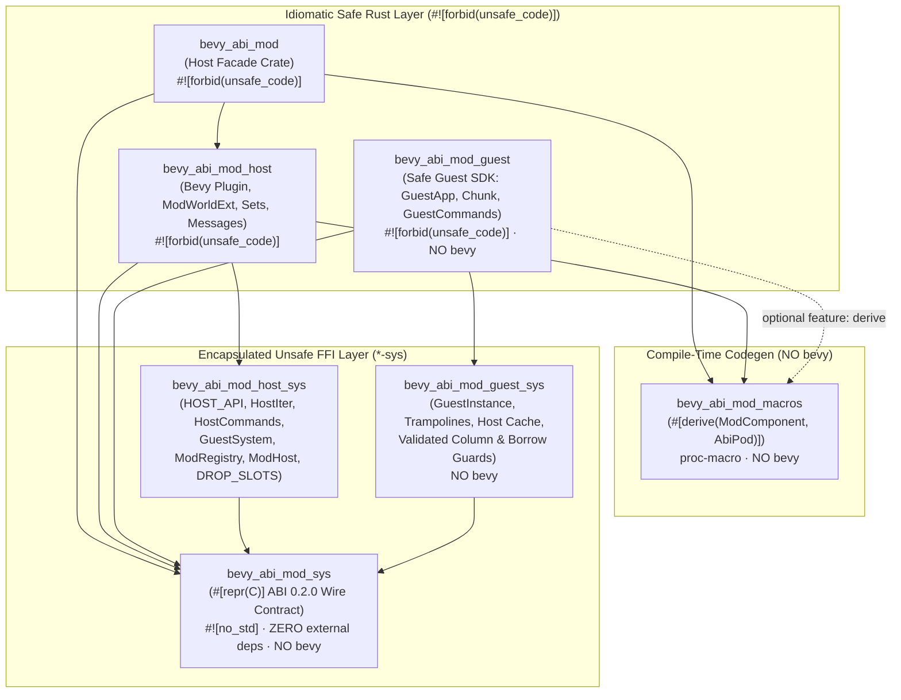

# Specification: `bevy_abi_mod` (`ABI 0.2.0`)
**Asymmetric, Zero-Serialization C-ABI Modding Framework for Bevy ECS (`v0.20+`)**

---

## 1. Vision, Scope & Threat Model

### 1.1 The Problem Space
Dynamically loading native shared libraries (`.so`, `.dylib`, `.dll`) into a Bevy Engine (`v0.20+`) application at runtime must navigate three fundamental systems constraints:
1. **Rust ABI Instability:** Rust intentionally provides no stable cross-compiler ABI. Differences in `rustc` versions, optimization levels, target features, or standard library revisions alter `#[repr(Rust)]` struct layouts, calling conventions, vtable layouts, and symbol mangling.
2. **Allocator Isolation:** Native dynamic libraries link independent heap allocators (for example, Windows per-DLL `HeapAlloc`, `mimalloc`, `jemalloc`, or `libc` `malloc`). Freeing guest-allocated memory on the host allocator—or vice versa—corrupts process heaps.
3. **Frame-Budget Throughput:** Serializing ECS archetype tables to JSON, MessagePack, or Bincode on every frame destroys cache locality and 60/120 Hz frame budgets.

### 1.2 Architectural Approach
`bevy_abi_mod` defines an **asymmetric, zero-serialization `extern "C"` wire contract (`ABI 0.2.0`, `0x0002_0000`)** between a Bevy host and native guest mods written in Rust, ISO C99, C++17/20, or Zig:
1. **Zero Shared Rust ABI Assumptions:** Every wire structure is `#[repr(C)]` or `#[repr(transparent)]` with zero implicit padding, verified at compile time on 64-bit and 32-bit targets in both Rust (`offset_of!`) and ISO C99 (`BAM_STATIC_ASSERT` in `include/bevy_abi_mod.h`).
2. **Versioned Table Handshake & Pre-Resolved Handles:** On load, the host validates the guest's `BamManifest` and passes a self-describing 27-slot `BamHostApi` table alongside a transactional `BamLoadCtx`. Components and resources resolve once at initialization into 1-based `BamComponent(u32)` handles so per-frame iteration, resource lookups, and deferred commands perform zero string parsing or hashing.
3. **Direct Archetype & Sparse-Set Iteration:** Host `Table` columns are exposed directly as contiguous SoA byte slices (and `SparseSet` columns as batched per-row pointer arrays) without copying component payloads.
4. **First-Class Bevy Scheduler Concurrency:** Each registered mod system runs inside a native Bevy `System` (`GuestSystem`) that populates `FilteredAccessSet` read/write locks from pre-resolved `ComponentId`s, allowing Bevy's multi-threaded executor to schedule non-conflicting mod and host systems in parallel.
5. **Per-World Instance Isolation & Deterministic Unloading:** Mods export `bevy_abi_mod_manifest`, `bevy_abi_mod_init(..., &mut instance_out)`, and `bevy_abi_mod_shutdown(instance)`. Each Bevy `World` owns an isolated `BamInstance*`, copy-on-write `ModRegistry` snapshot, transactional `LoadTransaction` rollback, shadow-copy loader support, and lock-free `ArcSwapOption` drop trampolines.

### 1.3 Threat Model & Native Trust Boundary
Native dynamic libraries loaded via `dlopen` / `LoadLibraryW` execute **in-process within the host's virtual address space and hold full operating-system privileges of the host process**. Accordingly:
- **Trusted Native Code:** Native mods are **fully trusted**. `bevy_abi_mod` is **not** a security sandbox against untrusted, adversarial, or network-downloaded binaries; malicious machine code in a `.dll`/`.so`/`.dylib` can read arbitrary process memory or invoke arbitrary syscalls.
- **What `bevy_abi_mod` Isolates:** `bevy_abi_mod` isolates **Rust compiler ABI drift**, **heap allocator boundaries**, **ECS borrow/aliasing rules**, **cross-mod namespace/symbol collisions**, **unwinding panics in default Rust guests**, and **`dlclose` lifecycle hazards** across cooperative or buggy mods.
- **Untrusted User Content Guidance:** Games that accept untrusted user-submitted mods from arbitrary sources should execute untrusted logic inside a **WebAssembly (Wasm)** runtime or an OS-sandboxed out-of-process worker, reserving `bevy_abi_mod` for trusted native plugins, studio gameplay modules, and locally opted-in native mods.

---

## 2. Seven-Crate Workspace Architecture (`-sys` vs. `#![forbid(unsafe_code)]`)

The workspace separates low-level `unsafe` FFI machinery (`*-sys`) from high-level idiomatic Rust crates enforcing `#![forbid(unsafe_code)]`, while strictly keeping `bevy*` out of all wire, macro, and guest crates ([ADR 0006](docs/adr/0006-sys-crate-split.md)).

### 2.1 Dependency & Safety Graph



### 2.2 Crate Boundaries & Invariants

| Crate | `#![no_std]` | `#![forbid(unsafe_code)]` | `bevy*` Allowed | Responsibility & Allowed Dependencies |
|---|---|---|---|---|
| `crates/bevy_abi_mod_sys` | Yes | No (`unsafe trait`, `FfiSlice`, `ExtensibleStruct`) | **Never** | **Zero external dependencies.** Defines `ABI_VERSION` (`0.2.0`), `BamManifest`, `BamHostApi`, `BamSystemDesc`, `BamQueryDesc`, `BamTermDesc`, `ComponentDesc`, `BamColumnInfo`, `VTableHeader`, `BamComponent`, `ComponentUuid`, `FfiResult`, `FfiBool`, `FfiEntity`, `ModComponent`, `AbiPod`, and `RawInsertable`. |
| `crates/bevy_abi_mod_macros` | N/A (`proc-macro`) | Yes (host macro logic) | **Never** | `syn`, `quote`, `proc-macro2`, `proc-macro-crate`. Implements `#[derive(ModComponent)]` (hygienic VTable + accessor codegen) and `#[derive(AbiPod)]`. |
| `crates/bevy_abi_mod_host_sys` | No (`std`) | No (isolates all host `unsafe`) | Yes | `bevy_ecs`, `bevy_app`, `bevy_platform`, `libloading`, `arc-swap`, `thiserror`, `tracing`, `bevy_abi_mod_sys`. Implements `HOST_API`, `HostIter`, `HostCommands` (`CommandArena`), `GuestSystem`, `ModRegistry` (`RegistrySnapshot`), `ModHost`, `LoadContext`, `DROP_SLOTS`, and `WorldDropGuard`. |
| `crates/bevy_abi_mod_host` | No (`std`) | **Yes** | Yes | `bevy_app`, `bevy_ecs`, `bevy_abi_mod_host_sys`, `bevy_abi_mod_sys`, `bevy_abi_mod_macros`. Safe Bevy plugin (`AbiModPlugin`), `ModWorldExt`, `ModAppExt`, `ModCommandsExt`, `LoadOptions`, `ComponentOptions`, `ModErrorPolicy`, `ModQuarantine`, `ModScheduleMap`, lifecycle `Message`s, `ModSystemSet`, `ModNamedSystemSet`, and `prelude`. |
| `crates/bevy_abi_mod` | No (`std`) | **Yes** | Yes | Top-level host facade re-exporting `bevy_abi_mod_host`, `ModComponent`, `AbiPod`, `bevy_abi_mod_sys`, and `prelude`. |
| `crates/bevy_abi_mod_guest_sys` | No (`std`) | No (isolates all guest `unsafe`) | **Never** | Depends **only** on `bevy_abi_mod_sys`. Implements `GuestInstance`, `catch_guest_*` panic guards, `extern "C"` init/shutdown/system/`run_if`/drop trampolines, `Host` API table cache, lock-free closure re-entrancy guards, and validated column/row slice constructors. |
| `crates/bevy_abi_mod_guest` | No (`std`) | **Yes** | **Never** | `bevy_abi_mod_guest_sys`, `bevy_abi_mod_sys`, optional `bevy_abi_mod_macros` (`derive` feature). Safe ergonomic Rust guest SDK: `GuestPlugin`, `GuestApp`, `SystemBuilder` (`app.system(...)`), `SystemContext`, `ChunkIter`, `Chunk`, `ChunkSlice`, `ChunkSliceMut`, `GuestCommands`, `GuestComponent`, `export_mod!`, `raw`, and `prelude`. |

### 2.3 Repository Layout

```text
bevy_abi_mod/
├── Cargo.toml                  # Workspace definition, shared lints, edition 2024
├── spec.md                     # Authoritative ABI 0.2.0 & runtime specification
├── CHANGELOG.md                # Release history (Keep a Changelog)
├── GEMINI.md                   # Engineering rules & Bevy 0.20 coding standards
├── include/
│   └── bevy_abi_mod.h          # Single-source ISO C99 header generated by `cargo xtask header`
├── xtask/                      # Workspace automation (`header`, `fixtures`, `lint`, `ci`, `miri`)
├── docs/
│   ├── MIGRATION_0.1_TO_0.2.md # Side-by-side 0.1 -> 0.2 migration guide & rename reference
│   ├── GUEST_MOD_GUIDE.md      # Rust & ISO C99 guest authoring + panic policy guide
│   ├── TEST_MATRIX.md          # Behavioral traceability across integration suites
│   └── adr/                    # Architecture Decision Records (0001..0006)
├── crates/
│   ├── bevy_abi_mod_sys/
│   ├── bevy_abi_mod_macros/
│   ├── bevy_abi_mod_host_sys/
│   ├── bevy_abi_mod_host/      # Contains consolidated `tests/{ffi,scheduling,lifecycle,e2e}` & `benches/`
│   ├── bevy_abi_mod/
│   ├── bevy_abi_mod_guest_sys/
│   └── bevy_abi_mod_guest/
├── tests/                      # Standalone C99 ABI harness (`standalone_c_test.c`) & `.cdylib` fixtures
└── examples/                   # Progressive host + guest examples (01..06)
```

---

## 3. SemVer Policy, Extensibility & Safety Contracts

### 3.1 ABI SemVer Packing & Compatibility (`C-06`)
ABI versions are packed into a 32-bit unsigned integer (`u32` / `uint32_t`) via `(major << 24) | (minor << 16) | patch`, with `const` range assertions (`major <= 255`, `minor <= 255`, `patch <= 65535`):
- Current contract version: `ABI_VERSION = 0x0002_0000` (`0.2.0`, C `BAM_ABI_VERSION`).
- **Pre-1.0 (`major == 0`):** Minor version bumps are breaking under Cargo SemVer. `abi_version_is_compatible(host, guest)` (`bam_version_is_compatible` in C99) requires `host_major == 0 && guest_major == 0 && host_minor == guest_minor`. Patch differences (`0.2.0` vs `0.2.3`) are wire-compatible.
- **Post-1.0 (`major >= 1`):** Minor bumps are strictly additive (`struct_size` extension). Compatibility requires `host_major == guest_major && guest_minor <= host_minor` (patch ignored).

### 3.2 `ExtensibleStruct`, `Option<fn>`, and Flag Validation (`C-02`, `C-08`, `C-09`)
1. **Frozen `MIN_V0_2_SIZE`:** Every extensible `#[repr(C)]` struct (`BamManifest`, `BamHostApi`, `BamQueryDesc`, `BamSystemDesc`, `ComponentDesc`, `VTableHeader`) carries `pub struct_size: u32` at byte offset `0` and defines `MIN_V0_2_SIZE` via `core::mem::offset_of!(Self, <last_v0_2_field>) + core::mem::size_of::<LastFieldTy>()` (never `size_of::<Self>()`). Appending fields in future compatible minor versions preserves `MIN_V0_2_SIZE`; `read_extensible_struct::<T>` copies `min(struct_size, size_of::<T>())` bytes into a zero-initialized `MaybeUninit<T>`.
2. **`Option<unsafe extern "C" fn(...)>` Callback Slots:** Every foreign function-pointer field across the ABI uses `Option<unsafe extern "C" fn(...)>`. Rust's guaranteed null-pointer niche optimization ensures all-bits-zero is a valid `None` on every architecture without `usize` byte-probing.
3. **Forward-Compatible Guest Slot Negotiation:** Guests check `api.struct_size >= BamHostApi::MIN_V0_2_SIZE` (`bam_host_api_copy_bounded` in C99) for mandatory `0.2` slots and use `BamHostApi::covers_slot(offset, slot_size)` for any future appended optional slots rather than requiring `api.struct_size >= size_of::<BamHostApi>()`.
4. **Strict Flag & Reserved Word Rejection:** Any unknown bit in a `flags` field (`flags & !KNOWN_FLAGS != 0`) is rejected synchronously with `FfiResult::UNSUPPORTED` (`14`). Any non-zero `reserved0` field is rejected with `FfiResult::INVALID_ARGUMENT` (`8`).

### 3.3 Memory & Allocator Isolation
1. **Owner-Frees Invariant:** Host-allocated memory (`World` columns, `String`/`Vec` component fields, `CommandArena` slabs, `RegistrySnapshot`) is allocated and freed exclusively by the host. Guest-allocated memory (`GuestInstance`, boxed system/`run_if` closures, owned C strings) is allocated by the guest in `bevy_abi_mod_init` and freed exclusively by the guest in `bevy_abi_mod_shutdown(instance)`.
2. **Explicit Slice Views (`FfiSlice<T>` & `StrView`):** Rust fat pointers (`&[T]`, `&str`, `dyn Trait`), `Box`, `Vec`, and `String` never cross `extern "C"`. Contiguous borrows use `FfiSlice<T> { ptr: *const T, len: usize }` (`StrView = FfiSlice<u8>`, C `BamStrView`). Empty C slices `(NULL, 0)` translate safely via `NonNull::dangling()` without triggering null-slice UB.
3. **Self-Aliasing Overlap Protection:** Component `String` and `Vec<T>` VTable setters detect when an incoming `StrView` / `FfiSlice<T>` aliases the component field's existing `[ptr, ptr + capacity)` buffer (for example, passing a `get_*` slice back into `set_*`) and copy through a host-side temporary buffer before mutating in place.
4. **No Raw `enum` or `bool` Hazards Across FFI:** Wire status codes, access modes, and schedules are `#[repr(transparent)]` `u32` newtypes, and booleans use `#[repr(transparent)] pub struct FfiBool(pub u8)` (`0` = false, non-zero = true; `<stdbool.h>` is omitted from `include/bevy_abi_mod.h`). Foreign code writing `2` or `255` cannot construct an invalid Rust `bool` or `enum` discriminant.

### 3.4 Cross-ABI Panic & Unwind Policy (`S-09`, `G-05`, [ADR 0004](docs/adr/0004-panic-policy.md))
1. **Strict `extern "C"` (`nounwind`) Boundary:** Every function pointer in `bevy_abi_mod_sys` and every generated VTable slot uses `unsafe extern "C" fn(...)` (never `extern "C-unwind"`). Under Rust 1.81+ (`c_unwind` stabilization), `extern "C"` carries the LLVM `nounwind` attribute: an uncaught Rust panic reaching an `extern "C"` boundary aborts the process inside the callee, and unwinding a foreign exception across `nounwind` is Undefined Behavior. Catching an asymmetric guest's `Box<dyn Any + Send>` inside the host would also free guest heap memory on the host allocator.
2. **Zero Host `catch_unwind` Around Foreign Calls:** `bevy_abi_mod_host_sys` and `bevy_abi_mod_host` contain **no** `std::panic::catch_unwind` wrappers around foreign `extern "C"` invocations. Fault signaling across the boundary is strictly value-based via `FfiResult`.
3. **Guest-Side Panic Containment (`panic = "unwind"` vs. `panic = "abort"`):**

| Guest Language / Profile | Fault Inside Callback | Runtime Behavior | Host Observation |
|---|---|---|---|
| **Rust (`panic = "unwind"`, default)** | `panic!(...)` / `.unwrap()` / bounds check | Caught inside the guest `.cdylib` by `bevy_abi_mod_guest_sys::catch_guest_*`; panic payload dropped on the **guest** allocator | Receives `FfiResult::PANIC_CAUGHT` (`3`); discards uncommitted commands, emits `ModSystemFaulted`, and applies `ModErrorPolicy` |
| **Rust (`panic = "abort"`)** | `panic!(...)` / `.unwrap()` / bounds check | `catch_unwind` is a no-op; guest `std` aborts the OS process at the panic site | Immediate deterministic process abort (`SIGABRT` / non-zero exit); zero UB |
| **ISO C99** | Explicit check (`return BAM_RESULT_*`) | Returns `BamResult` by value | Discards uncommitted commands, emits `ModSystemFaulted`, and applies `ModErrorPolicy` |
| **ISO C99** | `abort()` / null dereference | OS signal (`SIGABRT` / `SIGSEGV`) | Process termination (per §1.3 native trust model) |
| **C++17/20** | `try { ... } catch (...) { return BAM_RESULT_PANIC_CAUGHT; }` | Caught and freed inside C++ guest runtime | Receives `BAM_RESULT_PANIC_CAUGHT` (`3`); applies `ModErrorPolicy` |
| **C++17/20** | Uncaught `throw` escaping `extern "C"` | C++ `noexcept` boundary invokes `std::terminate()` | Deterministic process abort |
| **Zig** | Zig `error` mapped to `BamResult` | Returns `BamResult` by value | Applies `ModErrorPolicy` |
| **Zig** | `@panic(...)` / safety check | Zig panic handler aborts process | Deterministic process abort |

### 3.5 Threading & Concurrency Contract (`S-11`, `B-07`, `P-06`)
1. **Lifecycle Entry Points:** `bevy_abi_mod_manifest`, `bevy_abi_mod_init`, and `bevy_abi_mod_shutdown` execute sequentially on the thread holding exclusive `&mut World` access.
2. **Multi-Threaded System Execution:** Registered `BamSystemFn` and `BamRunIfFn` callbacks may execute on **any** worker thread in Bevy's `ComputeTaskPool`, **unless** `BAM_SYSTEM_FLAG_MAIN_THREAD` (`1 << 0`) is set on `BamSystemDesc::flags`, which registers a `NON_SEND` constraint pinning that system onto Bevy's main thread.
3. **Single-Instance Mutual Exclusion:** Bevy's scheduler never runs the same `GuestSystem` instance concurrently with itself, and never runs two systems in parallel when their declared `FilteredAccessSet` component/resource accesses conflict. `bevy_abi_mod_guest_sys` enforces single-entry per closure via a lock-free `UnsafeCell<F>` + `AtomicBool` re-entrancy guard (returning `FfiResult::ACCESS_CONFLICT` if invoked re-entrantly). C/C++/Zig mods that share mutable static state across distinct systems capable of running in parallel must synchronize that state or set `BAM_SYSTEM_FLAG_MAIN_THREAD`.
4. **Pointer Newtype Encapsulation:** Raw guest pointers (`user_data`, function pointers, static symbol addresses) are wrapped in narrow newtypes carrying documented `Send`/`Sync` safety proofs rather than blanket `unsafe impl Send/Sync` on host aggregates.

### 3.6 Opaque Handle Lifetimes & Header Hardening (`S-07`, `S-08`, `C-04`)
Every opaque handle has a strict lexical or session scope and **must never be cached beyond its validity window**:

| Opaque Handle | C Typedef | Issued By | Exact Validity Lifetime |
|---|---|---|---|
| `BamLoadCtx` | `BamLoadCtx*` | Host -> `bevy_abi_mod_init` | Strictly for the synchronous duration of `bevy_abi_mod_init` on the loading thread. Calling `register_component` or `register_system` after `init` returns fails with `FfiResult::INVALID_STATE`. |
| `BamHostCtx` | `const BamHostCtx*` | `load_host_ctx(load_ctx)` or `sys_host_ctx(sys_ctx)` | Valid during `bevy_abi_mod_init` and during any `BamSystemFn` execution on the owning `World`. Carries world-scoped symbol resolution (`get_proc_address`) and per-context `last_error` diagnostics with zero `thread_local!` state. |
| `BamSystemCtx` | `BamSystemCtx*` | Host -> `BamSystemFn` | Strictly for the synchronous duration of that single `BamSystemFn` callback invocation. |
| `BamIter` | `BamIter*` | `sys_query(sys_ctx, idx, &mut iter)` | Strictly for the enclosing `BamSystemFn` invocation. Dense/sparse column pointers returned by `iter_column_*` and `iter_entities` are valid **only** until the next `iter_next_chunk` or `iter_reset` on that `BamIter`, or until `BamSystemFn` returns. |
| `BamCommands` | `BamCommands*` | `sys_commands(sys_ctx, &mut cmds)` | Strictly for the enclosing `BamSystemFn` invocation. |
| `BamInstance` | `BamInstance*` | Guest -> `*instance_out` in `init` | Owned by the guest heap from return of `bevy_abi_mod_init` until the host passes it once to `bevy_abi_mod_shutdown(instance)` during `World::unload_mod` or `World::drop`. (`NULL` is valid for stateless C mods.) |

**Handle Header Validation (`S-08`):** On the host side, `HostIter`, `HostCommands`, `BamSystemCtx`, `LoadContext`, and `BamHostCtx` each begin with a `#[repr(C)]` `{ magic: u32, generation: u32 }` header. Debug builds and builds enabling `feature = "strict-ffi-checks"` verify exact handle magic and active generation on every FFI call and poison the header in `Drop`, catching type confusion (for example casting `BamCommands*` to `BamIter*`) and stale use-after-return pointers deterministically.

---

## 4. ABI `0.2.0` Wire Specification (`bevy_abi_mod_sys` & `include/bevy_abi_mod.h`)

`crates/bevy_abi_mod_sys` is the sole source of truth for the wire contract. `cargo xtask header` generates `include/bevy_abi_mod.h` with `Bam*` type prefixes, `BAM_*` constant prefixes, `bam_*` inline helpers, and 64-bit/32-bit `BAM_STATIC_ASSERT` offset/size checks ([ADR 0002](docs/adr/0002-abi-v0.2.md)).

### 4.1 Wire Struct Sizes & Alignments (Zero Implicit Padding)

| Rust Type (`bevy_abi_mod_sys`) | C99 Type (`bevy_abi_mod.h`) | 64-bit Size / Align | 32-bit Size / Align | Implicit Padding |
|---|---|---|---|---|
| `FfiBool(pub u8)` | `BamBool` | 1 B / 1 B | 1 B / 1 B | 0 B |
| `BamComponent(pub u32)` | `BamComponent` | 4 B / 4 B | 4 B / 4 B | 0 B |
| `FfiEntity(pub u64)` | `BamEntity` | 8 B / 8 B | 8 B / 4–8 B | 0 B |
| `FfiResult(pub u32)` | `BamResult` | 4 B / 4 B | 4 B / 4 B | 0 B |
| `AccessMode(pub u32)` | `BamAccessMode` | 4 B / 4 B | 4 B / 4 B | 0 B |
| `ScheduleId(pub u32)` | `BamScheduleId` | 4 B / 4 B | 4 B / 4 B | 0 B |
| `ComponentUuid` | `BamComponentUuid` | 16 B / 1 B | 16 B / 1 B | 0 B |
| `FfiSlice<T>` / `StrView` | `BamStrView` / `BamByteSlice` | 16 B / 8 B | 8 B / 4 B | 0 B |
| `BamManifest` | `BamManifest` | 32 B / 8 B | 24 B / 4 B | 0 B |
| `BamTermDesc` | `BamTermDesc` | 12 B / 4 B | 12 B / 4 B | 0 B |
| `BamQueryDesc` | `BamQueryDesc` | 24 B / 8 B | 16 B / 4 B | 0 B |
| `BamSystemDesc` | `BamSystemDesc` | 104 B / 8 B | 60 B / 4 B | 0 B (`reserved0`) |
| `ComponentDesc` | `BamComponentDesc` | 64 B / 8 B | 44 B / 4 B | 0 B |
| `BamColumnInfo` | `BamColumnInfo` | 48 B / 8 B | 40 B / 4 B | 0 B (`reserved0`) |
| `VTableHeader` | `BamVTableHeader` | 40 B / 8 B | 32 B / 4 B | 0 B |
| `BamHostApi` | `BamHostApi` | 224 B / 8 B | 116 B / 4 B | 0 B |

### 4.2 Primitives, Handles, Status Codes & Modes

- **`BamComponent(pub u32)` (`C-05`):** 1-based per-`World` registry handle covering both entity components and singleton resources. `BamComponent::INVALID = Self(0)` (`BAM_COMPONENT_INVALID = 0u`) is the uninitialized/invalid sentinel.
- **`FfiEntity(pub u64)` (`S-10`):** Matches `bevy_ecs::entity::Entity::to_bits()`, verified via compile-time size/alignment assertions and bit-pattern parity tests. `FfiEntity::NULL = Self(0)` (`BAM_ENTITY_NULL = 0ull`) is the canonical invalid entity sentinel (`Entity::try_from_bits(0) == None` in Bevy 0.20+; `Entity::PLACEHOLDER` is rejected on command paths with `FfiResult::INVALID_ENTITY`).
- **`FfiResult(pub u32)` (`BamResult`, `C-07`):**
  - `OK (0)`, `INVALID_COMPONENT (1)`, `ACCESS_CONFLICT (2)`, `PANIC_CAUGHT (3)`, `NULL_POINTER (4)`, `INVALID_UTF8 (5)`, `PERMISSION_DENIED (6)`, `INVALID_VERSION (7)`, `INVALID_ARGUMENT (8)`, `OUT_OF_RANGE (9)`, `NOT_FOUND (10)`, `INVALID_STATE (11)`, `INVALID_ENTITY (12)`, `CAPACITY_EXCEEDED (13)`, `UNSUPPORTED (14)`, `TYPE_MISMATCH (15)`, `INTERNAL_ERROR (99)`.
- **`AccessMode(pub u32)` (`BamAccessMode`):**
  - `READ (0)` (`&T`), `WRITE (1)` (`&mut T`), `FILTER_ONLY (2)` (`With<T>`), `WITHOUT (3)` (`Without<T>`), `OPTIONAL_READ (4)` (`Option<&T>`), `OPTIONAL_WRITE (5)` (`Option<&mut T>`), `CHANGED (6)` (`Changed<T> + &T`), `ADDED (7)` (`Added<T> + &T`), `RESOURCE_READ (8)` (`Res<R>`), `RESOURCE_WRITE (9)` (`ResMut<R>`).
- **`ScheduleId(pub u32)` (`BamScheduleId`, `B-06`):**
  - Built-in schedules: `UPDATE (0)`, `STARTUP (1)`, `PRE_UPDATE (2)`, `POST_UPDATE (3)`, `FIXED_UPDATE (4)`, `LAST (5)`.
  - `6..1024`: Reserved for future built-in Bevy schedules (rejected by `ScheduleId::is_valid()`).
  - `>= ScheduleId::CUSTOM_BASE (1024)`: Game-defined custom schedules registered on the host via `ModScheduleMap` (`register_mod_schedule(id, label)`).
- **Architectural Limits:** `MAX_TERMS_PER_QUERY = 32` (`BAM_MAX_TERMS_PER_QUERY`), `MAX_QUERIES_PER_SYSTEM = 8` (`BAM_MAX_QUERIES_PER_SYSTEM`).

### 4.3 Namespaced `ComponentUuid` (`SipHash-2-4-128`, `C-10`)
`ComponentUuid { pub bytes: [u8; 16] }` (`align = 1` across all 32-bit and 64-bit targets) prevents cross-mod name collisions and detects silent layout drift:
1. **Canonical Namespaced Name (`"<namespace>::<Name>"`):**
   - Host `#[derive(ModComponent)]` defaults to `concat!(module_path!(), "::", stringify!(Ident))`, overridable via `#[mod_component(name = "my_game::Position")]` or `#[mod_component(namespace = "my_game")]`.
   - Guest component registration prefixes unqualified names with the mod's manifest name (`"<manifest.name>::<Name>"`).
2. **Deterministic `const` SipHash-2-4-128:** `ComponentUuid::from_parts(canonical_name, size, align, field_schema_hash)` (mirrored bit-for-bit in C99 by `bam_uuid_from_parts`) hashes `canonical_name || 0xFF || (size as u64).to_le_bytes() || (align as u64).to_le_bytes() || field_schema_hash.to_le_bytes()` under fixed domain keys `SIPHASH_KEY_0 = 0x4241_4d5f_5555_4944` and `SIPHASH_KEY_1 = 0x5630_5f32_5349_5048` (`"BAM_UUIDV0_2SIPH"`).
   - For `#[repr(C)]` `AbiPod` structs, `field_schema_hash` hashes field names, type tags, and byte offsets.
   - For opaque/VTable-only `#[repr(Rust)]` components, `ComponentUuid::from_canonical_name(name)` hashes `(name, 0, 0, 0)` so host internal layout stays encapsulated across `rustc` versions.
   - Explicit UUID overrides are supported via `#[mod_component(uuid = "xxxxxxxx-xxxx-xxxx-xxxx-xxxxxxxxxxxx")]` (`ComponentUuid::parse_hex`).
3. **Collision & Drift Detection:** Re-registering or resolving a canonical name with a mismatched `uuid`, `size`, or `align` fails with `FfiResult::TYPE_MISMATCH` (`15`).

### 4.4 Mandatory Mod Manifest & Entry Points (`L-08`, `L-02`)
Every guest shared library must export three `extern "C"` entry points:
1. `bevy_abi_mod_manifest() -> *const BamManifest`: Returns a static `BamManifest { struct_size, abi_version, name, version, flags, reserved0 }`. Libraries missing this symbol fail load with `ModLoadError::MissingManifest`. The host validates `BamManifest` **before** calling `init`, populates `LoadedModInfo`, and assigns a strictly monotonic `ModId(u64)` (`1, 2, 3, ...`).
2. `bevy_abi_mod_init(api: *const BamHostApi, load_ctx: *mut BamLoadCtx, instance_out: *mut *mut BamInstance) -> FfiResult`: Initializes the mod for a single Bevy `World` and writes an optional guest-heap `*mut BamInstance` into `*instance_out`. On non-`OK` return, the guest frees partial guest allocations before returning and the host's `LoadTransaction` rolls back all staged registrations without calling `shutdown`.
3. `bevy_abi_mod_shutdown(instance: *mut BamInstance)`: Invoked once per successful `bevy_abi_mod_init` when that load session unloads from its `World` (or when that `World` drops), strictly after systems and drop trampolines are disarmed and strictly before `dlclose`.

### 4.5 Complete 27-Slot `BamHostApi` (`C-03`, `C-04`)
All core engine operations reside directly in `BamHostApi` (`224` bytes on 64-bit, `116` bytes on 32-bit) as `Option<unsafe extern "C" fn(...)>` slots (`ModRegistry::new()` registers zero built-in function symbols):

| Group | Slot (`BamHostApi`) | Signature Summary & Purpose |
|---|---|---|
| **1. Diagnostics & Custom Symbols** | `get_proc_address` | `(ctx: *const BamHostCtx, name: *const c_char) -> *const c_void` — resolves `"bam.v0.<name>"` symbols and component VTables (`"bam.v0.<canonical_name>.vtable"`). |
| | `last_error` | `(ctx: *const BamHostCtx, buf: *mut c_char, cap: usize) -> usize` — copies NUL-terminated UTF-8 diagnostic message recorded on `ctx` (`snprintf` return convention). |
| **2. Init-Time Registration & Resolution** | `load_host_ctx` | `(load_ctx: *const BamLoadCtx) -> *const BamHostCtx` — extracts world-scoped `BamHostCtx` during `init`. |
| | `register_component` | `(load_ctx: *mut BamLoadCtx, desc: *const ComponentDesc, out: *mut BamComponent) -> FfiResult` — registers a runtime dynamic component. |
| | `resolve_component` | `(ctx: *const BamHostCtx, name: *const c_char, uuid: *const ComponentUuid, out: *mut BamComponent) -> FfiResult` — resolves component/resource to 1-based `BamComponent`, verifying `*uuid` when non-null. |
| | `register_system` | `(load_ctx: *mut BamLoadCtx, desc: *const BamSystemDesc) -> FfiResult` — registers a unified `BamSystemDesc`. |
| **3. System Execution Context** | `sys_host_ctx` | `(sys_ctx: *const BamSystemCtx) -> *const BamHostCtx` — extracts `BamHostCtx` during `BamSystemFn`. |
| | `sys_query` | `(sys_ctx: *mut BamSystemCtx, query_index: usize, out_iter: *mut *mut BamIter) -> FfiResult` — borrows `BamIter` for `0..query_count`. |
| | `sys_commands` | `(sys_ctx: *mut BamSystemCtx, out_cmds: *mut *mut BamCommands) -> FfiResult` — borrows per-system `BamCommands`. |
| **4. Chunk & Sparse-Row Iteration** | `iter_next_chunk` | `(iter: *mut BamIter, out_len: *mut usize) -> FfiBool` — advances to next non-empty chunk, writing entity count to `*out_len`. |
| | `iter_reset` | `(iter: *mut BamIter) -> FfiResult` — rewinds chunk cursor to `0` for nested multi-query loops. |
| | `iter_entities` | `(iter: *const BamIter) -> *const FfiEntity` — returns `[FfiEntity; chunk_len]` pointer. |
| | `iter_column_readonly` | `(iter: *const BamIter, term_index: usize) -> *const u8` — dense `Table` read column pointer (null if absent optional, sparse, filter, or resource). |
| | `iter_column_mutable` | `(iter: *mut BamIter, term_index: usize) -> *mut u8` — dense `Table` write column pointer; marks chunk ticks changed at most once per chunk (`P-04`). |
| | `iter_column_mutable_untracked` | `(iter: *mut BamIter, term_index: usize) -> *mut u8` — dense `Table` write column pointer without marking change ticks (`P-04`). |
| | `iter_mark_changed_range` | `(iter: *mut BamIter, term_index: usize, start_row: usize, row_count: usize) -> FfiResult` — marks `start_row..start_row + row_count` changed (`P-04`). |
| | `iter_column_rows_readonly` | `(iter: *mut BamIter, term_index: usize) -> *const *const u8` — indirect `[*const u8; chunk_len]` row pointers for `SparseSet` read columns (`P-02`). |
| | `iter_column_rows_mutable` | `(iter: *mut BamIter, term_index: usize) -> *const *mut u8` — indirect `[*mut u8; chunk_len]` row pointers for `SparseSet` write columns, marking matched rows changed (`P-02`). |
| | `iter_column_info` | `(iter: *const BamIter, term_index: usize, out_info: *mut BamColumnInfo) -> FfiResult` — introspects `BamComponent`, `AccessMode`, `ComponentUuid`, `size`, `align`, and `storage_flags` (`C-13`). |
| **5. Singleton Resources** | `res_ptr` | `(iter: *const BamIter, term_index: usize) -> *const u8` — `O(1)` read pointer to `RESOURCE_READ`/`RESOURCE_WRITE` term at `term_index`. |
| | `res_mut_ptr` | `(iter: *mut BamIter, term_index: usize) -> *mut u8` — `O(1)` mutable pointer to `RESOURCE_WRITE` term at `term_index` (marks Bevy resource change tick). |
| **6. Deferred Commands** | `cmd_spawn_empty` | `(cmds: *mut BamCommands, out_entity: *mut FfiEntity) -> FfiResult` — atomically reserves a fresh empty `Entity`. |
| | `cmd_spawn` | `(cmds: *mut BamCommands, comps: *const BamComponent, data_ptrs: *const *const u8, count: usize, out_entity: *mut FfiEntity) -> FfiResult` — reserves an `Entity` and queues a single-archetype batched spawn (`P-05`). |
| | `cmd_despawn` | `(cmds: *mut BamCommands, entity: FfiEntity) -> FfiResult` — queues recursive Bevy entity despawn. |
| | `cmd_insert` | `(cmds: *mut BamCommands, entity: FfiEntity, comp: BamComponent, data: *const u8, len: usize) -> FfiResult` — queues raw byte component insertion into `CommandArena`. |
| | `cmd_insert_default` | `(cmds: *mut BamCommands, entity: FfiEntity, comp: BamComponent) -> FfiResult` — queues host-constructed `T::default()` insertion (including non-POD `String`/`Vec` components). |
| | `cmd_remove` | `(cmds: *mut BamCommands, entity: FfiEntity, comp: BamComponent) -> FfiResult` — queues component removal. |

### 4.6 Unified Descriptors (`BamSystemDesc`, `BamQueryDesc`, `BamTermDesc`, `ComponentDesc`, `BamColumnInfo`, `VTableHeader`)
1. **`BamTermDesc` (`12` B):** `{ component: BamComponent, mode: AccessMode, flags: u32 }`.
2. **`BamQueryDesc` (`24` B / `16` B):** `{ struct_size: u32, flags: u32, terms: *const BamTermDesc, term_count: usize }` (`term_count <= 32`). Resource-only queries (all terms `RESOURCE_READ`/`RESOURCE_WRITE`) register `FilteredAccessSet` resource locks and immediately serve `res_ptr` / `res_mut_ptr` without chunk iteration (`iter_next_chunk` returns `FfiBool::FALSE`).
3. **`BamSystemDesc` (`104` B / `60` B, `C-01`):** Unifies single-query, multi-query (`0..=8` queries), scheduled (`schedule: ScheduleId`), ordered (`after`/`before` C-string arrays), main-thread (`BAM_SYSTEM_FLAG_MAIN_THREAD`), and conditional (`run_if: Option<BamRunIfFn>`, `run_if_user_data`) systems into a single descriptor passed to `register_system`. `run_if` executes before advancing `last_run` so `Changed<T>` / `Added<T>` ticks accumulated across skipped frames are preserved.
4. **`ComponentDesc` (`64` B / `44` B, `B-08`):** `{ struct_size, flags, name, uuid, size, align, drop_fn: Option<ComponentDropFn>, vtable_ptr }`. Supports `BAM_COMPONENT_FLAG_SPARSE_SET` (`1 << 0`, `StorageType::SparseSet`) and `BAM_COMPONENT_FLAG_IMMUTABLE` (`1 << 1`, rejects mutable access modes with `PERMISSION_DENIED`), plus zero-sized marker components (`size == 0`, power-of-two `align >= 1`). When `drop_fn.is_some()`, the host sets `ComponentCloneBehavior::Ignore` so Bevy's `EntityCloner` never bitwise-duplicates foreign-owned allocations.
5. **`BamColumnInfo` (`48` B / `40` B, `C-13`):** `{ component, mode, uuid, size, align, storage_flags, reserved0 }` with `BAM_STORAGE_FLAG_SPARSE_SET (1 << 0)`, `BAM_STORAGE_FLAG_IMMUTABLE (1 << 1)`, and `BAM_STORAGE_FLAG_RESOURCE (1 << 2)`. Returned via out-pointer to avoid cross-platform 48-byte struct-return ABI subtle differences.
6. **`VTableHeader` (`40` B / `32` B, `M-05`):** `{ struct_size, abi_version, uuid, size, align }` placed at byte offset `0` of every `<Struct>VTable` emitted by `#[derive(ModComponent)]`.

---

## 5. Type System, Macros & VTable Codegen (`bevy_abi_mod_macros`)

### 5.1 `AbiPod` vs. `RawInsertable` vs. `ModComponent` (`C-11`, `S-03`, `S-04`, `N-02`)
1. **`unsafe trait AbiPod: RawInsertable + Copy + Send + Sync + 'static`:**
   - Marks cross-language Plain Old Data types with deterministic `#[repr(C)]` or `#[repr(transparent)]` non-packed layout, no drop glue, and universal bit validity across every field. Natural C inter-field or trailing alignment padding is allowed (`S-04`).
   - **Permitted primitives:** `u8`, `i8`, `u16`, `i16`, `u32`, `i32`, `u64`, `i64`, `f32`, `f64`, `FfiBool`, `BamComponent`, `FfiEntity`, `ComponentUuid`, and `[T; N] where T: AbiPod`.
   - **Excluded primitives:** `u128` and `i128` (no ISO C99 equivalent; 8-byte vs 16-byte alignment divergence across compilers/ABIs), `usize` and `isize` (pointer-width dependent), and `bool`, `char`, `NonZero*`, references, and `enum`s (invalid bit patterns).
   - Required by **all** safe typed column slices, sparse row slices, resource borrows, and raw guest insertions in `bevy_abi_mod_guest`.
2. **`unsafe trait RawInsertable: Sized + Send + Sync + 'static`:**
   - Marks types safe for same-process raw byte moves and unaligned reads (`!needs_drop`, no heap pointers or invalid bit patterns). Implemented for all `AbiPod` types plus `u128`, `i128`, `usize`, and `isize` (`IS_ABI_POD = false`, `IS_RAW_INSERTABLE = true`).
3. **`pub trait ModComponent: Sized + 'static`:**
   - Lives in `bevy_abi_mod_sys` with zero `bevy_ecs`, `RawInsertable`, or `Default` supertraits, exposing `CANONICAL_NAME`, `COMPONENT_CSTR`, `UUID`, `IS_ABI_POD`, `IS_RAW_INSERTABLE`, `COMPONENT_FLAGS`, `VTable`, `vtable()`, and `symbols()`.

### 5.2 `#[derive(ModComponent)]` & `#[derive(AbiPod)]` (`M-01..M-06`)
- Resolves crate paths hygienically via `proc-macro-crate` (`#[mod_component(crate = ...)]` override supported) and wraps generated `extern "C"` functions inside `const _: () = { ... };` (`M-01`, `M-02`).
- Prepends `pub header: VTableHeader` at offset `0` of `<Struct>VTable` and registers `"bam.v0.<canonical_name>.vtable"` in `ModComponent::symbols()` (`M-05`). When `export_symbols` is enabled, exports C symbols named `bam_<sanitized_ns>_<Struct>_<op>_<field>`.
- **Uniform `FfiResult` Setters (`M-04`):** Every generated setter takes `*mut c_void` and returns `FfiResult` (`NULL_POINTER` on null pointers, `INVALID_ARGUMENT` on misaligned pointers or slice overflow, `INVALID_UTF8` without mutating existing state on invalid UTF-8 in `String` setters, and `OK` on success).
- **Syntactic Type Classification Guards (`M-06`):** Explicit `#[mod_field(primitive | string | vec | nested | skip)]` overrides syntactic matching, and classified `String` / `Vec<T>` fields emit compile-time type identity assertions against `::std::string::String` / `::std::vec::Vec<T>` so shadowed user types fail compilation cleanly.

---

## 6. Host Runtime, Zero-Allocation Hot Paths & Lifecycle (`bevy_abi_mod_host_sys` & `bevy_abi_mod_host`)

### 6.1 Copy-on-Write `ModRegistry` & Dense Handle Lookup (`L-07`, `P-08`, [ADR 0003](docs/adr/0003-handles-vs-names.md))
- `ModRegistry` stores `{ snapshot: Arc<RegistrySnapshot>, generation: u64 }` backed by `Arc<str>` canonical names and `bevy_platform::collections::HashMap` (foldhash).
- `RegistrySnapshot::entries: Vec<RegisteredComponent>` maps 1-based `BamComponent(h)` to `entries[(h - 1) as usize]` in a single bounds check, ensuring forged handles cannot address unexposed Bevy components or resources.
- Mutations (`register_mod_component`, `LoadTransaction::commit`, `unload_mod`) clone the snapshot via `Arc::make_mut` and bump `generation`. Each `GuestSystem` compares `generation` (`1` integer load) and refreshes its cached `Arc<RegistrySnapshot>` only when the registry changes.

### 6.2 `GuestSystem` & `HostIter` Execution (`P-01..P-04`, `P-09`)
- **Incremental Archetype Matching (`P-09`):** `GuestSystem::update_archetypes` delegates directly to `QueryState::matched_tables()` (when all terms are dense `Table` storage) or `QueryState::matched_archetypes()` (when any term references `SparseSet` storage).
- **Fast Change/Added Tick Scans (`P-01`):** For `CHANGED` and `ADDED` terms, `HostIter` resolves `ComponentTicks` slices once per table, skips entire tables whose summary tick predates `last_run`, and runs a branch-light row scan.
- **Batched Indirect Sparse-Set Chunks (`P-02`):** Queries accessing `StorageType::SparseSet` data columns yield multi-entity archetype runs rather than 1-entity chunks, populating reusable scratch `Vec<*const u8>` / `Vec<*mut u8>` row-pointer buffers served by `iter_column_rows_readonly` and `iter_column_rows_mutable`.
- **Single-Pass Tick Marking (`P-04`):** `HostIter` maintains a per-chunk `marked_changed_mask: u32` bitmask so repeated calls to `iter_column_mutable` mark `ComponentTicks` at most once per chunk, alongside `iter_column_mutable_untracked` + `iter_mark_changed_range` for fine-grained writers.

### 6.3 Zero-Steady-State-Allocation `CommandArena` & Batched `cmd_spawn` (`P-05`, `S-04`, [ADR 0003](docs/adr/0003-handles-vs-names.md))
- Each `GuestSystem` owns a persistent `HostCommands` containing a reusable bump-allocated `CommandArena` (`MaybeUninit<u8>` slabs, 64 KiB default initial chunk) and flat `Vec<RecordedCommand>` tape—requiring zero synchronization across parallel systems.
- **Padding-Safe Raw Copy (`S-04`):** `CommandArena::alloc_copy_raw` copies guest struct bytes via `ptr::copy_nonoverlapping` into aligned `MaybeUninit<u8>` storage without ever constructing `&[u8]` over uninitialized C/Rust struct padding bytes.
- **Single-Archetype Batched Spawn (`P-05`):** `cmd_spawn` atomically reserves a `bevy_ecs::entity::Entity` via `Entities::reserve_entity()`, validates handle permissions and non-duplicate `ComponentId`s, and copies all `K` component payloads into `CommandArena`. During `GuestSystem::apply_deferred`, `world.entity_mut(entity).insert_by_ids(...)` places all `K` components directly into the final target archetype in **one** table transition with **zero steady-state heap allocations** (`0` `malloc`/`free` calls and `0` `Box<dyn Command>` closures after warmup).

### 6.4 Per-World Lifecycle, Shadow Copying, Exclusive Unload & Drop Trampolines ([ADR 0001](docs/adr/0001-drop-trampolines.md), [ADR 0005](docs/adr/0005-instance-lifecycle.md))
1. **Exclusive `&mut World` API Surface (`B-01`, `B-02`, `L-04`, `E-02`):**
   - Public load/unload/reload operations require exclusive world access via `ModWorldExt` (`world.load_mod`, `world.load_mod_with`, `world.unload_mod`), `ModAppExt` (delegating to `app.world_mut()`), or deferred `ModCommandsExt` (`commands.load_mod`, `commands.load_mod_with`, `commands.unload_mod`). `ModHost` exposes read-only inspection only, preventing concurrent `dlclose` races during parallel schedule execution. Errors use `thiserror` with preserved `#[source]` chains.
2. **Core Shadow-Copy Loader (`L-03`):**
   - `LoadOptions { shadow_copy, shadow_dir, schedule_override, strict, error_policy }` copies shared libraries to `<shadow_dir>/<stem>.<pid>.<seq>.<ext>` prior to `dlopen` / `LoadLibraryW` (preventing Windows PDB/DLL file locks and macOS Apple Silicon Mach-O in-place overwrite `SIGKILL`s). `LoadedLibrary` drops `libloading::Library` strictly before `ShadowFileGuard` unlinks the temporary file.
3. **Post-Startup Execution (`L-01`) & Scoped Ordering Sets (`L-05`, `B-06`):**
   - If `Startup` has already run (`StartupCompleted` resource), `ScheduleId::STARTUP` systems registered by runtime-loaded mods execute once immediately upon load commit.
   - Every registered system unconditionally joins `ModSystemSet(mod_id)` and `ModNamedSystemSet { mod_name, system_name }`. Unqualified `before`/`after` targets resolve within the same mod (`"integrate"`), while `"other_mod::integrate"` orders across mods. Unresolved targets emit a `tracing::warn!` (or fail load with `ModLoadError` when `LoadOptions::strict == true`).
4. **Fault Quarantine & Single-Path Observability (`B-05`, `B-09`):**
   - Lifecycle and fault notifications emit once through Bevy `Messages<ModLoaded>`, `Messages<ModUnloaded>`, and `Messages<ModSystemFaulted>` (with `tracing::warn!` / `tracing::error!` diagnostics). `ModQuarantine::reenable(mod_id, system_name)` allows hosts to re-enable quarantined systems, and `LoadedModInfo` tracks per-mod fault counters.
5. **Lock-Free `ArcSwapOption` Drop Trampolines & Two-Condition Reclamation (`L-06`, `S-06`, [ADR 0001](docs/adr/0001-drop-trampolines.md)):**
   - Dynamic components carrying a foreign `ComponentDropFn` bind to a 1,024-slot monomorphized trampoline table (`DROP_SLOTS: [ArcSwapOption<DropSlotSnapshot>; 1024]`, returning `FfiResult::CAPACITY_EXCEEDED` on exhaustion).
   - Failed `bevy_abi_mod_init` executions roll back atomically via `LoadTransaction::drop` before `Library` unmaps (`S-06`).
   - Dropping a `World` disarms its slots (`WorldDropGuard::drop`), transitions each slot to `SLOT_CLOSING`, and returns the slot to the global free list **only** once both `state == SLOT_CLOSING` and `live_values == 0` (`SeqCst`-fenced), safely handling Bevy `Storages` drop ordering without cross-`World` slot-reuse races or retired-snapshot memory leaks.
6. **Deterministic Unload Sequence (`world.unload_mod(id)`):**
   1. Excises `ModSystemSet(id)` and all owned `ModNamedSystemSet`s from Bevy `Schedules` (`ScheduleCleanupPolicy::RemoveSetAndSystems`).
   2. Disarms `is_active` (`Ordering::Release`) and prunes `id` from `DROP_SLOTS` while keeping `ComponentId` column storage intact for hot-reload rebinding.
   3. Updates `ModRegistry` CoW snapshot to null `vtable_ptr` on dynamic components owned by `id` and purge `"bam.v0.*"` symbols owned by `id` (`S-05`).
   4. Invokes `bevy_abi_mod_shutdown(instance)` while `.text`/`.rodata` remain mapped.
   5. Drops `LoadedLibrary` (`dlclose` / `FreeLibrary` under per-image mutex, followed by shadow-file unlink) and emits `ModUnloaded`.

---

## 7. Safe Rust Guest SDK (`bevy_abi_mod_guest` & `bevy_abi_mod_guest_sys`)

- **Zero `unsafe` in Public Guest Crate (`S-01..S-03`, [ADR 0006](docs/adr/0006-sys-crate-split.md)):** `bevy_abi_mod_guest` enforces `#![forbid(unsafe_code)]`. Raw pointer constructors live strictly as `unsafe fn`s inside `bevy_abi_mod_guest_sys`; `ChunkIter` tracks `current_len` internally (never accepting caller-supplied slice counts); and all typed slices, sparse row iterators, resource getters, and raw insertions require `T: AbiPod`.
- **Single `Host` Table & `BamInstance` State (`G-01`, `L-02`, `L-08`):** `bevy_abi_mod_guest_sys` copies and validates `BamHostApi` once per `GuestInstance` (`bevy_abi_mod_guest::raw` re-exports `bevy_abi_mod_sys`) with zero process-global `GUEST_ALLOCATIONS` state. `GuestPlugin` and `export_mod!` emit `bevy_abi_mod_manifest`, `bevy_abi_mod_init`, and `bevy_abi_mod_shutdown`.
- **Unified `SystemBuilder` (`G-02`):** `app.system(c"name")` configures `.query(|q| ...)`, multiple disjoint queries, `.resource_read::<R>()` / `.resource_write::<R>()`, `.schedule(...)`, `.after(...)` / `.before(...)`, `.main_thread()`, and `.run_if(...)`, compiling down to a single `BamSystemDesc`.
- **Runtime UUID Introspection & Sparse/Untracked Views (`C-13`, `P-02`, `P-04`, `G-07`):** `Chunk` validates `BamColumnInfo` (`uuid`, `size`, `align`, `mode`) before materializing typed slices (returning `None` on component type confusion), exposes `Chunk::rows::<T>` / `rows_mut::<T>` for sparse-set columns, exposes untracked mutable slices + `mark_changed_range`, and restricts `GuestApp::register_component::<T: GuestComponent>()` to `AbiPod` types (with raw `register_dynamic_component_with_drop` available in `bevy_abi_mod_guest_sys` for custom destructors).

---

## 8. Verification & Quality Gates

1. **Dependency & Safety Gates (`CI-01`):**
   - `cargo tree -p bevy_abi_mod_sys -p bevy_abi_mod_guest_sys -p bevy_abi_mod_guest -p bevy_abi_mod_macros | grep -v bevy_abi_mod | grep -i bevy` prints nothing.
   - `cargo check -p bevy_abi_mod_sys --target thumbv7em-none-eabihf` and 32-bit target checks verify `#![no_std]` purity and 32-bit layout assertions.
   - `#![forbid(unsafe_code)]` enforced at line 1 of `bevy_abi_mod`, `bevy_abi_mod_host`, `bevy_abi_mod_guest`, and `xtask`.
2. **Single-Source C99 Header Parity (`C-12`, `T-10`):**
   - `cargo xtask header --test-c99 && git diff --exit-code include/bevy_abi_mod.h` compiles `tests/standalone_c_test.c` under `-std=c99 -Wall -Wextra -Wpedantic -Werror`.
3. **Miri, `loom`, `trybuild` & Hermetic Integration Suites (`T-01..T-11`):**
   - `MIRIFLAGS="-Zmiri-tree-borrows" cargo +nightly miri test -p bevy_abi_mod_sys -p bevy_abi_mod_guest_sys -p bevy_abi_mod_guest` validates pointer provenance, padding-byte safety, and slice aliasing rules.
   - `loom` concurrency model checks verify `DROP_SLOTS` `ArcSwapOption` publication and `WorldDropGuard` two-condition reclamation (`T-07`).
   - `trybuild` UI snapshots and `compile_fail` doctests verify rejection of non-`AbiPod` types (`bool`, `u128`, `usize`, enums) and spoofed field types (`M-06`, `M-08`, `T-11`).
   - Four hermetic host integration binaries (`ffi`, `scheduling`, `lifecycle`, `e2e`) staged via `cargo xtask fixtures` verify multi-World isolation, `panic = "unwind"` quarantine vs `panic = "abort"` subprocess termination, zero steady-state command arena allocations, and native-vs-guest differential Bevy ECS parity.
